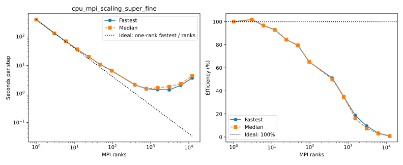
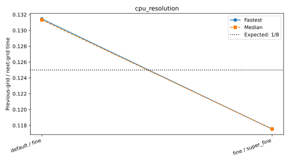
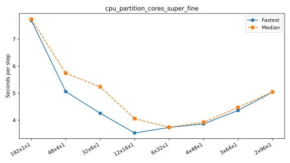

# Full benchmark suite

LatitudeLongitudeGrid without bathymetry; Float64, WENOVectorInvariantDefault, WENO7, CATKE, T/S, SplitRungeKutta3.
Δt=60 s; 30 requested free-surface substeps; two untimed steps and five ten-step windows.
One MPI rank per CPU core or GPU, one Julia computation thread per rank. CPU extended halos=false; GPU=true.
Window boundaries synchronize MPI ranks and GPUs. Fastest/median statistics use the maximum across ranks.
Efficiency uses the measured one-rank baseline for each scaling series. Missing baselines have no efficiency estimate.
Dashed reference lines show ideal inverse-rank timing and 100% MPI efficiency.
Resolution plots show previous-grid / next-grid time; doubling each grid dimension ideally gives 1/8.
Profiled timings are separate; Nsight captures CUDA/NVTX/MPI after warmup. Kernel shares sum durations across ranks, not elapsed wall time.

## cpu_mpi_scaling_super_fine

Highest completed count: **12288 ranks**.

| Case | Ranks | Partition | Global resolution | Grid type | State | Fastest s/step | Median s/step | Efficiency fastest / median | Details |
|---|---:|---|---|---|---|---:|---:|---|---|
| 1_ranks | 1 | 1x1x1 | 1440x720x200 | LatitudeLongitudeGrid | COMPLETED | 408.047172 | 409.016529 | 100.0% / 100.0% | Rank results, finite fields and resource placement verified |
| 3_ranks | 3 | 3x1x1 | 1440x720x200 | LatitudeLongitudeGrid | COMPLETED | 133.529783 | 133.811613 | 101.9% / 101.9% | Rank results, finite fields and resource placement verified |
| 6_ranks | 6 | 3x2x1 | 1440x720x200 | LatitudeLongitudeGrid | COMPLETED | 70.360215 | 70.453158 | 96.7% / 96.8% | Rank results, finite fields and resource placement verified |
| 12_ranks | 12 | 4x3x1 | 1440x720x200 | LatitudeLongitudeGrid | COMPLETED | 36.543614 | 36.709746 | 93.1% / 92.8% | Rank results, finite fields and resource placement verified |
| 24_ranks | 24 | 6x4x1 | 1440x720x200 | LatitudeLongitudeGrid | COMPLETED | 20.147543 | 20.184909 | 84.4% / 84.4% | Rank results, finite fields and resource placement verified |
| 48_ranks | 48 | 8x6x1 | 1440x720x200 | LatitudeLongitudeGrid | COMPLETED | 10.680753 | 10.728045 | 79.6% / 79.4% | Rank results, finite fields and resource placement verified |
| 96_ranks | 96 | 12x8x1 | 1440x720x200 | LatitudeLongitudeGrid | COMPLETED | 6.528443 | 6.529987 | 65.1% / 65.2% | Rank results, finite fields and resource placement verified |
| 192_ranks | 192 | 16x12x1 | 1440x720x200 | LatitudeLongitudeGrid | FAILED | — | — | — | Execution/export exit 143; see job.out and rank logs |
| 384_ranks | 384 | 24x16x1 | 1440x720x200 | LatitudeLongitudeGrid | COMPLETED | 2.081511 | 2.128320 | 51.1% / 50.0% | Rank results, finite fields and resource placement verified |
| 768_ranks | 768 | 32x24x1 | 1440x720x200 | LatitudeLongitudeGrid | COMPLETED | 1.522385 | 1.532329 | 34.9% / 34.8% | Rank results, finite fields and resource placement verified |
| 1536_ranks | 1536 | 32x48x1 | 1440x720x200 | LatitudeLongitudeGrid | COMPLETED | 1.417634 | 1.653889 | 18.7% / 16.1% | Rank results, finite fields and resource placement verified |
| 3072_ranks | 3072 | 64x48x1 | 1440x720x200 | LatitudeLongitudeGrid | COMPLETED | 1.397038 | 1.807820 | 9.5% / 7.4% | Rank results, finite fields and resource placement verified |
| 6144_ranks | 6144 | 96x64x1 | 1440x720x200 | LatitudeLongitudeGrid | COMPLETED | 2.012781 | 2.286964 | 3.3% / 2.9% | Rank results, finite fields and resource placement verified |
| 12288_ranks | 12288 | 128x96x1 | 1440x720x200 | LatitudeLongitudeGrid | COMPLETED | 3.620997 | 4.341938 | 0.9% / 0.8% | Rank results, finite fields and resource placement verified |
| 24576_ranks | 24576 |  | 1440x720x200 | LatitudeLongitudeGrid | GEOMETRY_LIMIT | — | — | — | 24576 ranks have no horizontal partition with at least 7 local cells per direction |

[1_ranks configuration](cpu_mpi_scaling_super_fine/1_ranks/configuration.md): local resolution **1440–1440 × 720–720 × 200**, retained free-surface substeps [21].

[3_ranks configuration](cpu_mpi_scaling_super_fine/3_ranks/configuration.md): local resolution **480–480 × 720–720 × 200**, retained free-surface substeps [21].

[6_ranks configuration](cpu_mpi_scaling_super_fine/6_ranks/configuration.md): local resolution **480–480 × 360–360 × 200**, retained free-surface substeps [21].

[12_ranks configuration](cpu_mpi_scaling_super_fine/12_ranks/configuration.md): local resolution **360–360 × 240–240 × 200**, retained free-surface substeps [21].

[24_ranks configuration](cpu_mpi_scaling_super_fine/24_ranks/configuration.md): local resolution **240–240 × 180–180 × 200**, retained free-surface substeps [21].

[48_ranks configuration](cpu_mpi_scaling_super_fine/48_ranks/configuration.md): local resolution **180–180 × 120–120 × 200**, retained free-surface substeps [21].

[96_ranks configuration](cpu_mpi_scaling_super_fine/96_ranks/configuration.md): local resolution **120–120 × 90–90 × 200**, retained free-surface substeps [21].

[384_ranks configuration](cpu_mpi_scaling_super_fine/384_ranks/configuration.md): local resolution **60–60 × 45–45 × 200**, retained free-surface substeps [21].

[768_ranks configuration](cpu_mpi_scaling_super_fine/768_ranks/configuration.md): local resolution **45–45 × 30–30 × 200**, retained free-surface substeps [21].

[1536_ranks configuration](cpu_mpi_scaling_super_fine/1536_ranks/configuration.md): local resolution **45–45 × 15–15 × 200**, retained free-surface substeps [21].

[3072_ranks configuration](cpu_mpi_scaling_super_fine/3072_ranks/configuration.md): local resolution **22–23 × 15–15 × 200**, retained free-surface substeps [21].

[6144_ranks configuration](cpu_mpi_scaling_super_fine/6144_ranks/configuration.md): local resolution **15–15 × 11–12 × 200**, retained free-surface substeps [21].

[12288_ranks configuration](cpu_mpi_scaling_super_fine/12288_ranks/configuration.md): local resolution **11–12 × 7–8 × 200**, retained free-surface substeps [21].
## cpu_resolution

Highest completed count: **1 ranks**.

| Case | Ranks | Partition | Global resolution | Grid type | State | Fastest s/step | Median s/step | Efficiency fastest / median | Details |
|---|---:|---|---|---|---|---:|---:|---|---|
| default | 1 | 1x1x1 | 360x180x50 | LatitudeLongitudeGrid | COMPLETED | 6.300513 | 6.308889 | — | Rank results, finite fields and resource placement verified |
| fine | 1 | 1x1x1 | 720x360x100 | LatitudeLongitudeGrid | COMPLETED | 47.930790 | 48.039327 | — | Rank results, finite fields and resource placement verified |
| super_fine | 1 | 1x1x1 | 1440x720x200 | LatitudeLongitudeGrid | COMPLETED | 407.789769 | 408.686054 | — | Rank results, finite fields and resource placement verified |

[default configuration](cpu_resolution/default/configuration.md): local resolution **360–360 × 180–180 × 50**, retained free-surface substeps [21].

[fine configuration](cpu_resolution/fine/configuration.md): local resolution **720–720 × 360–360 × 100**, retained free-surface substeps [21].

[super_fine configuration](cpu_resolution/super_fine/configuration.md): local resolution **1440–1440 × 720–720 × 200**, retained free-surface substeps [21].
## cpu_partition_cores_super_fine

Highest completed count: **192 ranks**.

| Case | Ranks | Partition | Global resolution | Grid type | State | Fastest s/step | Median s/step | Efficiency fastest / median | Details |
|---|---:|---|---|---|---|---:|---:|---|---|
| 192x1x1 | 192 | 192x1x1 | 1440x720x200 | LatitudeLongitudeGrid | COMPLETED | 7.690713 | 7.738272 | — | Rank results, finite fields and resource placement verified |
| 96x2x1 | 192 | 96x2x1 | 1440x720x200 | LatitudeLongitudeGrid | FAILED | — | — | — | Execution/export exit 143; see job.out and rank logs |
| 64x3x1 | 192 | 64x3x1 | 1440x720x200 | LatitudeLongitudeGrid | FAILED | — | — | — | Execution/export exit 143; see job.out and rank logs |
| 48x4x1 | 192 | 48x4x1 | 1440x720x200 | LatitudeLongitudeGrid | COMPLETED | 5.057673 | 5.740270 | — | Rank results, finite fields and resource placement verified |
| 32x6x1 | 192 | 32x6x1 | 1440x720x200 | LatitudeLongitudeGrid | COMPLETED | 4.254411 | 5.233642 | — | Rank results, finite fields and resource placement verified |
| 24x8x1 | 192 | 24x8x1 | 1440x720x200 | LatitudeLongitudeGrid | FAILED | — | — | — | Execution/export exit 143; see job.out and rank logs |
| 16x12x1 | 192 | 16x12x1 | 1440x720x200 | LatitudeLongitudeGrid | FAILED | — | — | — | Execution/export exit 143; see job.out and rank logs |
| 12x16x1 | 192 | 12x16x1 | 1440x720x200 | LatitudeLongitudeGrid | COMPLETED | 3.525778 | 4.055435 | — | Rank results, finite fields and resource placement verified |
| 8x24x1 | 192 | 8x24x1 | 1440x720x200 | LatitudeLongitudeGrid | FAILED | — | — | — | Execution/export exit 143; see job.out and rank logs |
| 6x32x1 | 192 | 6x32x1 | 1440x720x200 | LatitudeLongitudeGrid | COMPLETED | 3.730572 | 3.736250 | — | Rank results, finite fields and resource placement verified |
| 4x48x1 | 192 | 4x48x1 | 1440x720x200 | LatitudeLongitudeGrid | COMPLETED | 3.863746 | 3.923112 | — | Rank results, finite fields and resource placement verified |
| 3x64x1 | 192 | 3x64x1 | 1440x720x200 | LatitudeLongitudeGrid | COMPLETED | 4.360579 | 4.471454 | — | Rank results, finite fields and resource placement verified |
| 2x96x1 | 192 | 2x96x1 | 1440x720x200 | LatitudeLongitudeGrid | COMPLETED | 5.039626 | 5.044364 | — | Rank results, finite fields and resource placement verified |
| 1x192x1 | 192 | 1x192x1 | 1440x720x200 | LatitudeLongitudeGrid | GEOMETRY_LIMIT | — | — | — | Partition [1, 192, 1] has fewer than 7 local cells per horizontal direction |

[192x1x1 configuration](cpu_partition_cores_super_fine/192x1x1/configuration.md): local resolution **7–8 × 720–720 × 200**, retained free-surface substeps [21].

[48x4x1 configuration](cpu_partition_cores_super_fine/48x4x1/configuration.md): local resolution **30–30 × 180–180 × 200**, retained free-surface substeps [21].

[32x6x1 configuration](cpu_partition_cores_super_fine/32x6x1/configuration.md): local resolution **45–45 × 120–120 × 200**, retained free-surface substeps [21].

[12x16x1 configuration](cpu_partition_cores_super_fine/12x16x1/configuration.md): local resolution **120–120 × 45–45 × 200**, retained free-surface substeps [21].

[6x32x1 configuration](cpu_partition_cores_super_fine/6x32x1/configuration.md): local resolution **240–240 × 22–23 × 200**, retained free-surface substeps [21].

[4x48x1 configuration](cpu_partition_cores_super_fine/4x48x1/configuration.md): local resolution **360–360 × 15–15 × 200**, retained free-surface substeps [21].

[3x64x1 configuration](cpu_partition_cores_super_fine/3x64x1/configuration.md): local resolution **480–480 × 11–12 × 200**, retained free-surface substeps [21].

[2x96x1 configuration](cpu_partition_cores_super_fine/2x96x1/configuration.md): local resolution **720–720 × 7–8 × 200**, retained free-surface substeps [21].
