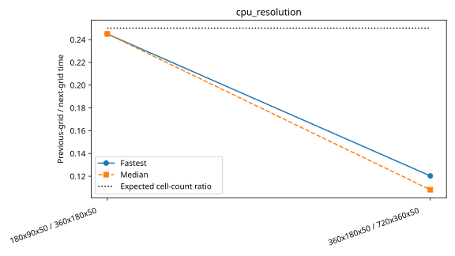

# Andi-5070ti: cpu_resolution

Latest accepted measurement for each case. Configuration links record the actual grid, partition, numerical methods, timing protocol and validation limits.

| Case | MPI ranks | Fastest s/step | Median s/step | Validation |
|---|---:|---:|---:|---|
| [180x90x50](180x90x50/configuration.md) | 1 | 1.361652 | 1.366482 | Historical: complete ranks and timing aggregates checked; finite-state/placement checks unavailable |
| [360x180x50](360x180x50/configuration.md) | 1 | 5.560213 | 5.578117 | Historical: complete ranks and timing aggregates checked; finite-state/placement checks unavailable |
| [720x360x50](720x360x50/configuration.md) | 1 | 46.225238 | 51.577884 | Historical: complete ranks and timing aggregates checked; finite-state/placement checks unavailable |
