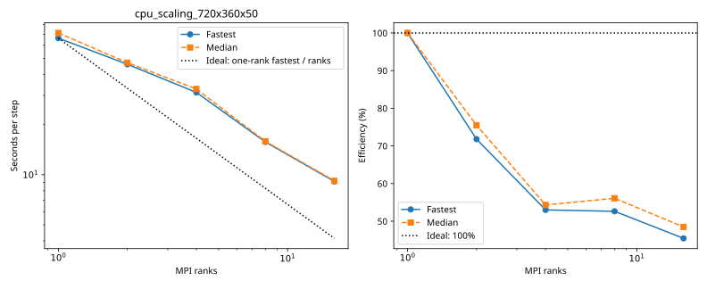

# Andi-5070ti: cpu_scaling_720x360x50

Latest accepted measurement for each case. Configuration links record the actual grid, partition, numerical methods, timing protocol and validation limits.

| Case | MPI ranks | Fastest s/step | Median s/step | Validation |
|---|---:|---:|---:|---|
| [16_ranks](16_ranks/configuration.md) | 16 | 9.113130 | 9.182949 | Historical: complete ranks and timing aggregates checked; finite-state/placement checks unavailable |
| [1_ranks](1_ranks/configuration.md) | 1 | 66.266962 | 71.232973 | Historical: complete ranks and timing aggregates checked; finite-state/placement checks unavailable |
| [2_ranks](2_ranks/configuration.md) | 2 | 46.150349 | 47.178648 | Historical: complete ranks and timing aggregates checked; finite-state/placement checks unavailable |
| [4_ranks](4_ranks/configuration.md) | 4 | 31.254408 | 32.785485 | Historical: complete ranks and timing aggregates checked; finite-state/placement checks unavailable |
| [8_ranks](8_ranks/configuration.md) | 8 | 15.739471 | 15.875104 | Historical: complete ranks and timing aggregates checked; finite-state/placement checks unavailable |
