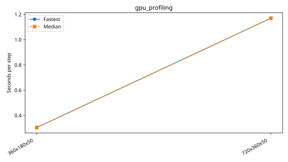

# Andi-5070ti: gpu_profiling

Latest accepted measurement for each case. Configuration links record the actual grid, partition, numerical methods, timing protocol and validation limits.

| Case | MPI ranks | Fastest s/step | Median s/step | Validation |
|---|---:|---:|---:|---|
| [360x180x50](360x180x50/configuration.md) | 1 | 0.304286 | 0.304286 | Historical: complete ranks and timing aggregates checked; finite-state/placement checks unavailable |
| [720x360x50](720x360x50/configuration.md) | 1 | 1.170183 | 1.170183 | Historical: complete ranks and timing aggregates checked; finite-state/placement checks unavailable |
