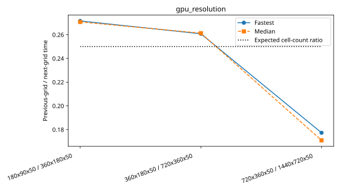

# Andi-5070ti: gpu_resolution

Latest accepted measurement for each case. Configuration links record the actual grid, partition, numerical methods, timing protocol and validation limits.

| Case | MPI ranks | Fastest s/step | Median s/step | Validation |
|---|---:|---:|---:|---|
| [1440x720x50](1440x720x50/configuration.md) | 1 | 8.115036 | 8.438134 | Historical: complete ranks and timing aggregates checked; finite-state/placement checks unavailable |
| [180x90x50](180x90x50/configuration.md) | 1 | 0.101870 | 0.102039 | Historical: complete ranks and timing aggregates checked; finite-state/placement checks unavailable |
| [360x180x50](360x180x50/configuration.md) | 1 | 0.375155 | 0.376875 | Historical: complete ranks and timing aggregates checked; finite-state/placement checks unavailable |
| [720x360x50](720x360x50/configuration.md) | 1 | 1.438834 | 1.442515 | Historical: complete ranks and timing aggregates checked; finite-state/placement checks unavailable |
