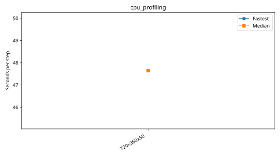

# Andi-5070ti benchmarks

Each series folder contains its configurations, measurements and provenance. Only completed measurements appear in timing tables and plots.

| Series | Completed cases | Report |
|---|---:|---|
| `cpu_profiling` | 1 | [Details](cpu_profiling/plot.md) |
| `cpu_resolution` | 3 | [Details](cpu_resolution/plot.md) |
| `cpu_scaling_720x360x50` | 5 | [Details](cpu_scaling_720x360x50/plot.md) |
| `gpu_profiling` | 2 | [Details](gpu_profiling/plot.md) |
| `gpu_resolution` | 4 | [Details](gpu_resolution/plot.md) |

## cpu_profiling

| Case | Ranks | Global resolution | Partition | Fastest / median s per step | Median MPI efficiency | Validation |
|---|---:|---|---|---:|---:|---|
| [720x360x50](cpu_profiling/720x360x50/configuration.md) | 1 | 720 × 360 × 50 | 1 × 1 × 1 | 47.644306 / 47.644306 | — | Historical: complete ranks and timing aggregates checked; finite-state/placement checks unavailable |

## cpu_resolution

| Case | Ranks | Global resolution | Partition | Fastest / median s per step | Median MPI efficiency | Validation |
|---|---:|---|---|---:|---:|---|
| [180x90x50](cpu_resolution/180x90x50/configuration.md) | 1 | 180 × 90 × 50 | 1 × 1 × 1 | 1.361652 / 1.366482 | — | Historical: complete ranks and timing aggregates checked; finite-state/placement checks unavailable |
| [360x180x50](cpu_resolution/360x180x50/configuration.md) | 1 | 360 × 180 × 50 | 1 × 1 × 1 | 5.560213 / 5.578117 | — | Historical: complete ranks and timing aggregates checked; finite-state/placement checks unavailable |
| [720x360x50](cpu_resolution/720x360x50/configuration.md) | 1 | 720 × 360 × 50 | 1 × 1 × 1 | 46.225238 / 51.577884 | — | Historical: complete ranks and timing aggregates checked; finite-state/placement checks unavailable |

## cpu_scaling_720x360x50

| Case | Ranks | Global resolution | Partition | Fastest / median s per step | Median MPI efficiency | Validation |
|---|---:|---|---|---:|---:|---|
| [1_ranks](cpu_scaling_720x360x50/1_ranks/configuration.md) | 1 | 720 × 360 × 50 | 1 × 1 × 1 | 66.266962 / 71.232973 | 100.0% | Historical: complete ranks and timing aggregates checked; finite-state/placement checks unavailable |
| [2_ranks](cpu_scaling_720x360x50/2_ranks/configuration.md) | 2 | 720 × 360 × 50 | 1 × 2 × 1 | 46.150349 / 47.178648 | 75.5% | Historical: complete ranks and timing aggregates checked; finite-state/placement checks unavailable |
| [4_ranks](cpu_scaling_720x360x50/4_ranks/configuration.md) | 4 | 720 × 360 × 50 | 2 × 2 × 1 | 31.254408 / 32.785485 | 54.3% | Historical: complete ranks and timing aggregates checked; finite-state/placement checks unavailable |
| [8_ranks](cpu_scaling_720x360x50/8_ranks/configuration.md) | 8 | 720 × 360 × 50 | 2 × 4 × 1 | 15.739471 / 15.875104 | 56.1% | Historical: complete ranks and timing aggregates checked; finite-state/placement checks unavailable |
| [16_ranks](cpu_scaling_720x360x50/16_ranks/configuration.md) | 16 | 720 × 360 × 50 | 4 × 4 × 1 | 9.113130 / 9.182949 | 48.5% | Historical: complete ranks and timing aggregates checked; finite-state/placement checks unavailable |

## gpu_profiling

| Case | Ranks | Global resolution | Partition | Fastest / median s per step | Median MPI efficiency | Validation |
|---|---:|---|---|---:|---:|---|
| [360x180x50](gpu_profiling/360x180x50/configuration.md) | 1 | 360 × 180 × 50 | 1 × 1 × 1 | 0.304286 / 0.304286 | — | Historical: complete ranks and timing aggregates checked; finite-state/placement checks unavailable |
| [720x360x50](gpu_profiling/720x360x50/configuration.md) | 1 | 720 × 360 × 50 | 1 × 1 × 1 | 1.170183 / 1.170183 | — | Historical: complete ranks and timing aggregates checked; finite-state/placement checks unavailable |

## gpu_resolution

| Case | Ranks | Global resolution | Partition | Fastest / median s per step | Median MPI efficiency | Validation |
|---|---:|---|---|---:|---:|---|
| [1440x720x50](gpu_resolution/1440x720x50/configuration.md) | 1 | 1440 × 720 × 50 | 1 × 1 × 1 | 8.115036 / 8.438134 | — | Historical: complete ranks and timing aggregates checked; finite-state/placement checks unavailable |
| [180x90x50](gpu_resolution/180x90x50/configuration.md) | 1 | 180 × 90 × 50 | 1 × 1 × 1 | 0.101870 / 0.102039 | — | Historical: complete ranks and timing aggregates checked; finite-state/placement checks unavailable |
| [360x180x50](gpu_resolution/360x180x50/configuration.md) | 1 | 360 × 180 × 50 | 1 × 1 × 1 | 0.375155 / 0.376875 | — | Historical: complete ranks and timing aggregates checked; finite-state/placement checks unavailable |
| [720x360x50](gpu_resolution/720x360x50/configuration.md) | 1 | 720 × 360 × 50 | 1 × 1 × 1 | 1.438834 / 1.442515 | — | Historical: complete ranks and timing aggregates checked; finite-state/placement checks unavailable |
