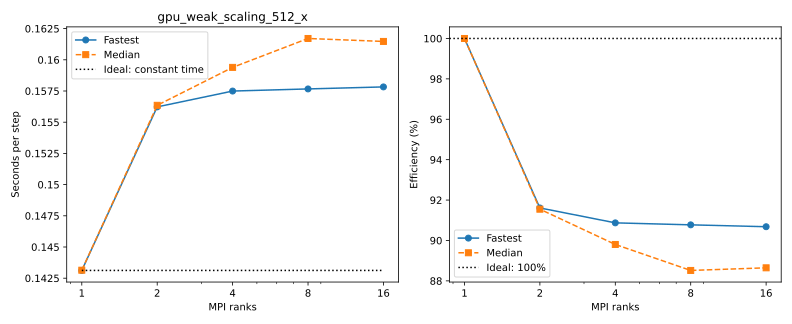

# baseline: gpu_weak_scaling_512_x

Latest accepted measurement for each case. Configuration links record the actual grid, partition, numerical methods, timing protocol and validation limits.

| Case | MPI ranks | Fastest s/step | Median s/step | Validation |
|---|---:|---:|---:|---|
| [1_ranks](1_ranks/configuration.md) | 1 | 0.143120 | 0.143139 | Current suite checks |
| [4_ranks](4_ranks/configuration.md) | 4 | 0.157496 | 0.159393 | Current suite checks |
| [8_ranks](8_ranks/configuration.md) | 8 | 0.157666 | 0.161709 | Current suite checks |
| [16_ranks](16_ranks/configuration.md) | 16 | 0.157828 | 0.161472 | Current suite checks |
