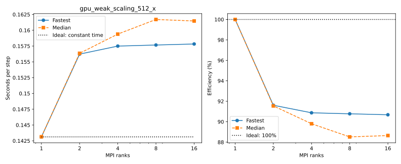

# baseline benchmarks

Each series folder contains its configurations, measurements and provenance. Only completed measurements appear in timing tables and plots.

| Series | Completed cases | Report |
|---|---:|---|
| `gpu_weak_scaling_512_x` | 4 | [Details](gpu_weak_scaling_512_x/plot.md) |

## gpu_weak_scaling_512_x

| Case | Ranks | Global resolution | Partition | Fastest / median s per step | Median MPI efficiency | Validation |
|---|---:|---|---|---:|---:|---|
| [1_ranks](gpu_weak_scaling_512_x/1_ranks/configuration.md) | 1 | 512 × 512 × 512 | 1 × 1 × 1 | 0.143120 / 0.143139 | 100.0% | Current suite checks |
| [4_ranks](gpu_weak_scaling_512_x/4_ranks/configuration.md) | 4 | 2048 × 512 × 512 | 4 × 1 × 1 | 0.157496 / 0.159393 | 89.8% | Current suite checks |
| [8_ranks](gpu_weak_scaling_512_x/8_ranks/configuration.md) | 8 | 4096 × 512 × 512 | 8 × 1 × 1 | 0.157666 / 0.161709 | 88.5% | Current suite checks |
| [16_ranks](gpu_weak_scaling_512_x/16_ranks/configuration.md) | 16 | 8192 × 512 × 512 | 16 × 1 × 1 | 0.157828 / 0.161472 | 88.6% | Current suite checks |
