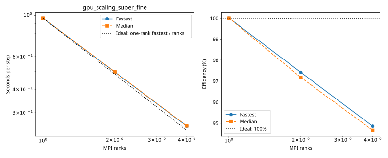

# fir benchmarks

Each series folder contains its configurations, measurements and provenance. Only completed measurements appear in timing tables and plots.

| Series | Completed cases | Report |
|---|---:|---|
| `gpu_scaling_super_fine` | 3 | [Details](gpu_scaling_super_fine/plot.md) |

## gpu_scaling_super_fine

| Case | Ranks | Global resolution | Partition | Fastest / median s per step | Median MPI efficiency | Validation |
|---|---:|---|---|---:|---:|---|
| [1_ranks](gpu_scaling_super_fine/1_ranks/configuration.md) | 1 | 1440 × 720 × 200 | 1 × 1 × 1 | 0.964918 / 0.965420 | 100.0% | Current suite: rank completeness, finite fields, placement and timings checked |
| [2_ranks](gpu_scaling_super_fine/2_ranks/configuration.md) | 2 | 1440 × 720 × 200 | 2 × 1 × 1 | 0.495245 / 0.496732 | 97.2% | Current suite: rank completeness, finite fields, placement and timings checked |
| [4_ranks](gpu_scaling_super_fine/4_ranks/configuration.md) | 4 | 1440 × 720 × 200 | 2 × 2 × 1 | 0.254298 / 0.254961 | 94.7% | Current suite: rank completeness, finite fields, placement and timings checked |
