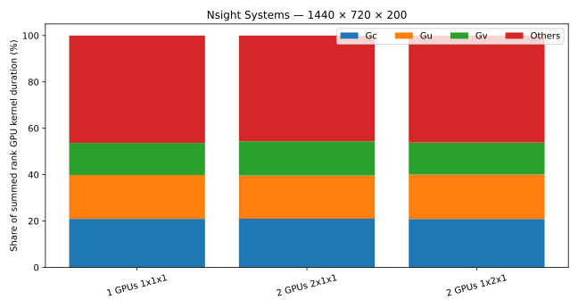

# Nsight Systems — super-fine GPU series

Global resolution: **1440 × 720 × 200**. Grid type: **LatitudeLongitudeGrid**. Float64, one MPI rank per GPU.
CUDA, NVTX and OpenMPI traces; capture starts after two untimed steps and covers five ten-step timing windows.
Model: WENOVectorInvariantDefault, WENO7, CATKE, T/S, SplitRungeKutta3, Δt=60 s, requested free-surface substeps=30, extend_halos=true.
The layouts for each GPU count run sequentially on the same allocated GPU set, with fresh Julia/MPI processes.
Profiled timings include instrumentation overhead and are separate from the existing unprofiled scaling series.

| GPUs | Partition | Resolution | Grid type | Job | State | Profiled fastest s/step | Median s/step | Details |
|---:|---|---|---|---|---|---:|---:|---|
| 1 | 1x1x1 | 1440x720x200 | LatitudeLongitudeGrid | 23324756 | COMPLETED | 1.030510 | 1.030879 | All rank timings, finite states, traces and CUDA kernel exports verified |
| 2 | 2x1x1 | 1440x720x200 | LatitudeLongitudeGrid | 23324758 | COMPLETED | 0.534756 | 0.535786 | All rank timings, finite states, traces and CUDA kernel exports verified |
| 2 | 1x2x1 | 1440x720x200 | LatitudeLongitudeGrid | 23324758 | COMPLETED | 0.544871 | 0.565503 | All rank timings, finite states, traces and CUDA kernel exports verified |
| 4 | 4x1x1 | 1440x720x200 | LatitudeLongitudeGrid | 23324759 | NOT_RUN | — | — | FAILED, exit 1:0; None |
| 4 | 2x2x1 | 1440x720x200 | LatitudeLongitudeGrid | 23324759 | NOT_RUN | — | — | FAILED, exit 1:0; None |
| 4 | 1x4x1 | 1440x720x200 | LatitudeLongitudeGrid | 23324759 | NOT_RUN | — | — | FAILED, exit 1:0; None |

Kernel categories follow the existing Rondeau Nsight grouping: hydrostatic Gc (tracers), Gu, Gv, and all other kernels.
Fractions use summed GPU kernel duration across ranks, not elapsed wall time. Concurrent activities may overlap; MPI CPU durations cannot be added to GPU durations to form a wall-time percentage.
Every rank retains CUDA kernel/API/memory, MPI and NVTX summaries when those events are available. Missing optional MPI/NVTX reports are recorded in their export logs.
Raw .nsys-rep traces and exported SQLite databases live in scratch; completed cases have raw_traces.csv with paths, sizes and SHA-256 checksums. Text summaries and timing/configuration metadata are committed here.

[Nsight capture and MPI profiling documentation](https://docs.nvidia.com/nsight-systems/UserGuide/index.html)

## 1 GPUs 1x1x1

| Category | Summed GPU seconds | Share |
|---|---:|---:|
| Gc | 10.777992 | 20.92% |
| Gu | 9.738644 | 18.90% |
| Gv | 7.137385 | 13.85% |
| Others | 23.873491 | 46.33% |

## 2 GPUs 2x1x1

| Category | Summed GPU seconds | Share |
|---|---:|---:|
| Gc | 10.989182 | 20.97% |
| Gu | 9.759009 | 18.62% |
| Gv | 7.750260 | 14.79% |
| Others | 23.910204 | 45.62% |

## 2 GPUs 1x2x1

| Category | Summed GPU seconds | Share |
|---|---:|---:|
| Gc | 10.948095 | 20.87% |
| Gu | 10.044354 | 19.15% |
| Gv | 7.235786 | 13.80% |
| Others | 24.221046 | 46.18% |
