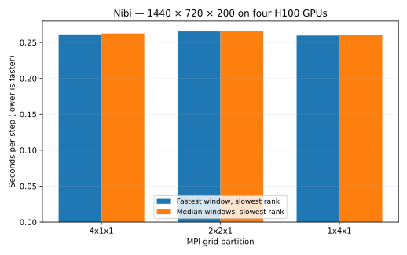

# Super-fine grid partition comparison

Global grid: **1440 × 720 × 200**. Four H100 GPUs, one MPI rank per GPU, on one node.
All three partitions run sequentially within the same allocation, each in a fresh Julia/MPI launch.
Float64, latitude–longitude without bathymetry, WENOVectorInvariantDefault, WENO7, CATKE, T/S, SplitRungeKutta3.
Δt = 60 s; two warmup steps, then five windows of ten steps per partition.

Slurm job **23304598**: **COMPLETED**. Whole-series wall-time limit: 30 minutes.

| Partition | Local grid per rank | State | Fastest s/step | Median s/step | Speedup vs 2×2×1 | Spread |
|---|---|---|---:|---:|---:|---:|
| 4x1x1 | 360×720×200 | COMPLETED | 0.261255 | 0.262522 | 1.016× | 3.0% |
| 2x2x1 | 720×360×200 | COMPLETED | 0.265362 | 0.266517 | 1.000× | 5.2% |
| 1x4x1 | 1440×180×200 | COMPLETED | 0.259693 | 0.261071 | 1.022× | 1.9% |

A window is ten consecutive steps; each window's elapsed time is divided by ten. The fastest and median statistics are calculated per rank, then the maximum across the four ranks is reported. Speedup compares the fresh 2×2×1 measurement with each layout. Values above 1 mean faster than 2×2×1. Spread = (maximum rank/window time ÷ fastest statistic − 1) × 100%.

Each partition retains its raw `results.json`, suite report, job log, hardware/modules/revision snapshots, and exit code. Failed or incomplete partitions are excluded from the chart.

4x1x1: All four MPI rank results verified.

2x2x1: All four MPI rank results verified.

1x4x1: All four MPI rank results verified.
