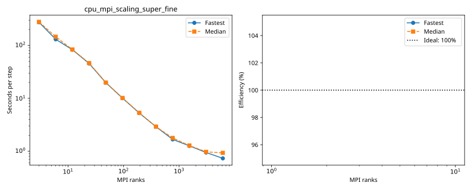

# nibi: cpu_mpi_scaling_super_fine

Latest accepted measurement for each case. Configuration links record the actual grid, partition, numerical methods, timing protocol and validation limits.

| Case | MPI ranks | Fastest s/step | Median s/step | Validation |
|---|---:|---:|---:|---|
| [12_ranks](12_ranks/configuration.md) | 12 | 82.813299 | 83.667303 | Historical: complete ranks, finite fields and timing aggregates checked; original placement record retained |
| [1536_ranks](1536_ranks/configuration.md) | 1536 | 1.259538 | 1.279207 | Historical: complete ranks, finite fields and timing aggregates checked; original placement record retained |
| [192_ranks](192_ranks/configuration.md) | 192 | 5.264863 | 5.322806 | Historical: complete ranks, finite fields and timing aggregates checked; original placement record retained |
| [24_ranks](24_ranks/configuration.md) | 24 | 45.492943 | 46.395053 | Historical: complete ranks, finite fields and timing aggregates checked; original placement record retained |
| [3072_ranks](3072_ranks/configuration.md) | 3072 | 0.944577 | 0.972165 | Historical: complete ranks, finite fields and timing aggregates checked; original placement record retained |
| [384_ranks](384_ranks/configuration.md) | 384 | 2.900148 | 2.908177 | Historical: complete ranks, finite fields and timing aggregates checked; original placement record retained |
| [3_ranks](3_ranks/configuration.md) | 3 | 274.287074 | 278.661033 | Historical: complete ranks, finite fields and timing aggregates checked; original placement record retained |
| [48_ranks](48_ranks/configuration.md) | 48 | 19.742974 | 19.874878 | Historical: complete ranks, finite fields and timing aggregates checked; original placement record retained |
| [6144_ranks](6144_ranks/configuration.md) | 6144 | 0.732171 | 0.929564 | Historical: complete ranks, finite fields and timing aggregates checked; original placement record retained |
| [6_ranks](6_ranks/configuration.md) | 6 | 130.623524 | 145.856198 | Historical: complete ranks, finite fields and timing aggregates checked; original placement record retained |
| [768_ranks](768_ranks/configuration.md) | 768 | 1.671754 | 1.775883 | Historical: complete ranks, finite fields and timing aggregates checked; original placement record retained |
| [96_ranks](96_ranks/configuration.md) | 96 | 10.054697 | 10.153559 | Historical: complete ranks, finite fields and timing aggregates checked; original placement record retained |
