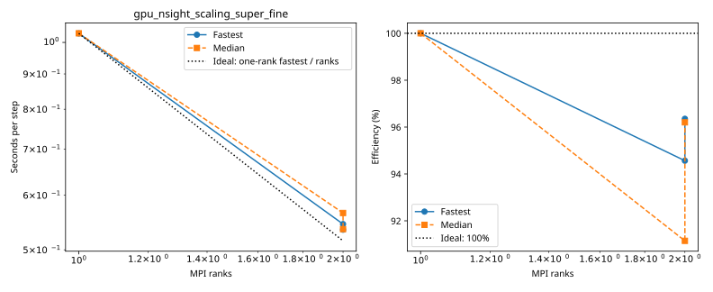
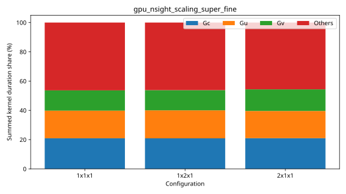

# nibi: gpu_nsight_scaling_super_fine

Latest accepted measurement for each case. Configuration links record the actual grid, partition, numerical methods, timing protocol and validation limits.

| Case | MPI ranks | Fastest s/step | Median s/step | Validation |
|---|---:|---:|---:|---|
| [1x1x1](1x1x1/configuration.md) | 1 | 1.030510 | 1.030879 | Historical: complete ranks, finite fields and timing aggregates checked; original placement record retained |
| [1x2x1](1x2x1/configuration.md) | 2 | 0.544871 | 0.565503 | Historical: complete ranks, finite fields and timing aggregates checked; original placement record retained |
| [2x1x1](2x1x1/configuration.md) | 2 | 0.534756 | 0.535786 | Historical: complete ranks, finite fields and timing aggregates checked; original placement record retained |
