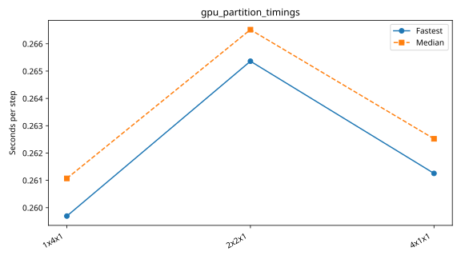

# nibi: gpu_partition_super_fine

Latest accepted measurement for each case. Configuration links record the actual grid, partition, numerical methods, timing protocol and validation limits.

| Case | MPI ranks | Fastest s/step | Median s/step | Validation |
|---|---:|---:|---:|---|
| [1x4x1](1x4x1/configuration.md) | 4 | 0.259693 | 0.261071 | Historical: complete ranks and timing aggregates checked; finite-state/placement checks unavailable |
| [2x2x1](2x2x1/configuration.md) | 4 | 0.265362 | 0.266517 | Historical: complete ranks and timing aggregates checked; finite-state/placement checks unavailable |
| [4x1x1](4x1x1/configuration.md) | 4 | 0.261255 | 0.262522 | Historical: complete ranks and timing aggregates checked; finite-state/placement checks unavailable |
