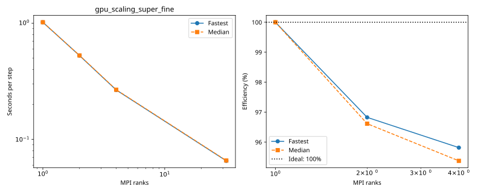

# nibi: gpu_scaling_super_fine

Latest accepted measurement for each case. Configuration links record the actual grid, partition, numerical methods, timing protocol and validation limits.

| Case | MPI ranks | Fastest s/step | Median s/step | Validation |
|---|---:|---:|---:|---|
| [1_ranks](1_ranks/configuration.md) | 1 | 1.021135 | 1.021461 | Historical: complete ranks and timing aggregates checked; finite-state/placement checks unavailable |
| [2_ranks](2_ranks/configuration.md) | 2 | 0.527312 | 0.528632 | Historical: complete ranks and timing aggregates checked; finite-state/placement checks unavailable |
| [32_ranks](32_ranks/configuration.md) | 32 | 0.065349 | 0.065708 | Current suite: rank completeness, finite fields, placement and timings checked |
| [4_ranks](4_ranks/configuration.md) | 4 | 0.266435 | 0.267753 | Historical: complete ranks and timing aggregates checked; finite-state/placement checks unavailable |
