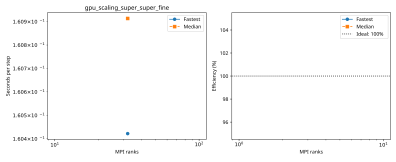

# nibi: gpu_scaling_super_super_fine

Latest accepted measurement for each case. Configuration links record the actual grid, partition, numerical methods, timing protocol and validation limits.

| Case | MPI ranks | Fastest s/step | Median s/step | Validation |
|---|---:|---:|---:|---|
| [32_ranks](32_ranks/configuration.md) | 32 | 0.160422 | 0.160913 | Current suite: rank completeness, finite fields, placement and timings checked |
