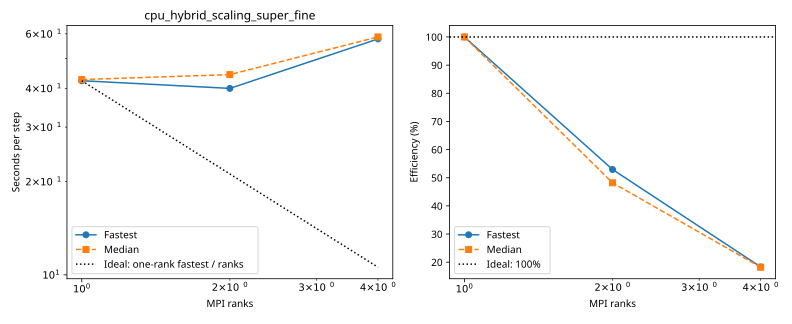
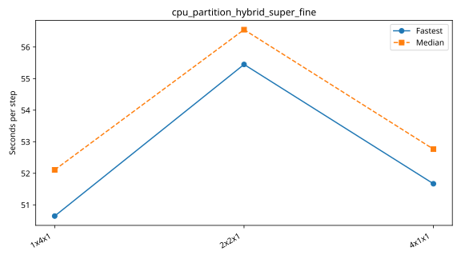
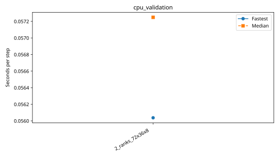

# nibi benchmarks

Each series folder contains its configurations, measurements and provenance. Only completed measurements appear in timing tables and plots.

| Series | Completed cases | Report |
|---|---:|---|
| `cpu_hybrid_scaling_super_fine` | 3 | [Details](cpu_hybrid_scaling_super_fine/plot.md) |
| `cpu_mpi_scaling_super_fine` | 12 | [Details](cpu_mpi_scaling_super_fine/plot.md) |
| `cpu_partition_hybrid_super_fine` | 3 | [Details](cpu_partition_hybrid_super_fine/plot.md) |
| `cpu_validation` | 1 | [Details](cpu_validation/plot.md) |
| `gpu_nsight_scaling_super_fine` | 3 | [Details](gpu_nsight_scaling_super_fine/plot.md) |
| `gpu_partition_super_fine` | 3 | [Details](gpu_partition_super_fine/plot.md) |
| `gpu_scaling_super_fine` | 4 | [Details](gpu_scaling_super_fine/plot.md) |
| `gpu_scaling_super_super_fine` | 1 | [Details](gpu_scaling_super_super_fine/plot.md) |

## cpu_hybrid_scaling_super_fine

| Case | Ranks | Global resolution | Partition | Fastest / median s per step | Median MPI efficiency | Validation |
|---|---:|---|---|---:|---:|---|
| [1x1x1](cpu_hybrid_scaling_super_fine/1x1x1/configuration.md) | 1 | 1440 × 720 × 200 | 1 × 1 × 1 | 42.336905 / 42.712967 | 100.0% | Historical: complete ranks and timing aggregates checked; finite-state/placement checks unavailable |
| [1x2x1](cpu_hybrid_scaling_super_fine/1x2x1/configuration.md) | 2 | 1440 × 720 × 200 | 1 × 2 × 1 | 39.997439 / 44.307615 | 48.2% | Historical: complete ranks and timing aggregates checked; finite-state/placement checks unavailable |
| [2x2x1](cpu_hybrid_scaling_super_fine/2x2x1/configuration.md) | 4 | 1440 × 720 × 200 | 2 × 2 × 1 | 57.774982 / 58.626502 | 18.2% | Historical: complete ranks and timing aggregates checked; finite-state/placement checks unavailable |

## cpu_mpi_scaling_super_fine

| Case | Ranks | Global resolution | Partition | Fastest / median s per step | Median MPI efficiency | Validation |
|---|---:|---|---|---:|---:|---|
| [3_ranks](cpu_mpi_scaling_super_fine/3_ranks/configuration.md) | 3 | 1440 × 720 × 200 | 3 × 1 × 1 | 274.287074 / 278.661033 | — | Historical: complete ranks, finite fields and timing aggregates checked; original placement record retained |
| [6_ranks](cpu_mpi_scaling_super_fine/6_ranks/configuration.md) | 6 | 1440 × 720 × 200 | 3 × 2 × 1 | 130.623524 / 145.856198 | — | Historical: complete ranks, finite fields and timing aggregates checked; original placement record retained |
| [12_ranks](cpu_mpi_scaling_super_fine/12_ranks/configuration.md) | 12 | 1440 × 720 × 200 | 4 × 3 × 1 | 82.813299 / 83.667303 | — | Historical: complete ranks, finite fields and timing aggregates checked; original placement record retained |
| [24_ranks](cpu_mpi_scaling_super_fine/24_ranks/configuration.md) | 24 | 1440 × 720 × 200 | 6 × 4 × 1 | 45.492943 / 46.395053 | — | Historical: complete ranks, finite fields and timing aggregates checked; original placement record retained |
| [48_ranks](cpu_mpi_scaling_super_fine/48_ranks/configuration.md) | 48 | 1440 × 720 × 200 | 8 × 6 × 1 | 19.742974 / 19.874878 | — | Historical: complete ranks, finite fields and timing aggregates checked; original placement record retained |
| [96_ranks](cpu_mpi_scaling_super_fine/96_ranks/configuration.md) | 96 | 1440 × 720 × 200 | 12 × 8 × 1 | 10.054697 / 10.153559 | — | Historical: complete ranks, finite fields and timing aggregates checked; original placement record retained |
| [192_ranks](cpu_mpi_scaling_super_fine/192_ranks/configuration.md) | 192 | 1440 × 720 × 200 | 16 × 12 × 1 | 5.264863 / 5.322806 | — | Historical: complete ranks, finite fields and timing aggregates checked; original placement record retained |
| [384_ranks](cpu_mpi_scaling_super_fine/384_ranks/configuration.md) | 384 | 1440 × 720 × 200 | 24 × 16 × 1 | 2.900148 / 2.908177 | — | Historical: complete ranks, finite fields and timing aggregates checked; original placement record retained |
| [768_ranks](cpu_mpi_scaling_super_fine/768_ranks/configuration.md) | 768 | 1440 × 720 × 200 | 32 × 24 × 1 | 1.671754 / 1.775883 | — | Historical: complete ranks, finite fields and timing aggregates checked; original placement record retained |
| [1536_ranks](cpu_mpi_scaling_super_fine/1536_ranks/configuration.md) | 1536 | 1440 × 720 × 200 | 32 × 48 × 1 | 1.259538 / 1.279207 | — | Historical: complete ranks, finite fields and timing aggregates checked; original placement record retained |
| [3072_ranks](cpu_mpi_scaling_super_fine/3072_ranks/configuration.md) | 3072 | 1440 × 720 × 200 | 64 × 48 × 1 | 0.944577 / 0.972165 | — | Historical: complete ranks, finite fields and timing aggregates checked; original placement record retained |
| [6144_ranks](cpu_mpi_scaling_super_fine/6144_ranks/configuration.md) | 6144 | 1440 × 720 × 200 | 96 × 64 × 1 | 0.732171 / 0.929564 | — | Historical: complete ranks, finite fields and timing aggregates checked; original placement record retained |

## cpu_partition_hybrid_super_fine

| Case | Ranks | Global resolution | Partition | Fastest / median s per step | Median MPI efficiency | Validation |
|---|---:|---|---|---:|---:|---|
| [1x4x1](cpu_partition_hybrid_super_fine/1x4x1/configuration.md) | 4 | 1440 × 720 × 200 | 1 × 4 × 1 | 50.645297 / 52.108303 | — | Historical: complete ranks and timing aggregates checked; finite-state/placement checks unavailable |
| [2x2x1](cpu_partition_hybrid_super_fine/2x2x1/configuration.md) | 4 | 1440 × 720 × 200 | 2 × 2 × 1 | 55.448350 / 56.550017 | — | Historical: complete ranks and timing aggregates checked; finite-state/placement checks unavailable |
| [4x1x1](cpu_partition_hybrid_super_fine/4x1x1/configuration.md) | 4 | 1440 × 720 × 200 | 4 × 1 × 1 | 51.668704 / 52.765599 | — | Historical: complete ranks and timing aggregates checked; finite-state/placement checks unavailable |

## cpu_validation

| Case | Ranks | Global resolution | Partition | Fastest / median s per step | Median MPI efficiency | Validation |
|---|---:|---|---|---:|---:|---|
| [2_ranks_72x36x8](cpu_validation/2_ranks_72x36x8/configuration.md) | 2 | 72 × 36 × 8 | 2 × 1 × 1 | 0.056037 / 0.057248 | — | Current suite: rank completeness, finite fields, placement and timings checked |

## gpu_nsight_scaling_super_fine

| Case | Ranks | Global resolution | Partition | Fastest / median s per step | Median MPI efficiency | Validation |
|---|---:|---|---|---:|---:|---|
| [1x1x1](gpu_nsight_scaling_super_fine/1x1x1/configuration.md) | 1 | 1440 × 720 × 200 | 1 × 1 × 1 | 1.030510 / 1.030879 | 100.0% | Historical: complete ranks, finite fields and timing aggregates checked; original placement record retained |
| [1x2x1](gpu_nsight_scaling_super_fine/1x2x1/configuration.md) | 2 | 1440 × 720 × 200 | 1 × 2 × 1 | 0.544871 / 0.565503 | 91.1% | Historical: complete ranks, finite fields and timing aggregates checked; original placement record retained |
| [2x1x1](gpu_nsight_scaling_super_fine/2x1x1/configuration.md) | 2 | 1440 × 720 × 200 | 2 × 1 × 1 | 0.534756 / 0.535786 | 96.2% | Historical: complete ranks, finite fields and timing aggregates checked; original placement record retained |

## gpu_partition_super_fine

| Case | Ranks | Global resolution | Partition | Fastest / median s per step | Median MPI efficiency | Validation |
|---|---:|---|---|---:|---:|---|
| [1x4x1](gpu_partition_super_fine/1x4x1/configuration.md) | 4 | 1440 × 720 × 200 | 1 × 4 × 1 | 0.259693 / 0.261071 | — | Historical: complete ranks and timing aggregates checked; finite-state/placement checks unavailable |
| [2x2x1](gpu_partition_super_fine/2x2x1/configuration.md) | 4 | 1440 × 720 × 200 | 2 × 2 × 1 | 0.265362 / 0.266517 | — | Historical: complete ranks and timing aggregates checked; finite-state/placement checks unavailable |
| [4x1x1](gpu_partition_super_fine/4x1x1/configuration.md) | 4 | 1440 × 720 × 200 | 4 × 1 × 1 | 0.261255 / 0.262522 | — | Historical: complete ranks and timing aggregates checked; finite-state/placement checks unavailable |

## gpu_scaling_super_fine

| Case | Ranks | Global resolution | Partition | Fastest / median s per step | Median MPI efficiency | Validation |
|---|---:|---|---|---:|---:|---|
| [1_ranks](gpu_scaling_super_fine/1_ranks/configuration.md) | 1 | 1440 × 720 × 200 | 1 × 1 × 1 | 1.021135 / 1.021461 | 100.0% | Historical: complete ranks and timing aggregates checked; finite-state/placement checks unavailable |
| [2_ranks](gpu_scaling_super_fine/2_ranks/configuration.md) | 2 | 1440 × 720 × 200 | 1 × 2 × 1 | 0.527312 / 0.528632 | 96.6% | Historical: complete ranks and timing aggregates checked; finite-state/placement checks unavailable |
| [4_ranks](gpu_scaling_super_fine/4_ranks/configuration.md) | 4 | 1440 × 720 × 200 | 2 × 2 × 1 | 0.266435 / 0.267753 | 95.4% | Historical: complete ranks and timing aggregates checked; finite-state/placement checks unavailable |
| [32_ranks](gpu_scaling_super_fine/32_ranks/configuration.md) | 32 | 1440 × 720 × 200 | 32 × 1 × 1 | 0.065349 / 0.065708 | — | Current suite: rank completeness, finite fields, placement and timings checked |

## gpu_scaling_super_super_fine

| Case | Ranks | Global resolution | Partition | Fastest / median s per step | Median MPI efficiency | Validation |
|---|---:|---|---|---:|---:|---|
| [32_ranks](gpu_scaling_super_super_fine/32_ranks/configuration.md) | 32 | 2880 × 1440 × 200 | 32 × 1 × 1 | 0.160422 / 0.160913 | — | Current suite: rank completeness, finite fields, placement and timings checked |
