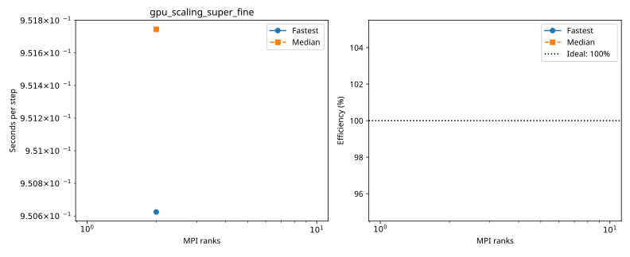

# baseline: gpu_scaling_super_fine

Latest accepted measurement for each case. Configuration links record the actual grid, partition, numerical methods, timing protocol and validation limits.

| Case | MPI ranks | Fastest s/step | Median s/step | Validation |
|---|---:|---:|---:|---|
| [2_ranks](2_ranks/configuration.md) | 2 | 0.950625 | 0.951745 | Current suite checks |
