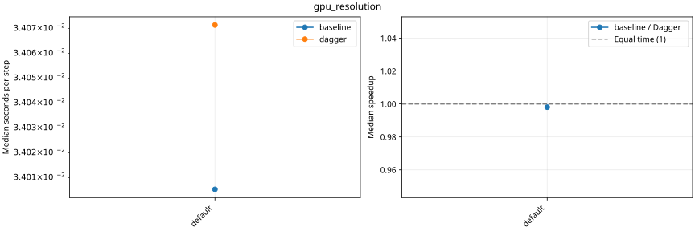

# Rondeau: hydrostatic baseline versus Dagger

For MPI series, Dagger submits one task per timing window, restricted to the current MPI process and its sole Julia computation thread. Oceananigans retains its existing MPI domain decomposition. Both paths synchronize CUDA before completing a window.

Speedup = baseline seconds per step / Dagger seconds per step. Above 1 favors Dagger; the equal-time reference is 1. Fastest and median timings are the maximum rank statistic. Only completed, validated pairs with matching configurations have ratios.

Nsight timings are compared only against the matching profiled variant. Shared-machine activity can affect timings; these are paired runs, not exclusive-node measurements.

Raw study and execution logs: `/u/ajtse/Oceananigans.jl/.runtime/hydrostatic_dagger_2026-10-30/study`.

[Baseline records](baseline/plot.md) · [Dagger records](dagger/plot.md) · [All outcomes as CSV](comparison.csv)

## gpu_scaling_super_fine

| Case | Resolution / partition | Baseline outcome | Dagger outcome | Median s/step baseline / Dagger | Speedup |
|---|---|---|---|---:|---:|
| 1_ranks | 1440x720x200 / 1x1x1 | OUT_OF_MEMORY | OUT_OF_MEMORY | — | — |
| 2_ranks | 1440x720x200 / 2x1x1 | PLANNED | RUNNING | — | — |
| 4_ranks | 1440x720x200 / 2x2x1 | PLANNED | PLANNED | — | — |
| 8_ranks | 1440x720x200 / 4x2x1 | RESOURCE_LIMIT | RESOURCE_LIMIT | — | — |

No completed, validated pair is available.

1_ranks: baseline: Execution failed; ERROR: LoadError: Out of GPU memory trying to allocate 1.702 GiB; dagger: Execution failed; ERROR: LoadError: Out of GPU memory trying to allocate 1.702 GiB

2_ranks: baseline: ; dagger: Local allocation started; see job.out

4_ranks: baseline: ; dagger:

8_ranks: baseline: Requires 8; configured capacity is 4; dagger: Requires 8; configured capacity is 4

## gpu_resolution

| Case | Resolution / partition | Baseline outcome | Dagger outcome | Median s/step baseline / Dagger | Speedup |
|---|---|---|---|---:|---:|
| default | 360x180x50 / 1x1x1 | COMPLETED | COMPLETED | 0.0340053 / 0.0340714 | 0.9981 |
| fine | 720x360x100 / 1x1x1 | COMPLETED | COMPLETED | 0.24857 / 0.248573 | 1.0000 |
| super_fine | 1440x720x200 / 1x1x1 | OUT_OF_MEMORY | OUT_OF_MEMORY | — | — |

super_fine: baseline: Execution failed; ERROR: LoadError: Out of GPU memory trying to allocate 1.702 GiB; dagger: Execution failed; ERROR: LoadError: Out of GPU memory trying to allocate 1.702 GiB

## gpu_nsight_scaling_super_fine

| Case | Resolution / partition | Baseline outcome | Dagger outcome | Median s/step baseline / Dagger | Speedup |
|---|---|---|---|---:|---:|
| 1_ranks | 1440x720x200 / 1x1x1 | OUT_OF_MEMORY | OUT_OF_MEMORY | — | — |
| 2_ranks | 1440x720x200 / 2x1x1 | PLANNED | PLANNED | — | — |
| 4_ranks | 1440x720x200 / 2x2x1 | PLANNED | PLANNED | — | — |
| 8_ranks | 1440x720x200 / 4x2x1 | RESOURCE_LIMIT | RESOURCE_LIMIT | — | — |

No completed, validated pair is available.

1_ranks: baseline: Execution failed; ERROR: LoadError: Out of GPU memory trying to allocate 1.702 GiB; dagger: Execution failed; ERROR: LoadError: Out of GPU memory trying to allocate 1.702 GiB

2_ranks: baseline: ; dagger:

4_ranks: baseline: ; dagger:

8_ranks: baseline: Requires 8; configured capacity is 4; dagger: Requires 8; configured capacity is 4

## gpu_partition_super_fine

| Case | Resolution / partition | Baseline outcome | Dagger outcome | Median s/step baseline / Dagger | Speedup |
|---|---|---|---|---:|---:|
| 16x1x1 | 1440x720x200 / 16x1x1 | RESOURCE_LIMIT | RESOURCE_LIMIT | — | — |
| 16x2x1 | 1440x720x200 / 16x2x1 | RESOURCE_LIMIT | RESOURCE_LIMIT | — | — |
| 16x4x1 | 1440x720x200 / 16x4x1 | RESOURCE_LIMIT | RESOURCE_LIMIT | — | — |
| 1x16x1 | 1440x720x200 / 1x16x1 | RESOURCE_LIMIT | RESOURCE_LIMIT | — | — |
| 1x1x1 | 1440x720x200 / 1x1x1 | OUT_OF_MEMORY | OUT_OF_MEMORY | — | — |
| 1x2x1 | 1440x720x200 / 1x2x1 | PLANNED | PLANNED | — | — |
| 1x32x1 |  /  | GEOMETRY_LIMIT | GEOMETRY_LIMIT | — | — |
| 1x4x1 | 1440x720x200 / 1x4x1 | PLANNED | PLANNED | — | — |
| 1x64x1 |  /  | GEOMETRY_LIMIT | GEOMETRY_LIMIT | — | — |
| 1x8x1 | 1440x720x200 / 1x8x1 | RESOURCE_LIMIT | RESOURCE_LIMIT | — | — |
| 2x16x1 | 1440x720x200 / 2x16x1 | RESOURCE_LIMIT | RESOURCE_LIMIT | — | — |
| 2x1x1 | 1440x720x200 / 2x1x1 | PLANNED | PLANNED | — | — |
| 2x2x1 | 1440x720x200 / 2x2x1 | PLANNED | PLANNED | — | — |
| 2x32x1 |  /  | GEOMETRY_LIMIT | GEOMETRY_LIMIT | — | — |
| 2x4x1 | 1440x720x200 / 2x4x1 | RESOURCE_LIMIT | RESOURCE_LIMIT | — | — |
| 2x8x1 | 1440x720x200 / 2x8x1 | RESOURCE_LIMIT | RESOURCE_LIMIT | — | — |
| 32x1x1 | 1440x720x200 / 32x1x1 | RESOURCE_LIMIT | RESOURCE_LIMIT | — | — |
| 32x2x1 | 1440x720x200 / 32x2x1 | RESOURCE_LIMIT | RESOURCE_LIMIT | — | — |
| 4x16x1 | 1440x720x200 / 4x16x1 | RESOURCE_LIMIT | RESOURCE_LIMIT | — | — |
| 4x1x1 | 1440x720x200 / 4x1x1 | PLANNED | PLANNED | — | — |
| 4x2x1 | 1440x720x200 / 4x2x1 | RESOURCE_LIMIT | RESOURCE_LIMIT | — | — |
| 4x4x1 | 1440x720x200 / 4x4x1 | RESOURCE_LIMIT | RESOURCE_LIMIT | — | — |
| 4x8x1 | 1440x720x200 / 4x8x1 | RESOURCE_LIMIT | RESOURCE_LIMIT | — | — |
| 64x1x1 |  /  | GEOMETRY_LIMIT | GEOMETRY_LIMIT | — | — |
| 8x1x1 | 1440x720x200 / 8x1x1 | RESOURCE_LIMIT | RESOURCE_LIMIT | — | — |
| 8x2x1 | 1440x720x200 / 8x2x1 | RESOURCE_LIMIT | RESOURCE_LIMIT | — | — |
| 8x4x1 | 1440x720x200 / 8x4x1 | RESOURCE_LIMIT | RESOURCE_LIMIT | — | — |
| 8x8x1 | 1440x720x200 / 8x8x1 | RESOURCE_LIMIT | RESOURCE_LIMIT | — | — |

No completed, validated pair is available.

16x1x1: baseline: Requires 16; configured capacity is 4; dagger: Requires 16; configured capacity is 4

16x2x1: baseline: Requires 32; configured capacity is 4; dagger: Requires 32; configured capacity is 4

16x4x1: baseline: Requires 64; configured capacity is 4; dagger: Requires 64; configured capacity is 4

1x16x1: baseline: Requires 16; configured capacity is 4; dagger: Requires 16; configured capacity is 4

1x1x1: baseline: Execution failed; ERROR: LoadError: Out of GPU memory trying to allocate 1.702 GiB; dagger: Execution failed; ERROR: LoadError: Out of GPU memory trying to allocate 1.702 GiB

1x2x1: baseline: ; dagger:

1x32x1: baseline: Partition [1, 32, 1] has fewer than 23 local cells per horizontal direction; dagger: Partition [1, 32, 1] has fewer than 23 local cells per horizontal direction

1x4x1: baseline: ; dagger:

1x64x1: baseline: Partition [1, 64, 1] has fewer than 23 local cells per horizontal direction; dagger: Partition [1, 64, 1] has fewer than 23 local cells per horizontal direction

1x8x1: baseline: Requires 8; configured capacity is 4; dagger: Requires 8; configured capacity is 4

2x16x1: baseline: Requires 32; configured capacity is 4; dagger: Requires 32; configured capacity is 4

2x1x1: baseline: ; dagger:

2x2x1: baseline: ; dagger:

2x32x1: baseline: Partition [2, 32, 1] has fewer than 23 local cells per horizontal direction; dagger: Partition [2, 32, 1] has fewer than 23 local cells per horizontal direction

2x4x1: baseline: Requires 8; configured capacity is 4; dagger: Requires 8; configured capacity is 4

2x8x1: baseline: Requires 16; configured capacity is 4; dagger: Requires 16; configured capacity is 4

32x1x1: baseline: Requires 32; configured capacity is 4; dagger: Requires 32; configured capacity is 4

32x2x1: baseline: Requires 64; configured capacity is 4; dagger: Requires 64; configured capacity is 4

4x16x1: baseline: Requires 64; configured capacity is 4; dagger: Requires 64; configured capacity is 4

4x1x1: baseline: ; dagger:

4x2x1: baseline: Requires 8; configured capacity is 4; dagger: Requires 8; configured capacity is 4

4x4x1: baseline: Requires 16; configured capacity is 4; dagger: Requires 16; configured capacity is 4

4x8x1: baseline: Requires 32; configured capacity is 4; dagger: Requires 32; configured capacity is 4

64x1x1: baseline: Partition [64, 1, 1] has fewer than 23 local cells per horizontal direction; dagger: Partition [64, 1, 1] has fewer than 23 local cells per horizontal direction

8x1x1: baseline: Requires 8; configured capacity is 4; dagger: Requires 8; configured capacity is 4

8x2x1: baseline: Requires 16; configured capacity is 4; dagger: Requires 16; configured capacity is 4

8x4x1: baseline: Requires 32; configured capacity is 4; dagger: Requires 32; configured capacity is 4

8x8x1: baseline: Requires 64; configured capacity is 4; dagger: Requires 64; configured capacity is 4

## gpu_scaling_super_super_fine

| Case | Resolution / partition | Baseline outcome | Dagger outcome | Median s/step baseline / Dagger | Speedup |
|---|---|---|---|---:|---:|
| 4_ranks | 2880x1440x200 / 2x2x1 | PLANNED | PLANNED | — | — |
| 8_ranks | 2880x1440x200 / 4x2x1 | RESOURCE_LIMIT | RESOURCE_LIMIT | — | — |

No completed, validated pair is available.

4_ranks: baseline: ; dagger:

8_ranks: baseline: Requires 8; configured capacity is 4; dagger: Requires 8; configured capacity is 4

## gpu_scaling_super_super_super_fine

| Case | Resolution / partition | Baseline outcome | Dagger outcome | Median s/step baseline / Dagger | Speedup |
|---|---|---|---|---:|---:|
| 16_ranks | 5760x2880x200 / 4x4x1 | RESOURCE_LIMIT | RESOURCE_LIMIT | — | — |

No completed, validated pair is available.

16_ranks: baseline: Requires 16; configured capacity is 4; dagger: Requires 16; configured capacity is 4

## gpu_weak_scaling_super_fine

| Case | Resolution / partition | Baseline outcome | Dagger outcome | Median s/step baseline / Dagger | Speedup |
|---|---|---|---|---:|---:|
| 16_ranks | 5760x2880x200 / 4x4x1 | RESOURCE_LIMIT | RESOURCE_LIMIT | — | — |
| 1_ranks | 1440x720x200 / 1x1x1 | OUT_OF_MEMORY | OUT_OF_MEMORY | — | — |
| 4_ranks | 2880x1440x200 / 2x2x1 | PLANNED | PLANNED | — | — |

No completed, validated pair is available.

16_ranks: baseline: Requires 16; configured capacity is 4; dagger: Requires 16; configured capacity is 4

1_ranks: baseline: Execution failed; ERROR: LoadError: Out of GPU memory trying to allocate 1.702 GiB; dagger: Execution failed; ERROR: LoadError: Out of GPU memory trying to allocate 1.702 GiB

4_ranks: baseline: ; dagger:

