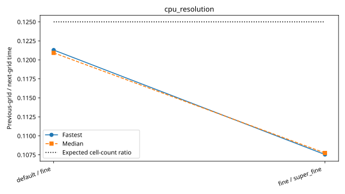

# rondeau: cpu_resolution

Latest accepted measurement for each case. Configuration links record the actual grid, partition, numerical methods, timing protocol and validation limits.

| Case | MPI ranks | Fastest s/step | Median s/step | Validation |
|---|---:|---:|---:|---|
| [180x90x50](180x90x50/configuration.md) | 1 | 3.126001 | 3.136650 | Historical: complete ranks and timing aggregates checked; finite-state/placement checks unavailable |
| [360x180x50](360x180x50/configuration.md) | 1 | 12.734940 | 12.780053 | Historical: complete ranks and timing aggregates checked; finite-state/placement checks unavailable |
| [720x360x50](720x360x50/configuration.md) | 1 | 96.617069 | 96.688752 | Historical: complete ranks and timing aggregates checked; finite-state/placement checks unavailable |
| [default](default/configuration.md) | 1 | 12.666954 | 12.674764 | Current suite checks |
| [fine](fine/configuration.md) | 1 | 104.432778 | 104.815036 | Current suite checks |
| [super_fine](super_fine/configuration.md) | 1 | 971.087729 | 972.828508 | Current suite checks |
| [2880x1440x400](2880x1440x400/configuration.md) | 1 | 8529.267294 | 8541.961095 | Current suite checks |

<!-- current-rerun -->
## Current rerun

Study: `/local_scratch/ajtse/benchmark_studies/hydrostatic_free_surface_models/2026-10-13T193658Z/rondeau`. Original commands, allocation scripts and failure logs remain there.
Two untimed steps, then five synchronized windows of ten steps; one Julia thread per MPI rank.
This rerun validates all rank results, MPI communication, distinct resources and finite model fields.

Highest completed case: **2880x1440x400**.

| Case | Global resolution | MPI partition | Outcome | Details |
|---|---|---|---|---|
| default | 360 × 180 × 50 | 1 × 1 × 1 | COMPLETED | Rank results, finite fields and resource placement verified |
| fine | 720 × 360 × 100 | 1 × 1 × 1 | COMPLETED | Rank results, finite fields and resource placement verified |
| super_fine | 1440 × 720 × 200 | 1 × 1 × 1 | COMPLETED | Rank results, finite fields and resource placement verified |
| 2880x1440x400 | 2880 × 1440 × 400 | 1 × 1 × 1 | COMPLETED | Rank results, finite fields and resource placement verified |
| 5760x2880x800 | 5760 × 2880 × 800 | 1 × 1 × 1 | FAILED | Host allocation failed under the available-memory address-space limit; see allocation.out and job.out in scratch study |
