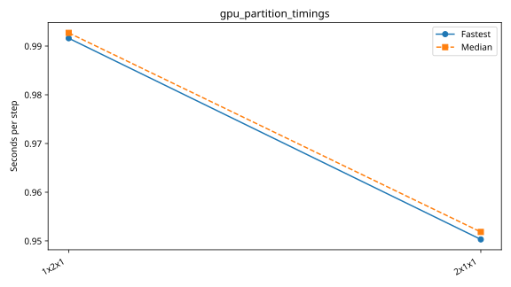

# dagger: gpu_partition_super_fine

Latest accepted measurement for each case. Configuration links record the actual grid, partition, numerical methods, timing protocol and validation limits.

| Case | MPI ranks | Fastest s/step | Median s/step | Validation |
|---|---:|---:|---:|---|
| [1x2x1](1x2x1/configuration.md) | 2 | 0.991599 | 0.992706 | Current suite checks |
| [2x1x1](2x1x1/configuration.md) | 2 | 0.950305 | 0.951837 | Current suite checks |
