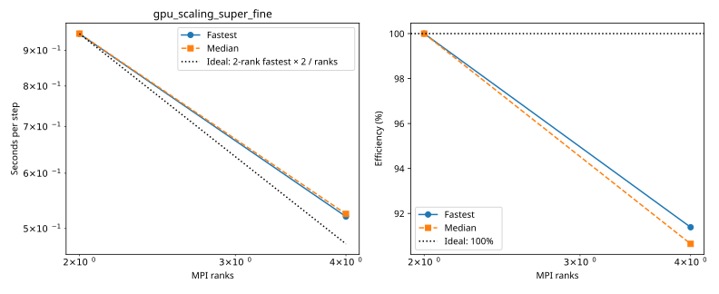

# rondeau: gpu_scaling_super_fine

Latest accepted measurement for each case. Configuration links record the actual grid, partition, numerical methods, timing protocol and validation limits.

| Case | MPI ranks | Fastest s/step | Median s/step | Validation |
|---|---:|---:|---:|---|
| [2_ranks](2_ranks/configuration.md) | 2 | 0.950611 | 0.951165 | Current suite checks |
| [4_ranks](4_ranks/configuration.md) | 4 | 0.520111 | 0.524653 | Current suite checks |

<!-- current-rerun -->
## Current rerun

Study: `/local_scratch/ajtse/benchmark_studies/hydrostatic_free_surface_models/2026-10-13T193658Z/rondeau`. Original commands, allocation scripts and failure logs remain there.
Two untimed steps, then five synchronized windows of ten steps; one Julia thread per MPI rank.
This rerun validates all rank results, MPI communication, distinct resources and finite model fields.

Highest completed case: **4_ranks**.

| Case | Global resolution | MPI partition | Outcome | Details |
|---|---|---|---|---|
| 1_ranks | 1440 × 720 × 200 | 1 × 1 × 1 | FAILED | GPU VRAM exhausted; see original job.out and profiler logs in scratch study |
| 2_ranks | 1440 × 720 × 200 | 2 × 1 × 1 | COMPLETED | Rank results, finite fields and resource placement verified |
| 4_ranks | 1440 × 720 × 200 | 2 × 2 × 1 | COMPLETED | Rank results, finite fields and resource placement verified |
| 8_ranks | 1440 × 720 × 200 | 4 × 2 × 1 | RESOURCE_LIMIT | Requires 8; configured capacity is 4 |
