# rondeau benchmarks

Each series folder contains its configurations, measurements and provenance. Only completed measurements appear in timing tables and plots.

| Series | Completed cases | Report |
|---|---:|---|
| `cpu_mpi_scaling_super_fine` | 7 | [Details](cpu_mpi_scaling_super_fine/plot.md) |
| `cpu_profiling` | 1 | [Details](cpu_profiling/plot.md) |
| `cpu_resolution` | 7 | [Details](cpu_resolution/plot.md) |
| `cpu_scaling_360x180x50` | 8 | [Details](cpu_scaling_360x180x50/plot.md) |
| `cpu_scaling_720x360x50` | 8 | [Details](cpu_scaling_720x360x50/plot.md) |
| `gpu_component_ablation` | 6 | [Details](gpu_component_ablation/plot.md) |
| `gpu_nsight_scaling_super_fine` | 2 | [Details](gpu_nsight_scaling_super_fine/plot.md) |
| `gpu_partition_super_fine` | 5 | [Details](gpu_partition_super_fine/plot.md) |
| `gpu_profiling` | 2 | [Details](gpu_profiling/plot.md) |
| `gpu_resolution` | 6 | [Details](gpu_resolution/plot.md) |
| `gpu_scaling_720x360x50` | 3 | [Details](gpu_scaling_720x360x50/plot.md) |
| `gpu_scaling_super_fine` | 2 | [Details](gpu_scaling_super_fine/plot.md) |

## cpu_mpi_scaling_super_fine

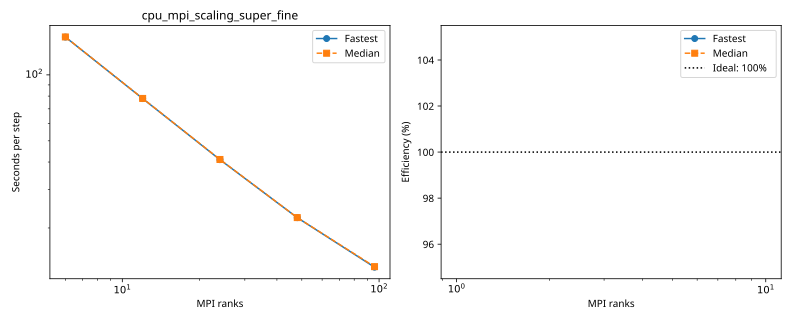

| Case | Ranks | Global resolution | Partition | Fastest / median s per step | Median MPI efficiency | Validation |
|---|---:|---|---|---:|---:|---|
| [1_ranks](cpu_mpi_scaling_super_fine/1_ranks/configuration.md) | 1 | 1440 × 720 × 200 | 1 × 1 × 1 | 974.460472 / 974.754017 | 100.0% | Current suite checks |
| [3_ranks](cpu_mpi_scaling_super_fine/3_ranks/configuration.md) | 3 | 1440 × 720 × 200 | 3 × 1 × 1 | 296.836258 / 297.374857 | 109.3% | Current suite checks |
| [6_ranks](cpu_mpi_scaling_super_fine/6_ranks/configuration.md) | 6 | 1440 × 720 × 200 | 3 × 2 × 1 | 148.776940 / 148.953459 | 109.1% | Current suite checks |
| [12_ranks](cpu_mpi_scaling_super_fine/12_ranks/configuration.md) | 12 | 1440 × 720 × 200 | 4 × 3 × 1 | 77.926198 / 78.058682 | 104.1% | Current suite checks |
| [24_ranks](cpu_mpi_scaling_super_fine/24_ranks/configuration.md) | 24 | 1440 × 720 × 200 | 6 × 4 × 1 | 41.004804 / 41.094211 | 98.8% | Current suite checks |
| [48_ranks](cpu_mpi_scaling_super_fine/48_ranks/configuration.md) | 48 | 1440 × 720 × 200 | 8 × 6 × 1 | 22.291999 / 22.308046 | 91.0% | Current suite checks |
| [96_ranks](cpu_mpi_scaling_super_fine/96_ranks/configuration.md) | 96 | 1440 × 720 × 200 | 12 × 8 × 1 | 13.242835 / 13.322377 | 76.2% | Current suite checks |

## cpu_profiling

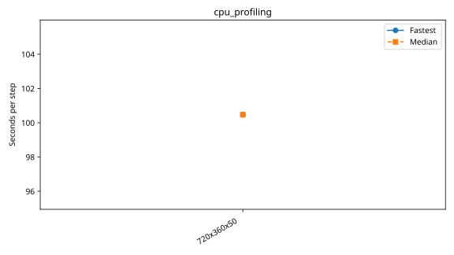

| Case | Ranks | Global resolution | Partition | Fastest / median s per step | Median MPI efficiency | Validation |
|---|---:|---|---|---:|---:|---|
| [720x360x50](cpu_profiling/720x360x50/configuration.md) | 1 | 720 × 360 × 50 | 1 × 1 × 1 | 100.471697 / 100.471697 | — | Historical: complete ranks and timing aggregates checked; finite-state/placement checks unavailable |

## cpu_resolution

| Case | Ranks | Global resolution | Partition | Fastest / median s per step | Median MPI efficiency | Validation |
|---|---:|---|---|---:|---:|---|
| [180x90x50](cpu_resolution/180x90x50/configuration.md) | 1 | 180 × 90 × 50 | 1 × 1 × 1 | 3.126001 / 3.136650 | — | Historical: complete ranks and timing aggregates checked; finite-state/placement checks unavailable |
| [2880x1440x400](cpu_resolution/2880x1440x400/configuration.md) | 1 | 2880 × 1440 × 400 | 1 × 1 × 1 | 8529.267294 / 8541.961095 | — | Current suite checks |
| [360x180x50](cpu_resolution/360x180x50/configuration.md) | 1 | 360 × 180 × 50 | 1 × 1 × 1 | 12.734940 / 12.780053 | — | Historical: complete ranks and timing aggregates checked; finite-state/placement checks unavailable |
| [720x360x50](cpu_resolution/720x360x50/configuration.md) | 1 | 720 × 360 × 50 | 1 × 1 × 1 | 96.617069 / 96.688752 | — | Historical: complete ranks and timing aggregates checked; finite-state/placement checks unavailable |
| [default](cpu_resolution/default/configuration.md) | 1 | 360 × 180 × 50 | 1 × 1 × 1 | 12.666954 / 12.674764 | — | Current suite checks |
| [fine](cpu_resolution/fine/configuration.md) | 1 | 720 × 360 × 100 | 1 × 1 × 1 | 104.432778 / 104.815036 | — | Current suite checks |
| [super_fine](cpu_resolution/super_fine/configuration.md) | 1 | 1440 × 720 × 200 | 1 × 1 × 1 | 971.087729 / 972.828508 | — | Current suite checks |

## cpu_scaling_360x180x50

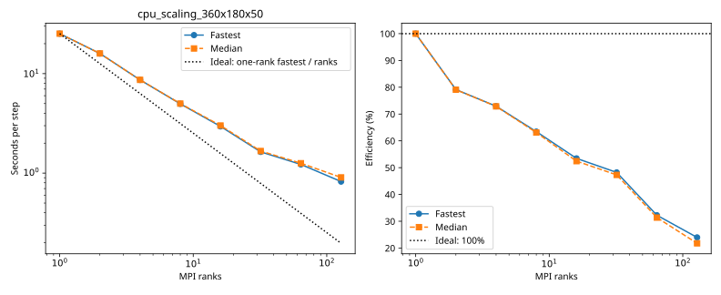

| Case | Ranks | Global resolution | Partition | Fastest / median s per step | Median MPI efficiency | Validation |
|---|---:|---|---|---:|---:|---|
| [1_ranks](cpu_scaling_360x180x50/1_ranks/configuration.md) | 1 | 360 × 180 × 50 | 1 × 1 × 1 | 25.226968 / 25.239282 | 100.0% | Historical: complete ranks and timing aggregates checked; finite-state/placement checks unavailable |
| [2_ranks](cpu_scaling_360x180x50/2_ranks/configuration.md) | 2 | 360 × 180 × 50 | 1 × 2 × 1 | 15.939943 / 15.958389 | 79.1% | Historical: complete ranks and timing aggregates checked; finite-state/placement checks unavailable |
| [4_ranks](cpu_scaling_360x180x50/4_ranks/configuration.md) | 4 | 360 × 180 × 50 | 2 × 2 × 1 | 8.648960 / 8.659548 | 72.9% | Historical: complete ranks and timing aggregates checked; finite-state/placement checks unavailable |
| [8_ranks](cpu_scaling_360x180x50/8_ranks/configuration.md) | 8 | 360 × 180 × 50 | 2 × 4 × 1 | 4.970663 / 4.999632 | 63.1% | Historical: complete ranks and timing aggregates checked; finite-state/placement checks unavailable |
| [16_ranks](cpu_scaling_360x180x50/16_ranks/configuration.md) | 16 | 360 × 180 × 50 | 4 × 4 × 1 | 2.949576 / 3.008893 | 52.4% | Historical: complete ranks and timing aggregates checked; finite-state/placement checks unavailable |
| [32_ranks](cpu_scaling_360x180x50/32_ranks/configuration.md) | 32 | 360 × 180 × 50 | 8 × 4 × 1 | 1.635220 / 1.667603 | 47.3% | Historical: complete ranks and timing aggregates checked; finite-state/placement checks unavailable |
| [64_ranks](cpu_scaling_360x180x50/64_ranks/configuration.md) | 64 | 360 × 180 × 50 | 8 × 8 × 1 | 1.222766 / 1.257602 | 31.4% | Historical: complete ranks and timing aggregates checked; finite-state/placement checks unavailable |
| [128_ranks](cpu_scaling_360x180x50/128_ranks/configuration.md) | 128 | 360 × 180 × 50 | 8 × 16 × 1 | 0.822501 / 0.905613 | 21.8% | Historical: complete ranks and timing aggregates checked; finite-state/placement checks unavailable |

## cpu_scaling_720x360x50

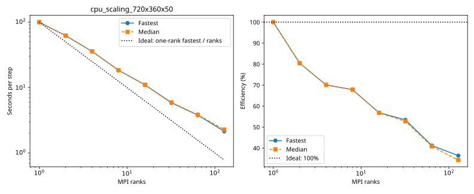

| Case | Ranks | Global resolution | Partition | Fastest / median s per step | Median MPI efficiency | Validation |
|---|---:|---|---|---:|---:|---|
| [1_ranks](cpu_scaling_720x360x50/1_ranks/configuration.md) | 1 | 720 × 360 × 50 | 1 × 1 × 1 | 99.772836 / 99.955489 | 100.0% | Historical: complete ranks and timing aggregates checked; finite-state/placement checks unavailable |
| [2_ranks](cpu_scaling_720x360x50/2_ranks/configuration.md) | 2 | 720 × 360 × 50 | 1 × 2 × 1 | 62.044896 / 62.111557 | 80.5% | Historical: complete ranks and timing aggregates checked; finite-state/placement checks unavailable |
| [4_ranks](cpu_scaling_720x360x50/4_ranks/configuration.md) | 4 | 720 × 360 × 50 | 2 × 2 × 1 | 35.604443 / 35.653836 | 70.1% | Historical: complete ranks and timing aggregates checked; finite-state/placement checks unavailable |
| [8_ranks](cpu_scaling_720x360x50/8_ranks/configuration.md) | 8 | 720 × 360 × 50 | 2 × 4 × 1 | 18.389982 / 18.414785 | 67.9% | Historical: complete ranks and timing aggregates checked; finite-state/placement checks unavailable |
| [16_ranks](cpu_scaling_720x360x50/16_ranks/configuration.md) | 16 | 720 × 360 × 50 | 4 × 4 × 1 | 10.964632 / 11.008190 | 56.8% | Historical: complete ranks and timing aggregates checked; finite-state/placement checks unavailable |
| [32_ranks](cpu_scaling_720x360x50/32_ranks/configuration.md) | 32 | 720 × 360 × 50 | 8 × 4 × 1 | 5.835605 / 5.920510 | 52.8% | Historical: complete ranks and timing aggregates checked; finite-state/placement checks unavailable |
| [64_ranks](cpu_scaling_720x360x50/64_ranks/configuration.md) | 64 | 720 × 360 × 50 | 8 × 8 × 1 | 3.783972 / 3.826437 | 40.8% | Historical: complete ranks and timing aggregates checked; finite-state/placement checks unavailable |
| [128_ranks](cpu_scaling_720x360x50/128_ranks/configuration.md) | 128 | 720 × 360 × 50 | 16 × 8 × 1 | 2.141795 / 2.275661 | 34.3% | Historical: complete ranks and timing aggregates checked; finite-state/placement checks unavailable |

## gpu_component_ablation

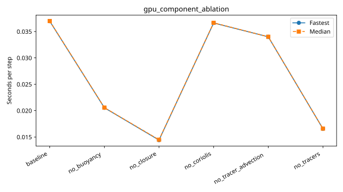

| Case | Ranks | Global resolution | Partition | Fastest / median s per step | Median MPI efficiency | Validation |
|---|---:|---|---|---:|---:|---|
| [baseline](gpu_component_ablation/baseline/configuration.md) | 1 | 360 × 180 × 50 | 1 × 1 × 1 | 0.036953 / 0.036988 | — | Historical: complete ranks and timing aggregates checked; finite-state/placement checks unavailable |
| [no_buoyancy](gpu_component_ablation/no_buoyancy/configuration.md) | 1 | 360 × 180 × 50 | 1 × 1 × 1 | 0.020543 / 0.020568 | — | Historical: complete ranks and timing aggregates checked; finite-state/placement checks unavailable |
| [no_closure](gpu_component_ablation/no_closure/configuration.md) | 1 | 360 × 180 × 50 | 1 × 1 × 1 | 0.014414 / 0.014475 | — | Historical: complete ranks and timing aggregates checked; finite-state/placement checks unavailable |
| [no_coriolis](gpu_component_ablation/no_coriolis/configuration.md) | 1 | 360 × 180 × 50 | 1 × 1 × 1 | 0.036615 / 0.036649 | — | Historical: complete ranks and timing aggregates checked; finite-state/placement checks unavailable |
| [no_tracer_advection](gpu_component_ablation/no_tracer_advection/configuration.md) | 1 | 360 × 180 × 50 | 1 × 1 × 1 | 0.033992 / 0.034004 | — | Historical: complete ranks and timing aggregates checked; finite-state/placement checks unavailable |
| [no_tracers](gpu_component_ablation/no_tracers/configuration.md) | 1 | 360 × 180 × 50 | 1 × 1 × 1 | 0.016565 / 0.016587 | — | Historical: complete ranks and timing aggregates checked; finite-state/placement checks unavailable |

## gpu_nsight_scaling_super_fine

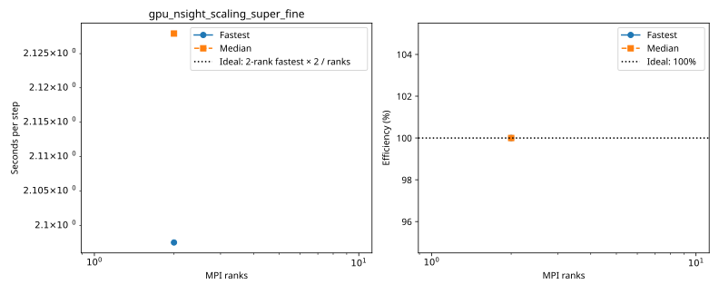

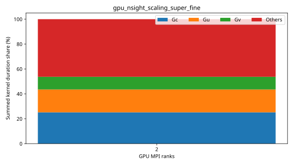

| Case | Ranks | Global resolution | Partition | Fastest / median s per step | Median MPI efficiency | Validation |
|---|---:|---|---|---:|---:|---|
| [2_ranks](gpu_nsight_scaling_super_fine/2_ranks/configuration.md) | 2 | 1440 × 720 × 200 | 2 × 1 × 1 | 2.097548 / 2.127938 | 100.0% | Current suite checks |
| [4_ranks](gpu_nsight_scaling_super_fine/4_ranks/configuration.md) | 4 | 1440 × 720 × 200 | 2 × 2 × 1 | 0.588694 / 0.633875 | 167.9% | Current suite checks |

## gpu_partition_super_fine

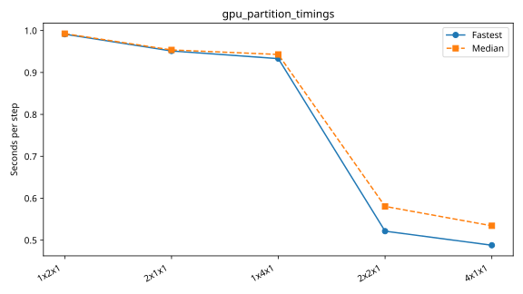

| Case | Ranks | Global resolution | Partition | Fastest / median s per step | Median MPI efficiency | Validation |
|---|---:|---|---|---:|---:|---|
| [1x2x1](gpu_partition_super_fine/1x2x1/configuration.md) | 2 | 1440 × 720 × 200 | 1 × 2 × 1 | 0.991286 / 0.992599 | — | Current suite checks |
| [2x1x1](gpu_partition_super_fine/2x1x1/configuration.md) | 2 | 1440 × 720 × 200 | 2 × 1 × 1 | 0.951312 / 0.953770 | — | Current suite checks |
| [1x4x1](gpu_partition_super_fine/1x4x1/configuration.md) | 4 | 1440 × 720 × 200 | 1 × 4 × 1 | 0.933036 / 0.943002 | — | Current suite checks |
| [2x2x1](gpu_partition_super_fine/2x2x1/configuration.md) | 4 | 1440 × 720 × 200 | 2 × 2 × 1 | 0.521430 / 0.580483 | — | Current suite checks |
| [4x1x1](gpu_partition_super_fine/4x1x1/configuration.md) | 4 | 1440 × 720 × 200 | 4 × 1 × 1 | 0.487795 / 0.534275 | — | Current suite checks |

## gpu_profiling

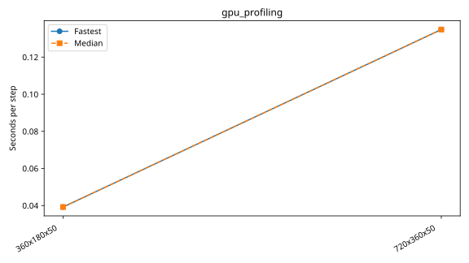

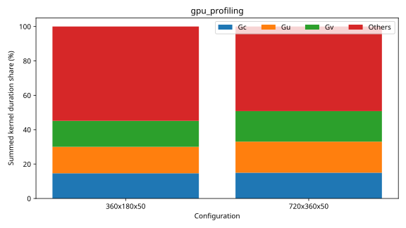

| Case | Ranks | Global resolution | Partition | Fastest / median s per step | Median MPI efficiency | Validation |
|---|---:|---|---|---:|---:|---|
| [360x180x50](gpu_profiling/360x180x50/configuration.md) | 1 | 360 × 180 × 50 | 1 × 1 × 1 | 0.039191 / 0.039191 | — | Historical: complete ranks and timing aggregates checked; finite-state/placement checks unavailable |
| [720x360x50](gpu_profiling/720x360x50/configuration.md) | 1 | 720 × 360 × 50 | 1 × 1 × 1 | 0.134866 / 0.134866 | — | Historical: complete ranks and timing aggregates checked; finite-state/placement checks unavailable |

## gpu_resolution

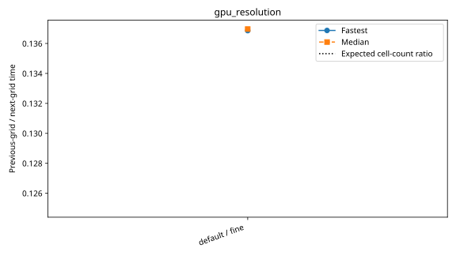

| Case | Ranks | Global resolution | Partition | Fastest / median s per step | Median MPI efficiency | Validation |
|---|---:|---|---|---:|---:|---|
| [1440x720x50](gpu_resolution/1440x720x50/configuration.md) | 1 | 1440 × 720 × 50 | 1 × 1 × 1 | 0.503266 / 0.503473 | — | Historical: complete ranks and timing aggregates checked; finite-state/placement checks unavailable |
| [180x90x50](gpu_resolution/180x90x50/configuration.md) | 1 | 180 × 90 × 50 | 1 × 1 × 1 | 0.011853 / 0.011891 | — | Historical: complete ranks and timing aggregates checked; finite-state/placement checks unavailable |
| [360x180x50](gpu_resolution/360x180x50/configuration.md) | 1 | 360 × 180 × 50 | 1 × 1 × 1 | 0.033800 / 0.033816 | — | Historical: complete ranks and timing aggregates checked; finite-state/placement checks unavailable |
| [720x360x50](gpu_resolution/720x360x50/configuration.md) | 1 | 720 × 360 × 50 | 1 × 1 × 1 | 0.125816 / 0.125869 | — | Historical: complete ranks and timing aggregates checked; finite-state/placement checks unavailable |
| [default](gpu_resolution/default/configuration.md) | 1 | 360 × 180 × 50 | 1 × 1 × 1 | 0.033990 / 0.034029 | — | Current suite checks |
| [fine](gpu_resolution/fine/configuration.md) | 1 | 720 × 360 × 100 | 1 × 1 × 1 | 0.248365 / 0.248458 | — | Current suite checks |

## gpu_scaling_720x360x50

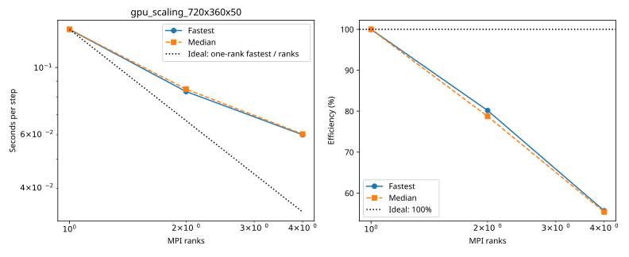

| Case | Ranks | Global resolution | Partition | Fastest / median s per step | Median MPI efficiency | Validation |
|---|---:|---|---|---:|---:|---|
| [1_ranks](gpu_scaling_720x360x50/1_ranks/configuration.md) | 1 | 720 × 360 × 50 | 1 × 1 × 1 | 0.133612 / 0.133664 | 100.0% | Historical: complete ranks and timing aggregates checked; finite-state/placement checks unavailable |
| [2_ranks](gpu_scaling_720x360x50/2_ranks/configuration.md) | 2 | 720 × 360 × 50 | 1 × 2 × 1 | 0.083338 / 0.084888 | 78.7% | Historical: complete ranks and timing aggregates checked; finite-state/placement checks unavailable |
| [4_ranks](gpu_scaling_720x360x50/4_ranks/configuration.md) | 4 | 720 × 360 × 50 | 2 × 2 × 1 | 0.060002 / 0.060339 | 55.4% | Historical: complete ranks and timing aggregates checked; finite-state/placement checks unavailable |

## gpu_scaling_super_fine

| Case | Ranks | Global resolution | Partition | Fastest / median s per step | Median MPI efficiency | Validation |
|---|---:|---|---|---:|---:|---|
| [2_ranks](gpu_scaling_super_fine/2_ranks/configuration.md) | 2 | 1440 × 720 × 200 | 2 × 1 × 1 | 0.950611 / 0.951165 | 100.0% | Current suite checks |
| [4_ranks](gpu_scaling_super_fine/4_ranks/configuration.md) | 4 | 1440 × 720 × 200 | 2 × 2 × 1 | 0.520111 / 0.524653 | 90.6% | Current suite checks |

## README series rerun

Host: Rondeau; 128 physical CPU cores and four NVIDIA A100-SXM4-40GB GPUs.
Serial execution prevents benchmark cases from competing with one another.
Full study and live logs: `/local_scratch/ajtse/benchmark_studies/hydrostatic_free_surface_models/2026-10-13T193658Z`.
GPU resolution stops at the first observed VRAM failure. CPU resolution doubles all three grid dimensions until a host allocation failure; available RAM bounds each process address space.
Historical measurements retain their original validation labels until comparable reruns complete.

| Standard series | Completed new cases | Pending cases | Report |
|---|---:|---:|---|
| gpu_resolution | 2 | 0 | [gpu_resolution](gpu_resolution/plot.md) |
| gpu_scaling_super_fine | 2 | 0 | [gpu_scaling_super_fine](gpu_scaling_super_fine/plot.md) |
| gpu_partition_super_fine | 5 | 0 | [gpu_partition_super_fine](gpu_partition_super_fine/plot.md) |
| gpu_nsight_scaling_super_fine | 2 | 0 | [gpu_nsight_scaling_super_fine](gpu_nsight_scaling_super_fine/plot.md) |
| gpu_scaling_super_super_fine | 0 | 0 | [gpu_scaling_super_super_fine](gpu_scaling_super_super_fine/plot.md) |
| gpu_weak_scaling_super_fine | 0 | 0 | [gpu_weak_scaling_super_fine](gpu_weak_scaling_super_fine/plot.md) |
| gpu_scaling_super_super_super_fine | 0 | 0 | [gpu_scaling_super_super_super_fine](gpu_scaling_super_super_super_fine/plot.md) |
| cpu_partition_cores_super_fine | 0 | 0 | [cpu_partition_cores_super_fine](cpu_partition_cores_super_fine/plot.md) |
| cpu_mpi_scaling_super_fine | 7 | 0 | [cpu_mpi_scaling_super_fine](cpu_mpi_scaling_super_fine/plot.md) |
| cpu_resolution | 4 | 0 | [cpu_resolution](cpu_resolution/plot.md) |
