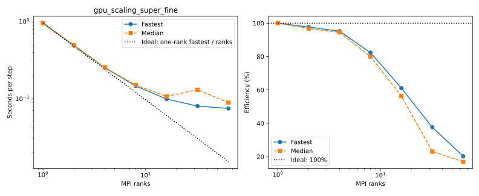
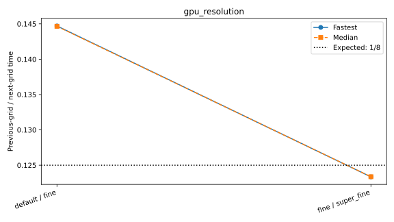
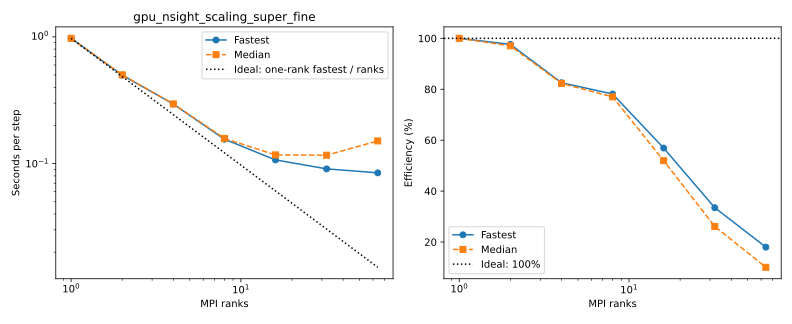
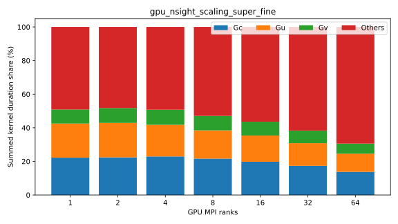

# Full benchmark suite

LatitudeLongitudeGrid without bathymetry; Float64, WENOVectorInvariantDefault, WENO7, CATKE, T/S, SplitRungeKutta3.
Δt=60 s on the standard grids; larger horizontal grids reduce Δt in proportion to grid spacing (see each configuration).
30 requested free-surface substeps; two untimed steps and five ten-step windows.
One MPI rank per CPU core or GPU, one Julia computation thread per rank. CPU extended halos=false; GPU=true.
Window boundaries synchronize MPI ranks and GPUs. Fastest/median statistics use the maximum across ranks.
Strong efficiency = baseline time × baseline ranks / (time × ranks); weak efficiency = baseline time / time.
Standard baselines use one rank; the larger GPU grids use 4 and 16 ranks. Missing baselines have no efficiency estimate.
Reference lines show ideal inverse-rank strong timing, constant weak timing, and 100% efficiency.
Resolution plots show previous-grid / next-grid time; doubling each grid dimension ideally gives 1/8.
Profiled timings are separate; Nsight captures CUDA/NVTX/MPI after warmup. Kernel shares sum durations across ranks, not elapsed wall time.

Selected rerun: [2026-10-12_gpu_partition_and_largest_grid_rerun](../2026-10-12_gpu_partition_and_largest_grid_rerun/plot.md). Replaced series use that run's measurements and baseline; earlier raw records remain in their original directories.

## gpu_partition_super_fine

Highest completed count: **0 ranks**.

MPI efficiency awaits the measured 1 × 1 × 1 baseline.

| Case | Ranks | Partition | Global resolution | Grid type | State | Fastest s/step | Median s/step | Efficiency fastest / median | Details |
|---|---:|---|---|---|---|---:|---:|---|---|
| 1x1x1 | 1 | 1x1x1 | 1440x720x200 | LatitudeLongitudeGrid | PENDING | — | — | — | (ReqNodeNotAvail, UnavailableNodes:rg[12602,12903,13403,21702]); estimated start N/A (scheduler timezone) |
| 2x1x1 | 2 | 2x1x1 | 1440x720x200 | LatitudeLongitudeGrid | PENDING | — | — | — | (ReqNodeNotAvail, UnavailableNodes:rg[12602,12903,13403,21702]); estimated start N/A (scheduler timezone) |
| 1x2x1 | 2 | 1x2x1 | 1440x720x200 | LatitudeLongitudeGrid | PENDING | — | — | — | (ReqNodeNotAvail, UnavailableNodes:rg[12602,12903,13403,21702]); estimated start N/A (scheduler timezone) |
| 4x1x1 | 4 | 4x1x1 | 1440x720x200 | LatitudeLongitudeGrid | PENDING | — | — | — | (Priority); estimated start N/A (scheduler timezone) |
| 2x2x1 | 4 | 2x2x1 | 1440x720x200 | LatitudeLongitudeGrid | PENDING | — | — | — | (Priority); estimated start N/A (scheduler timezone) |
| 1x4x1 | 4 | 1x4x1 | 1440x720x200 | LatitudeLongitudeGrid | PENDING | — | — | — | (Priority); estimated start N/A (scheduler timezone) |
| 8x1x1 | 8 | 8x1x1 | 1440x720x200 | LatitudeLongitudeGrid | PENDING | — | — | — | (Priority); estimated start N/A (scheduler timezone) |
| 4x2x1 | 8 | 4x2x1 | 1440x720x200 | LatitudeLongitudeGrid | PENDING | — | — | — | (Priority); estimated start N/A (scheduler timezone) |
| 2x4x1 | 8 | 2x4x1 | 1440x720x200 | LatitudeLongitudeGrid | PENDING | — | — | — | (Priority); estimated start N/A (scheduler timezone) |
| 1x8x1 | 8 | 1x8x1 | 1440x720x200 | LatitudeLongitudeGrid | PENDING | — | — | — | (Priority); estimated start N/A (scheduler timezone) |
| 16x1x1 | 16 | 16x1x1 | 1440x720x200 | LatitudeLongitudeGrid | PENDING | — | — | — | (Priority); estimated start N/A (scheduler timezone) |
| 8x2x1 | 16 | 8x2x1 | 1440x720x200 | LatitudeLongitudeGrid | PENDING | — | — | — | (Priority); estimated start N/A (scheduler timezone) |
| 4x4x1 | 16 | 4x4x1 | 1440x720x200 | LatitudeLongitudeGrid | PENDING | — | — | — | (Priority); estimated start N/A (scheduler timezone) |
| 2x8x1 | 16 | 2x8x1 | 1440x720x200 | LatitudeLongitudeGrid | PENDING | — | — | — | (Priority); estimated start N/A (scheduler timezone) |
| 1x16x1 | 16 | 1x16x1 | 1440x720x200 | LatitudeLongitudeGrid | PENDING | — | — | — | (Priority); estimated start N/A (scheduler timezone) |
| 32x1x1 | 32 | 32x1x1 | 1440x720x200 | LatitudeLongitudeGrid | PENDING | — | — | — | (Priority); estimated start N/A (scheduler timezone) |
| 16x2x1 | 32 | 16x2x1 | 1440x720x200 | LatitudeLongitudeGrid | PENDING | — | — | — | (Priority); estimated start N/A (scheduler timezone) |
| 8x4x1 | 32 | 8x4x1 | 1440x720x200 | LatitudeLongitudeGrid | PENDING | — | — | — | (Priority); estimated start N/A (scheduler timezone) |
| 4x8x1 | 32 | 4x8x1 | 1440x720x200 | LatitudeLongitudeGrid | PENDING | — | — | — | (Priority); estimated start N/A (scheduler timezone) |
| 2x16x1 | 32 | 2x16x1 | 1440x720x200 | LatitudeLongitudeGrid | PENDING | — | — | — | (Priority); estimated start N/A (scheduler timezone) |
| 1x32x1 | 32 | 1x32x1 | 1440x720x200 | LatitudeLongitudeGrid | GEOMETRY_LIMIT | — | — | — | Partition [1, 32, 1] has fewer than 23 local cells per horizontal direction |
| 64x1x1 | 64 | 64x1x1 | 1440x720x200 | LatitudeLongitudeGrid | GEOMETRY_LIMIT | — | — | — | Partition [64, 1, 1] has fewer than 23 local cells per horizontal direction |
| 32x2x1 | 64 | 32x2x1 | 1440x720x200 | LatitudeLongitudeGrid | PENDING | — | — | — | (Priority); estimated start 2026-10-13T04:46:16 (scheduler timezone) |
| 16x4x1 | 64 | 16x4x1 | 1440x720x200 | LatitudeLongitudeGrid | PENDING | — | — | — | (Priority); estimated start 2026-10-13T04:46:16 (scheduler timezone) |
| 8x8x1 | 64 | 8x8x1 | 1440x720x200 | LatitudeLongitudeGrid | PENDING | — | — | — | (Priority); estimated start 2026-10-13T04:46:16 (scheduler timezone) |
| 4x16x1 | 64 | 4x16x1 | 1440x720x200 | LatitudeLongitudeGrid | PENDING | — | — | — | (Priority); estimated start 2026-10-13T04:46:16 (scheduler timezone) |
| 2x32x1 | 64 | 2x32x1 | 1440x720x200 | LatitudeLongitudeGrid | GEOMETRY_LIMIT | — | — | — | Partition [2, 32, 1] has fewer than 23 local cells per horizontal direction |
| 1x64x1 | 64 | 1x64x1 | 1440x720x200 | LatitudeLongitudeGrid | GEOMETRY_LIMIT | — | — | — | Partition [1, 64, 1] has fewer than 23 local cells per horizontal direction |
## cpu_mpi_scaling_super_fine

Highest completed count: **0 ranks**.

| Case | Ranks | Partition | Global resolution | Grid type | State | Fastest s/step | Median s/step | Efficiency fastest / median | Details |
|---|---:|---|---|---|---|---:|---:|---|---|
| 1_ranks | 1 | 1x1x1 | 1440x720x200 | LatitudeLongitudeGrid | FAILED | — | — | — | Exit 9:0; None |
| 3_ranks | 3 | 3x1x1 | 1440x720x200 | LatitudeLongitudeGrid | FAILED | — | — | — | Exit 9:0; None |
| 6_ranks | 6 | 3x2x1 | 1440x720x200 | LatitudeLongitudeGrid | FAILED | — | — | — | Exit 9:0; None |
| 12_ranks | 12 | 4x3x1 | 1440x720x200 | LatitudeLongitudeGrid | FAILED | — | — | — | Exit 9:0; None |
| 24_ranks | 24 | 6x4x1 | 1440x720x200 | LatitudeLongitudeGrid | FAILED | — | — | — | Exit 9:0; None |
| 48_ranks | 48 | 8x6x1 | 1440x720x200 | LatitudeLongitudeGrid | FAILED | — | — | — | Exit 9:0; None |
| 96_ranks | 96 | 12x8x1 | 1440x720x200 | LatitudeLongitudeGrid | FAILED | — | — | — | Exit 9:0; None |
| 192_ranks | 192 | 16x12x1 | 1440x720x200 | LatitudeLongitudeGrid | FAILED | — | — | — | Exit 9:0; None |
| 384_ranks | 384 | 24x16x1 | 1440x720x200 | LatitudeLongitudeGrid | FAILED | — | — | — | Exit 9:0; None |
| 768_ranks | 768 | 32x24x1 | 1440x720x200 | LatitudeLongitudeGrid | FAILED | — | — | — | Exit 9:0; None |
| 1536_ranks | 1536 | 32x48x1 | 1440x720x200 | LatitudeLongitudeGrid | FAILED | — | — | — | Exit 9:0; None |
| 3072_ranks | 3072 | 64x48x1 | 1440x720x200 | LatitudeLongitudeGrid | FAILED | — | — | — | Exit 9:0; None |
| 6144_ranks | 6144 | 96x64x1 | 1440x720x200 | LatitudeLongitudeGrid | FAILED | — | — | — | Exit 9:0; None |
| 12288_ranks | 12288 | 128x96x1 | 1440x720x200 | LatitudeLongitudeGrid | FAILED | — | — | — | Exit 9:0; None |
| 24576_ranks | 24576 |  | 1440x720x200 | LatitudeLongitudeGrid | GEOMETRY_LIMIT | — | — | — | 24576 ranks have no horizontal partition with at least 7 local cells per direction |
## gpu_scaling_super_fine

Highest completed count: **64 ranks**.

Efficiency baseline: **1 measured ranks**.

| Case | Ranks | Partition | Global resolution | Grid type | State | Fastest s/step | Median s/step | Efficiency fastest / median | Details |
|---|---:|---|---|---|---|---:|---:|---|---|
| 1_ranks | 1 | 1x1x1 | 1440x720x200 | LatitudeLongitudeGrid | COMPLETED | 0.964997 | 0.965221 | 100.0% / 100.0% | Rank results, finite fields and resource placement verified |
| 2_ranks | 2 | 2x1x1 | 1440x720x200 | LatitudeLongitudeGrid | COMPLETED | 0.493953 | 0.498924 | 97.7% / 96.7% | Rank results, finite fields and resource placement verified |
| 4_ranks | 4 | 2x2x1 | 1440x720x200 | LatitudeLongitudeGrid | COMPLETED | 0.253451 | 0.255255 | 95.2% / 94.5% | Rank results, finite fields and resource placement verified |
| 8_ranks | 8 | 4x2x1 | 1440x720x200 | LatitudeLongitudeGrid | COMPLETED | 0.146426 | 0.150829 | 82.4% / 80.0% | Rank results, finite fields and resource placement verified |
| 16_ranks | 16 | 4x4x1 | 1440x720x200 | LatitudeLongitudeGrid | COMPLETED | 0.098755 | 0.107124 | 61.1% / 56.3% | Rank results, finite fields and resource placement verified |
| 32_ranks | 32 | 8x4x1 | 1440x720x200 | LatitudeLongitudeGrid | COMPLETED | 0.080087 | 0.130831 | 37.7% / 23.1% | Rank results, finite fields and resource placement verified |
| 64_ranks | 64 | 8x8x1 | 1440x720x200 | LatitudeLongitudeGrid | COMPLETED | 0.074548 | 0.088781 | 20.2% / 17.0% | Rank results, finite fields and resource placement verified |
| 128_ranks | 128 | 16x8x1 | 1440x720x200 | LatitudeLongitudeGrid | PENDING | — | — | — | (Priority); estimated start 2026-10-13T14:10:00 (scheduler timezone) |
| 256_ranks | 256 | 16x16x1 | 1440x720x200 | LatitudeLongitudeGrid | PENDING | — | — | — | (PartitionNodeLimit); estimated start N/A (scheduler timezone) |
| 512_ranks | 512 | 32x16x1 | 1440x720x200 | LatitudeLongitudeGrid | RESOURCE_LIMIT | — | — | — | Requires 512; configured capacity is 264 |

[1_ranks configuration](gpu_scaling_super_fine/1_ranks/configuration.md): local resolution **1440–1440 × 720–720 × 200**, retained free-surface substeps [21].

[2_ranks configuration](gpu_scaling_super_fine/2_ranks/configuration.md): local resolution **720–720 × 720–720 × 200**, retained free-surface substeps [21].

[4_ranks configuration](gpu_scaling_super_fine/4_ranks/configuration.md): local resolution **720–720 × 360–360 × 200**, retained free-surface substeps [21].

[8_ranks configuration](gpu_scaling_super_fine/8_ranks/configuration.md): local resolution **360–360 × 360–360 × 200**, retained free-surface substeps [21].

[16_ranks configuration](gpu_scaling_super_fine/16_ranks/configuration.md): local resolution **360–360 × 180–180 × 200**, retained free-surface substeps [21].

[32_ranks configuration](gpu_scaling_super_fine/32_ranks/configuration.md): local resolution **180–180 × 180–180 × 200**, retained free-surface substeps [21].

[64_ranks configuration](gpu_scaling_super_fine/64_ranks/configuration.md): local resolution **180–180 × 90–90 × 200**, retained free-surface substeps [21].
## cpu_resolution

Highest completed count: **0 ranks**.

| Case | Ranks | Partition | Global resolution | Grid type | State | Fastest s/step | Median s/step | Efficiency fastest / median | Details |
|---|---:|---|---|---|---|---:|---:|---|---|
| default | 1 | 1x1x1 | 360x180x50 | LatitudeLongitudeGrid | FAILED | — | — | — | Exit 9:0; None |
| fine | 1 | 1x1x1 | 720x360x100 | LatitudeLongitudeGrid | FAILED | — | — | — | Exit 9:0; None |
| super_fine | 1 | 1x1x1 | 1440x720x200 | LatitudeLongitudeGrid | FAILED | — | — | — | Exit 9:0; None |
## gpu_resolution

Highest completed count: **1 ranks**.

| Case | Ranks | Partition | Global resolution | Grid type | State | Fastest s/step | Median s/step | Efficiency fastest / median | Details |
|---|---:|---|---|---|---|---:|---:|---|---|
| default | 1 | 1x1x1 | 360x180x50 | LatitudeLongitudeGrid | COMPLETED | 0.017257 | 0.017261 | — | Rank results, finite fields and resource placement verified |
| fine | 1 | 1x1x1 | 720x360x100 | LatitudeLongitudeGrid | COMPLETED | 0.119260 | 0.119324 | — | Rank results, finite fields and resource placement verified |
| super_fine | 1 | 1x1x1 | 1440x720x200 | LatitudeLongitudeGrid | COMPLETED | 0.966834 | 0.967193 | — | Rank results, finite fields and resource placement verified |

[default configuration](gpu_resolution/default/configuration.md): local resolution **360–360 × 180–180 × 50**, retained free-surface substeps [21].

[fine configuration](gpu_resolution/fine/configuration.md): local resolution **720–720 × 360–360 × 100**, retained free-surface substeps [21].

[super_fine configuration](gpu_resolution/super_fine/configuration.md): local resolution **1440–1440 × 720–720 × 200**, retained free-surface substeps [21].
## cpu_partition_cores_super_fine

Highest completed count: **0 ranks**.

| Case | Ranks | Partition | Global resolution | Grid type | State | Fastest s/step | Median s/step | Efficiency fastest / median | Details |
|---|---:|---|---|---|---|---:|---:|---|---|
| 192x1x1 | 192 | 192x1x1 | 1440x720x200 | LatitudeLongitudeGrid | FAILED | — | — | — | Exit 9:0; None |
| 96x2x1 | 192 | 96x2x1 | 1440x720x200 | LatitudeLongitudeGrid | FAILED | — | — | — | Exit 9:0; None |
| 64x3x1 | 192 | 64x3x1 | 1440x720x200 | LatitudeLongitudeGrid | FAILED | — | — | — | Exit 9:0; None |
| 48x4x1 | 192 | 48x4x1 | 1440x720x200 | LatitudeLongitudeGrid | FAILED | — | — | — | Exit 9:0; None |
| 32x6x1 | 192 | 32x6x1 | 1440x720x200 | LatitudeLongitudeGrid | FAILED | — | — | — | Exit 9:0; None |
| 24x8x1 | 192 | 24x8x1 | 1440x720x200 | LatitudeLongitudeGrid | FAILED | — | — | — | Exit 9:0; None |
| 16x12x1 | 192 | 16x12x1 | 1440x720x200 | LatitudeLongitudeGrid | FAILED | — | — | — | Exit 9:0; None |
| 12x16x1 | 192 | 12x16x1 | 1440x720x200 | LatitudeLongitudeGrid | FAILED | — | — | — | Exit 9:0; None |
| 8x24x1 | 192 | 8x24x1 | 1440x720x200 | LatitudeLongitudeGrid | FAILED | — | — | — | Exit 9:0; None |
| 6x32x1 | 192 | 6x32x1 | 1440x720x200 | LatitudeLongitudeGrid | FAILED | — | — | — | Exit 9:0; None |
| 4x48x1 | 192 | 4x48x1 | 1440x720x200 | LatitudeLongitudeGrid | FAILED | — | — | — | Exit 9:0; None |
| 3x64x1 | 192 | 3x64x1 | 1440x720x200 | LatitudeLongitudeGrid | FAILED | — | — | — | Exit 9:0; None |
| 2x96x1 | 192 | 2x96x1 | 1440x720x200 | LatitudeLongitudeGrid | FAILED | — | — | — | Exit 9:0; None |
| 1x192x1 | 192 | 1x192x1 | 1440x720x200 | LatitudeLongitudeGrid | GEOMETRY_LIMIT | — | — | — | Partition [1, 192, 1] has fewer than 7 local cells per horizontal direction |
## gpu_nsight_scaling_super_fine

Highest completed count: **64 ranks**.

Efficiency baseline: **1 measured ranks**.

| Case | Ranks | Partition | Global resolution | Grid type | State | Fastest s/step | Median s/step | Efficiency fastest / median | Details |
|---|---:|---|---|---|---|---:|---:|---|---|
| 1_ranks | 1 | 1x1x1 | 1440x720x200 | LatitudeLongitudeGrid | COMPLETED | 0.973019 | 0.973334 | 100.0% / 100.0% | Rank results, finite fields and resource placement verified |
| 2_ranks | 2 | 2x1x1 | 1440x720x200 | LatitudeLongitudeGrid | COMPLETED | 0.498359 | 0.501470 | 97.6% / 97.0% | Rank results, finite fields and resource placement verified |
| 4_ranks | 4 | 2x2x1 | 1440x720x200 | LatitudeLongitudeGrid | COMPLETED | 0.294648 | 0.295675 | 82.6% / 82.3% | Rank results, finite fields and resource placement verified |
| 8_ranks | 8 | 4x2x1 | 1440x720x200 | LatitudeLongitudeGrid | COMPLETED | 0.155678 | 0.157967 | 78.1% / 77.0% | Rank results, finite fields and resource placement verified |
| 16_ranks | 16 | 4x4x1 | 1440x720x200 | LatitudeLongitudeGrid | COMPLETED | 0.106867 | 0.117125 | 56.9% / 51.9% | Rank results, finite fields and resource placement verified |
| 32_ranks | 32 | 8x4x1 | 1440x720x200 | LatitudeLongitudeGrid | COMPLETED | 0.090823 | 0.116467 | 33.5% / 26.1% | Rank results, finite fields and resource placement verified |
| 64_ranks | 64 | 8x8x1 | 1440x720x200 | LatitudeLongitudeGrid | COMPLETED | 0.084528 | 0.150939 | 18.0% / 10.1% | Rank results, finite fields and resource placement verified |
| 128_ranks | 128 | 16x8x1 | 1440x720x200 | LatitudeLongitudeGrid | PENDING | — | — | — | (Priority); estimated start 2026-10-13T15:00:00 (scheduler timezone) |
| 256_ranks | 256 | 16x16x1 | 1440x720x200 | LatitudeLongitudeGrid | PENDING | — | — | — | (PartitionNodeLimit); estimated start N/A (scheduler timezone) |
| 512_ranks | 512 | 32x16x1 | 1440x720x200 | LatitudeLongitudeGrid | RESOURCE_LIMIT | — | — | — | Requires 512; configured capacity is 264 |

| Profile | Gc | Gu | Gv | Others |
|---|---:|---:|---:|---:|
| 1_ranks | 22.22% | 20.29% | 8.38% | 49.11% |
| 2_ranks | 22.40% | 20.50% | 8.86% | 48.24% |
| 4_ranks | 22.94% | 18.83% | 8.99% | 49.25% |
| 8_ranks | 21.64% | 16.80% | 8.64% | 52.93% |
| 16_ranks | 19.79% | 15.60% | 8.24% | 56.38% |
| 32_ranks | 17.38% | 13.47% | 7.50% | 61.66% |
| 64_ranks | 13.76% | 10.81% | 6.02% | 69.41% |

[1_ranks configuration](gpu_nsight_scaling_super_fine/1_ranks/configuration.md): local resolution **1440–1440 × 720–720 × 200**, retained free-surface substeps [21].

[2_ranks configuration](gpu_nsight_scaling_super_fine/2_ranks/configuration.md): local resolution **720–720 × 720–720 × 200**, retained free-surface substeps [21].

[4_ranks configuration](gpu_nsight_scaling_super_fine/4_ranks/configuration.md): local resolution **720–720 × 360–360 × 200**, retained free-surface substeps [21].

[8_ranks configuration](gpu_nsight_scaling_super_fine/8_ranks/configuration.md): local resolution **360–360 × 360–360 × 200**, retained free-surface substeps [21].

[16_ranks configuration](gpu_nsight_scaling_super_fine/16_ranks/configuration.md): local resolution **360–360 × 180–180 × 200**, retained free-surface substeps [21].

[32_ranks configuration](gpu_nsight_scaling_super_fine/32_ranks/configuration.md): local resolution **180–180 × 180–180 × 200**, retained free-surface substeps [21].

[64_ranks configuration](gpu_nsight_scaling_super_fine/64_ranks/configuration.md): local resolution **180–180 × 90–90 × 200**, retained free-surface substeps [21].

## GPU scaling comparison (DRAC table format)

Reference: Oceananigans-DRAC/docs/drac.md, section 8. These are Rorqual measurements, not the reference’s Nibi timings.
This suite uses five ten-step windows; the reference uses five 100-step windows. Tables use median seconds per step.
LatitudeLongitudeGrid; partitions are Px × Py × Pz. Nodes are measured from rank placement.
Throughput = global interior cells / median step time. Memory is maximum device-used GiB across ranks after timing, including CUDA context and buffers; it is not peak memory.
Missing memory measurements and unfinished timings are shown as —.

### Strong scaling

Strong efficiency = baseline time × baseline GPUs / (measured time × GPUs); ideal = 100%. Baselines: super_fine 1 GPU, super_super_fine 4 GPUs, super_super_super_fine 16 GPUs.

| Grid | Global resolution (cells) | GPUs | Nodes | Partition | Δt (s) | Median s/step | Efficiency | Throughput (cells/s) | Memory/GPU (GiB) | State |
|---|---|---:|---:|---|---:|---:|---:|---:|---:|---|
| super_fine | 1440 × 720 × 200 (207,360,000) | 1 | 1 | 1 × 1 × 1 | 60 | 0.965221 | 100.0% | 2.148e+08 | — | COMPLETED |
| super_fine | 1440 × 720 × 200 (207,360,000) | 2 | 1 | 2 × 1 × 1 | 60 | 0.498924 | 96.7% | 4.156e+08 | — | COMPLETED |
| super_fine | 1440 × 720 × 200 (207,360,000) | 4 | 1 | 2 × 2 × 1 | 60 | 0.255255 | 94.5% | 8.124e+08 | — | COMPLETED |
| super_fine | 1440 × 720 × 200 (207,360,000) | 8 | 2 | 4 × 2 × 1 | 60 | 0.150829 | 80.0% | 1.375e+09 | — | COMPLETED |
| super_fine | 1440 × 720 × 200 (207,360,000) | 16 | 4 | 4 × 4 × 1 | 60 | 0.107124 | 56.3% | 1.936e+09 | — | COMPLETED |
| super_fine | 1440 × 720 × 200 (207,360,000) | 32 | 8 | 8 × 4 × 1 | 60 | 0.130831 | 23.1% | 1.585e+09 | — | COMPLETED |
| super_fine | 1440 × 720 × 200 (207,360,000) | 64 | 16 | 8 × 8 × 1 | 60 | 0.088781 | 17.0% | 2.336e+09 | — | COMPLETED |
| super_fine | 1440 × 720 × 200 (207,360,000) | 128 | — | 16 × 8 × 1 | 60 | — | — | — | — | PENDING |
| super_fine | 1440 × 720 × 200 (207,360,000) | 256 | — | 16 × 16 × 1 | 60 | — | — | — | — | PENDING |
| super_super_super_fine | 5760 × 2880 × 200 (3,317,760,000) | 16 | — | 4 × 4 × 1 | 15 | — | — | — | — | PENDING |
| super_super_super_fine | 5760 × 2880 × 200 (3,317,760,000) | 32 | — | 8 × 4 × 1 | 15 | — | — | — | — | PENDING |
| super_super_super_fine | 5760 × 2880 × 200 (3,317,760,000) | 64 | — | 8 × 8 × 1 | 15 | — | — | — | — | PENDING |
| super_super_super_fine | 5760 × 2880 × 200 (3,317,760,000) | 128 | — | 16 × 8 × 1 | 15 | — | — | — | — | PENDING |
| super_super_super_fine | 5760 × 2880 × 200 (3,317,760,000) | 256 | — | 16 × 16 × 1 | 15 | — | — | — | — | PENDING |

