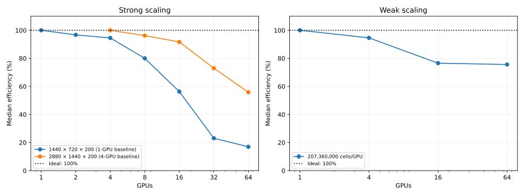

# Full benchmark suite

LatitudeLongitudeGrid without bathymetry; Float64, WENOVectorInvariantDefault, WENO7, CATKE, T/S, SplitRungeKutta3.
Δt=60 s on the standard grids; larger horizontal grids reduce Δt in proportion to grid spacing (see each configuration).
30 requested free-surface substeps; two untimed steps and five ten-step windows.
One MPI rank per CPU core or GPU, one Julia computation thread per rank. CPU extended halos=false; GPU=true.
Window boundaries synchronize MPI ranks and GPUs. Fastest/median statistics use the maximum across ranks.
Strong efficiency = baseline time × baseline ranks / (time × ranks); weak efficiency = baseline time / time.
Standard baselines use one rank; the larger GPU grids use 4 and 16 ranks. Missing baselines have no efficiency estimate.
Reference lines show ideal inverse-rank strong timing, constant weak timing, and 100% efficiency.
Resolution plots show previous-grid / next-grid time; doubling each grid dimension ideally gives 1/8.
Profiled timings are separate; Nsight captures CUDA/NVTX/MPI after warmup. Kernel shares sum durations across ranks, not elapsed wall time.

## gpu_partition_super_fine

Highest completed count: **4 ranks**.

MPI efficiency awaits the measured 1 × 1 × 1 baseline.

| Case | Ranks | Partition | Global resolution | Grid type | State | Fastest s/step | Median s/step | Efficiency fastest / median | Details |
|---|---:|---|---|---|---|---:|---:|---|---|
| 1x1x1 | 1 | 1x1x1 | 1440x720x200 | LatitudeLongitudeGrid | PENDING | — | — | — | (ReqNodeNotAvail, UnavailableNodes:rg[12602,12903,13403,21702]); estimated start N/A (scheduler timezone) |
| 2x1x1 | 2 | 2x1x1 | 1440x720x200 | LatitudeLongitudeGrid | PENDING | — | — | — | (ReqNodeNotAvail, UnavailableNodes:rg[12602,12903,13403,21702]); estimated start N/A (scheduler timezone) |
| 1x2x1 | 2 | 1x2x1 | 1440x720x200 | LatitudeLongitudeGrid | PENDING | — | — | — | (ReqNodeNotAvail, UnavailableNodes:rg[12602,12903,13403,21702]); estimated start N/A (scheduler timezone) |
| 4x1x1 | 4 | 4x1x1 | 1440x720x200 | LatitudeLongitudeGrid | COMPLETED | 0.246198 | 0.249393 | — | Rank results, finite fields and resource placement verified |
| 2x2x1 | 4 | 2x2x1 | 1440x720x200 | LatitudeLongitudeGrid | COMPLETED | 0.254379 | 0.256339 | — | Rank results, finite fields and resource placement verified |
| 1x4x1 | 4 | 1x4x1 | 1440x720x200 | LatitudeLongitudeGrid | RUNNING | — | — | — | Exit 0:0; None |
| 8x1x1 | 8 | 8x1x1 | 1440x720x200 | LatitudeLongitudeGrid | PENDING | — | — | — | (Priority); estimated start N/A (scheduler timezone) |
| 4x2x1 | 8 | 4x2x1 | 1440x720x200 | LatitudeLongitudeGrid | PENDING | — | — | — | (Priority); estimated start N/A (scheduler timezone) |
| 2x4x1 | 8 | 2x4x1 | 1440x720x200 | LatitudeLongitudeGrid | PENDING | — | — | — | (Priority); estimated start N/A (scheduler timezone) |
| 1x8x1 | 8 | 1x8x1 | 1440x720x200 | LatitudeLongitudeGrid | PENDING | — | — | — | (Priority); estimated start N/A (scheduler timezone) |
| 16x1x1 | 16 | 16x1x1 | 1440x720x200 | LatitudeLongitudeGrid | PENDING | — | — | — | (Priority); estimated start N/A (scheduler timezone) |
| 8x2x1 | 16 | 8x2x1 | 1440x720x200 | LatitudeLongitudeGrid | PENDING | — | — | — | (Priority); estimated start N/A (scheduler timezone) |
| 4x4x1 | 16 | 4x4x1 | 1440x720x200 | LatitudeLongitudeGrid | PENDING | — | — | — | (Priority); estimated start N/A (scheduler timezone) |
| 2x8x1 | 16 | 2x8x1 | 1440x720x200 | LatitudeLongitudeGrid | PENDING | — | — | — | (Priority); estimated start N/A (scheduler timezone) |
| 1x16x1 | 16 | 1x16x1 | 1440x720x200 | LatitudeLongitudeGrid | PENDING | — | — | — | (Priority); estimated start N/A (scheduler timezone) |
| 32x1x1 | 32 | 32x1x1 | 1440x720x200 | LatitudeLongitudeGrid | PENDING | — | — | — | (Priority); estimated start N/A (scheduler timezone) |
| 16x2x1 | 32 | 16x2x1 | 1440x720x200 | LatitudeLongitudeGrid | PENDING | — | — | — | (Priority); estimated start N/A (scheduler timezone) |
| 8x4x1 | 32 | 8x4x1 | 1440x720x200 | LatitudeLongitudeGrid | PENDING | — | — | — | (Priority); estimated start N/A (scheduler timezone) |
| 4x8x1 | 32 | 4x8x1 | 1440x720x200 | LatitudeLongitudeGrid | PENDING | — | — | — | (Priority); estimated start N/A (scheduler timezone) |
| 2x16x1 | 32 | 2x16x1 | 1440x720x200 | LatitudeLongitudeGrid | PENDING | — | — | — | (Priority); estimated start N/A (scheduler timezone) |
| 1x32x1 | 32 | 1x32x1 | 1440x720x200 | LatitudeLongitudeGrid | GEOMETRY_LIMIT | — | — | — | Partition [1, 32, 1] has fewer than 23 local cells per horizontal direction |
| 64x1x1 | 64 | 64x1x1 | 1440x720x200 | LatitudeLongitudeGrid | GEOMETRY_LIMIT | — | — | — | Partition [64, 1, 1] has fewer than 23 local cells per horizontal direction |
| 32x2x1 | 64 | 32x2x1 | 1440x720x200 | LatitudeLongitudeGrid | PENDING | — | — | — | (Priority); estimated start 2026-10-13T08:40:00 (scheduler timezone) |
| 16x4x1 | 64 | 16x4x1 | 1440x720x200 | LatitudeLongitudeGrid | PENDING | — | — | — | (Priority); estimated start 2026-10-13T08:40:00 (scheduler timezone) |
| 8x8x1 | 64 | 8x8x1 | 1440x720x200 | LatitudeLongitudeGrid | PENDING | — | — | — | (Priority); estimated start 2026-10-13T08:40:00 (scheduler timezone) |
| 4x16x1 | 64 | 4x16x1 | 1440x720x200 | LatitudeLongitudeGrid | PENDING | — | — | — | (Priority); estimated start 2026-10-13T08:40:00 (scheduler timezone) |
| 2x32x1 | 64 | 2x32x1 | 1440x720x200 | LatitudeLongitudeGrid | GEOMETRY_LIMIT | — | — | — | Partition [2, 32, 1] has fewer than 23 local cells per horizontal direction |
| 1x64x1 | 64 | 1x64x1 | 1440x720x200 | LatitudeLongitudeGrid | GEOMETRY_LIMIT | — | — | — | Partition [1, 64, 1] has fewer than 23 local cells per horizontal direction |

[4x1x1 configuration](gpu_partition_super_fine/4x1x1/configuration.md): local resolution **360–360 × 720–720 × 200**, retained free-surface substeps [21].

[2x2x1 configuration](gpu_partition_super_fine/2x2x1/configuration.md): local resolution **720–720 × 360–360 × 200**, retained free-surface substeps [21].
## gpu_scaling_super_super_super_fine

Highest completed count: **0 ranks**.

| Case | Ranks | Partition | Global resolution | Grid type | State | Fastest s/step | Median s/step | Efficiency fastest / median | Details |
|---|---:|---|---|---|---|---:|---:|---|---|
| 16_ranks | 16 | 4x4x1 | 5760x2880x200 | LatitudeLongitudeGrid | PENDING | — | — | — | (Priority); estimated start N/A (scheduler timezone) |
| 32_ranks | 32 | 8x4x1 | 5760x2880x200 | LatitudeLongitudeGrid | PENDING | — | — | — | (Priority); estimated start N/A (scheduler timezone) |
| 64_ranks | 64 | 8x8x1 | 5760x2880x200 | LatitudeLongitudeGrid | PENDING | — | — | — | (Priority); estimated start N/A (scheduler timezone) |
| 128_ranks | 128 | 16x8x1 | 5760x2880x200 | LatitudeLongitudeGrid | PENDING | — | — | — | (Priority); estimated start 2026-10-13T19:19:19 (scheduler timezone) |
| 256_ranks | 256 | 16x16x1 | 5760x2880x200 | LatitudeLongitudeGrid | PENDING | — | — | — | (Nodes required for job are DOWN, DRAINED or reserved for jobs in higher priority partitions); estimated start N/A (scheduler timezone) |
| 512_ranks | 512 | 32x16x1 | 5760x2880x200 | LatitudeLongitudeGrid | RESOURCE_LIMIT | — | — | — | Requires 512; configured capacity is 264 |

## GPU scaling comparison (DRAC table format)

Reference: Oceananigans-DRAC/docs/drac.md, section 8. These are Rorqual measurements, not the reference’s Nibi timings.
This suite uses five ten-step windows; the reference uses five 100-step windows. Tables use median seconds per step.
LatitudeLongitudeGrid; partitions are Px × Py × Pz. Nodes are measured from rank placement.
Throughput = global interior cells / median step time. Memory is maximum device-used GiB across ranks after timing, including CUDA context and buffers; it is not peak memory.
Missing memory measurements and unfinished timings are shown as —.

Median efficiencies use each strong grid’s measured baseline and the weak study’s one-GPU baseline; the dotted reference is ideal 100% efficiency.

### Strong scaling

Strong efficiency = baseline time × baseline GPUs / (measured time × GPUs); ideal = 100%. Baselines: super_fine 1 GPU, super_super_fine 4 GPUs, super_super_super_fine 16 GPUs.

| Grid | Global resolution (cells) | GPUs | Nodes | Partition | Δt (s) | Median s/step | Efficiency | Throughput (cells/s) | Memory/GPU (GiB) | State |
|---|---|---:|---:|---|---:|---:|---:|---:|---:|---|
| super_fine | 1440 × 720 × 200 (207,360,000) | 1 | 1 | 1 × 1 × 1 | 60 | 0.965221 | 100.0% | 2.148e+08 | — | COMPLETED |
| super_fine | 1440 × 720 × 200 (207,360,000) | 2 | 1 | 2 × 1 × 1 | 60 | 0.498924 | 96.7% | 4.156e+08 | — | COMPLETED |
| super_fine | 1440 × 720 × 200 (207,360,000) | 4 | 1 | 2 × 2 × 1 | 60 | 0.255255 | 94.5% | 8.124e+08 | — | COMPLETED |
| super_fine | 1440 × 720 × 200 (207,360,000) | 8 | 2 | 4 × 2 × 1 | 60 | 0.150829 | 80.0% | 1.375e+09 | — | COMPLETED |
| super_fine | 1440 × 720 × 200 (207,360,000) | 16 | 4 | 4 × 4 × 1 | 60 | 0.107124 | 56.3% | 1.936e+09 | — | COMPLETED |
| super_fine | 1440 × 720 × 200 (207,360,000) | 32 | 8 | 8 × 4 × 1 | 60 | 0.130831 | 23.1% | 1.585e+09 | — | COMPLETED |
| super_fine | 1440 × 720 × 200 (207,360,000) | 64 | 16 | 8 × 8 × 1 | 60 | 0.088781 | 17.0% | 2.336e+09 | — | COMPLETED |
| super_fine | 1440 × 720 × 200 (207,360,000) | 128 | — | 16 × 8 × 1 | 60 | — | — | — | — | PENDING |
| super_fine | 1440 × 720 × 200 (207,360,000) | 256 | — | 16 × 16 × 1 | 60 | — | — | — | — | PENDING |
| super_super_fine | 2880 × 1440 × 200 (829,440,000) | 4 | 1 | 2 × 2 × 1 | 30 | 0.995564 | 100.0% | 8.331e+08 | 48.55 | COMPLETED |
| super_super_fine | 2880 × 1440 × 200 (829,440,000) | 8 | 2 | 4 × 2 × 1 | 30 | 0.517392 | 96.2% | 1.603e+09 | 25.36 | COMPLETED |
| super_super_fine | 2880 × 1440 × 200 (829,440,000) | 16 | 4 | 4 × 4 × 1 | 30 | 0.271461 | 91.7% | 3.055e+09 | 14.11 | COMPLETED |
| super_super_fine | 2880 × 1440 × 200 (829,440,000) | 32 | 8 | 8 × 4 × 1 | 30 | 0.170486 | 73.0% | 4.865e+09 | 7.88 | COMPLETED |
| super_super_fine | 2880 × 1440 × 200 (829,440,000) | 64 | 16 | 8 × 8 × 1 | 30 | 0.111415 | 55.8% | 7.445e+09 | 4.77 | COMPLETED |
| super_super_fine | 2880 × 1440 × 200 (829,440,000) | 128 | — | 16 × 8 × 1 | 30 | — | — | — | — | PENDING |
| super_super_fine | 2880 × 1440 × 200 (829,440,000) | 256 | — | 16 × 16 × 1 | 30 | — | — | — | — | PENDING |
| super_super_super_fine | 5760 × 2880 × 200 (3,317,760,000) | 16 | — | 4 × 4 × 1 | 15 | — | — | — | — | PENDING |
| super_super_super_fine | 5760 × 2880 × 200 (3,317,760,000) | 32 | — | 8 × 4 × 1 | 15 | — | — | — | — | PENDING |
| super_super_super_fine | 5760 × 2880 × 200 (3,317,760,000) | 64 | — | 8 × 8 × 1 | 15 | — | — | — | — | PENDING |
| super_super_super_fine | 5760 × 2880 × 200 (3,317,760,000) | 128 | — | 16 × 8 × 1 | 15 | — | — | — | — | PENDING |
| super_super_super_fine | 5760 × 2880 × 200 (3,317,760,000) | 256 | — | 16 × 16 × 1 | 15 | — | — | — | — | PENDING |

### Weak scaling

Weak efficiency = one-GPU baseline time / measured time; ideal = 100%. Interior cells/GPU = 207,360,000.

| Grid | Global resolution (cells) | GPUs | Nodes | Partition | Δt (s) | Median s/step | Efficiency | Throughput (cells/s) | Memory/GPU (GiB) | State |
|---|---|---:|---:|---|---:|---:|---:|---:|---:|---|
| super_fine | 1440 × 720 × 200 (207,360,000) | 1 | 1 | 1 × 1 × 1 | 60 | 0.965692 | 100.0% | 2.147e+08 | 46.60 | COMPLETED |
| weak_4_ranks | 2880 × 1440 × 200 (829,440,000) | 4 | 1 | 2 × 2 × 1 | 30 | 1.020760 | 94.6% | 8.126e+08 | 48.55 | COMPLETED |
| weak_16_ranks | 5760 × 2880 × 200 (3,317,760,000) | 16 | 4 | 4 × 4 × 1 | 15 | 1.261272 | 76.6% | 2.630e+09 | 49.47 | COMPLETED |
| weak_64_ranks | 11520 × 5760 × 200 (13,271,040,000) | 64 | 16 | 8 × 8 × 1 | 7.5 | 1.277216 | 75.6% | 1.039e+10 | 49.47 | COMPLETED |
| weak_256_ranks | 23040 × 11520 × 200 (53,084,160,000) | 256 | — | 16 × 16 × 1 | 3.75 | — | — | — | — | PENDING |

