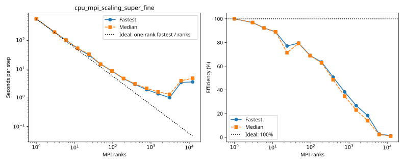

# rorqual: cpu_mpi_scaling_super_fine

Latest accepted measurement for each case. Configuration links record the actual grid, partition, numerical methods, timing protocol and validation limits.

| Case | MPI ranks | Fastest s/step | Median s/step | Validation |
|---|---:|---:|---:|---|
| [12288_ranks](12288_ranks/configuration.md) | 12288 | 3.592287 | 4.829213 | Current suite: rank completeness, finite fields, placement and timings checked |
| [12_ranks](12_ranks/configuration.md) | 12 | 53.475571 | 53.536204 | Current suite: rank completeness, finite fields, placement and timings checked |
| [1536_ranks](1536_ranks/configuration.md) | 1536 | 1.389463 | 1.621086 | Current suite: rank completeness, finite fields, placement and timings checked |
| [192_ranks](192_ranks/configuration.md) | 192 | 4.684070 | 4.746761 | Current suite: rank completeness, finite fields, placement and timings checked |
| [1_ranks](1_ranks/configuration.md) | 1 | 570.778232 | 571.854116 | Current suite: rank completeness, finite fields, placement and timings checked |
| [24_ranks](24_ranks/configuration.md) | 24 | 30.866122 | 33.370943 | Current suite: rank completeness, finite fields, placement and timings checked |
| [3072_ranks](3072_ranks/configuration.md) | 3072 | 1.015510 | 1.330853 | Current suite: rank completeness, finite fields, placement and timings checked |
| [384_ranks](384_ranks/configuration.md) | 384 | 2.929167 | 3.067832 | Current suite: rank completeness, finite fields, placement and timings checked |
| [3_ranks](3_ranks/configuration.md) | 3 | 196.382277 | 196.766246 | Current suite: rank completeness, finite fields, placement and timings checked |
| [48_ranks](48_ranks/configuration.md) | 48 | 14.954807 | 15.022399 | Current suite: rank completeness, finite fields, placement and timings checked |
| [6144_ranks](6144_ranks/configuration.md) | 6144 | 3.458143 | 3.973169 | Current suite: rank completeness, finite fields, placement and timings checked |
| [6_ranks](6_ranks/configuration.md) | 6 | 103.102502 | 103.291139 | Current suite: rank completeness, finite fields, placement and timings checked |
| [768_ranks](768_ranks/configuration.md) | 768 | 1.940831 | 2.146462 | Current suite: rank completeness, finite fields, placement and timings checked |
| [96_ranks](96_ranks/configuration.md) | 96 | 8.611579 | 8.640376 | Current suite: rank completeness, finite fields, placement and timings checked |
