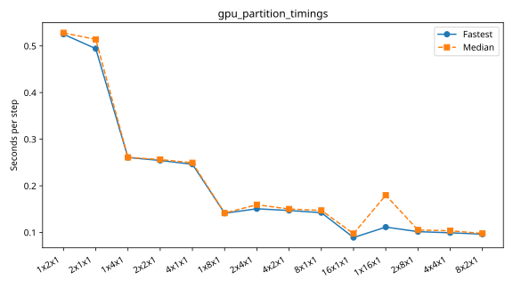

# rorqual: gpu_partition_super_fine

Latest accepted measurement for each case. Configuration links record the actual grid, partition, numerical methods, timing protocol and validation limits.

| Case | MPI ranks | Fastest s/step | Median s/step | Validation |
|---|---:|---:|---:|---|
| [16x1x1](16x1x1/configuration.md) | 16 | 0.089033 | 0.097464 | Current suite: rank completeness, finite fields, placement and timings checked |
| [1x16x1](1x16x1/configuration.md) | 16 | 0.111402 | 0.179838 | Current suite: rank completeness, finite fields, placement and timings checked |
| [1x2x1](1x2x1/configuration.md) | 2 | 0.525043 | 0.528090 | Current suite: rank completeness, finite fields, placement and timings checked |
| [1x4x1](1x4x1/configuration.md) | 4 | 0.260742 | 0.260913 | Current suite: rank completeness, finite fields, placement and timings checked |
| [1x8x1](1x8x1/configuration.md) | 8 | 0.141200 | 0.141413 | Current suite: rank completeness, finite fields, placement and timings checked |
| [2x1x1](2x1x1/configuration.md) | 2 | 0.494139 | 0.514013 | Current suite: rank completeness, finite fields, placement and timings checked |
| [2x2x1](2x2x1/configuration.md) | 4 | 0.254379 | 0.256339 | Current suite: rank completeness, finite fields, placement and timings checked |
| [2x4x1](2x4x1/configuration.md) | 8 | 0.150725 | 0.159511 | Current suite: rank completeness, finite fields, placement and timings checked |
| [2x8x1](2x8x1/configuration.md) | 16 | 0.101643 | 0.105266 | Current suite: rank completeness, finite fields, placement and timings checked |
| [4x1x1](4x1x1/configuration.md) | 4 | 0.246198 | 0.249393 | Current suite: rank completeness, finite fields, placement and timings checked |
| [4x2x1](4x2x1/configuration.md) | 8 | 0.147079 | 0.150229 | Current suite: rank completeness, finite fields, placement and timings checked |
| [4x4x1](4x4x1/configuration.md) | 16 | 0.099257 | 0.103579 | Current suite: rank completeness, finite fields, placement and timings checked |
| [8x1x1](8x1x1/configuration.md) | 8 | 0.142374 | 0.147195 | Current suite: rank completeness, finite fields, placement and timings checked |
| [8x2x1](8x2x1/configuration.md) | 16 | 0.096162 | 0.097788 | Current suite: rank completeness, finite fields, placement and timings checked |
