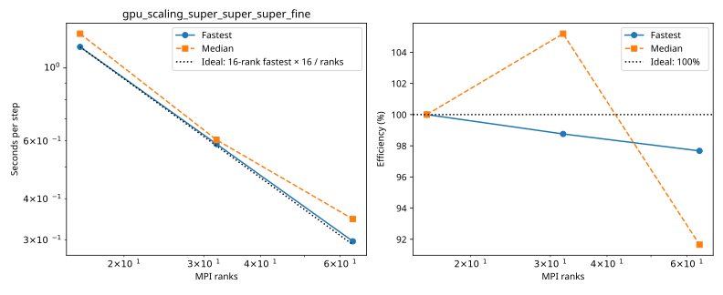

# rorqual: gpu_scaling_super_super_super_fine

Latest accepted measurement for each case. Configuration links record the actual grid, partition, numerical methods, timing protocol and validation limits.

| Case | MPI ranks | Fastest s/step | Median s/step | Validation |
|---|---:|---:|---:|---|
| [16_ranks](16_ranks/configuration.md) | 16 | 1.159040 | 1.271404 | Current suite: rank completeness, finite fields, placement and timings checked |
| [32_ranks](32_ranks/configuration.md) | 32 | 0.586813 | 0.604331 | Current suite: rank completeness, finite fields, placement and timings checked |
| [64_ranks](64_ranks/configuration.md) | 64 | 0.296665 | 0.346800 | Current suite: rank completeness, finite fields, placement and timings checked |
