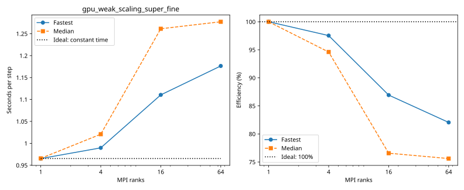

# rorqual: gpu_weak_scaling_super_fine

Latest accepted measurement for each case. Configuration links record the actual grid, partition, numerical methods, timing protocol and validation limits.

| Case | MPI ranks | Fastest s/step | Median s/step | Validation |
|---|---:|---:|---:|---|
| [16_ranks](16_ranks/configuration.md) | 16 | 1.110443 | 1.261272 | Current suite: rank completeness, finite fields, placement and timings checked |
| [1_ranks](1_ranks/configuration.md) | 1 | 0.965274 | 0.965692 | Current suite: rank completeness, finite fields, placement and timings checked |
| [4_ranks](4_ranks/configuration.md) | 4 | 0.989689 | 1.020760 | Current suite: rank completeness, finite fields, placement and timings checked |
| [64_ranks](64_ranks/configuration.md) | 64 | 1.176431 | 1.277216 | Current suite: rank completeness, finite fields, placement and timings checked |
