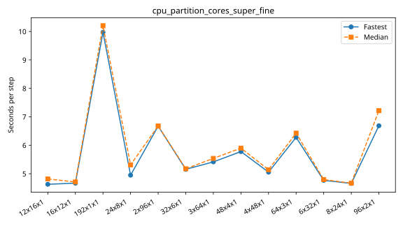
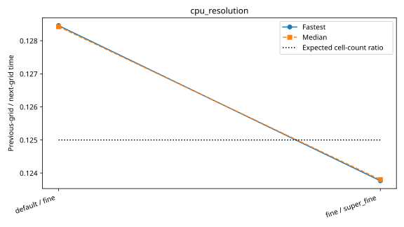
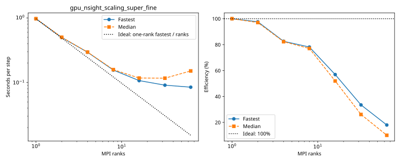
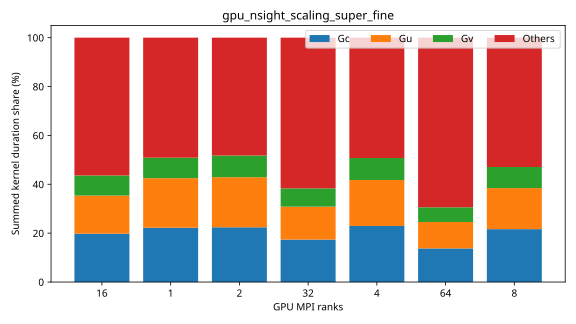
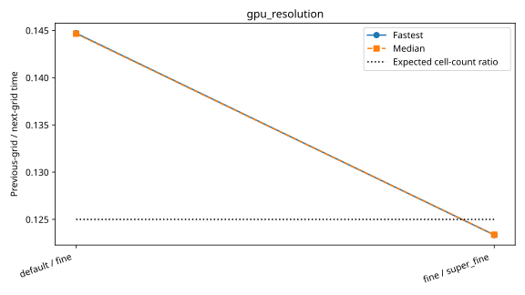
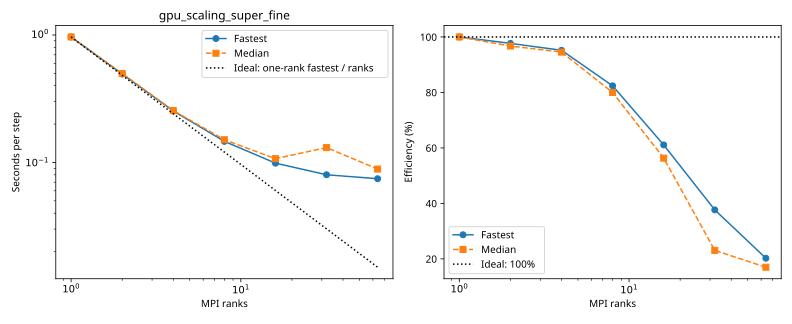
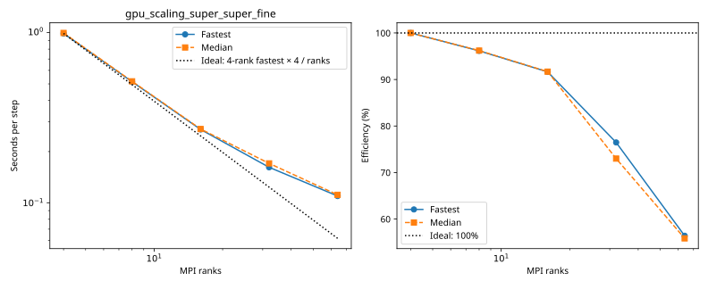

# rorqual benchmarks

Each series folder contains its configurations, measurements and provenance. Only completed measurements appear in timing tables and plots.

| Series | Completed cases | Report |
|---|---:|---|
| `cpu_mpi_scaling_super_fine` | 14 | [Details](cpu_mpi_scaling_super_fine/plot.md) |
| `cpu_partition_cores_super_fine` | 13 | [Details](cpu_partition_cores_super_fine/plot.md) |
| `cpu_resolution` | 3 | [Details](cpu_resolution/plot.md) |
| `gpu_nsight_scaling_super_fine` | 7 | [Details](gpu_nsight_scaling_super_fine/plot.md) |
| `gpu_partition_super_fine` | 14 | [Details](gpu_partition_super_fine/plot.md) |
| `gpu_resolution` | 3 | [Details](gpu_resolution/plot.md) |
| `gpu_scaling_super_fine` | 7 | [Details](gpu_scaling_super_fine/plot.md) |
| `gpu_scaling_super_super_fine` | 5 | [Details](gpu_scaling_super_super_fine/plot.md) |
| `gpu_scaling_super_super_super_fine` | 3 | [Details](gpu_scaling_super_super_super_fine/plot.md) |
| `gpu_weak_scaling_super_fine` | 4 | [Details](gpu_weak_scaling_super_fine/plot.md) |

## cpu_mpi_scaling_super_fine

| Case | Ranks | Global resolution | Partition | Fastest / median s per step | Median MPI efficiency | Validation |
|---|---:|---|---|---:|---:|---|
| [1_ranks](cpu_mpi_scaling_super_fine/1_ranks/configuration.md) | 1 | 1440 × 720 × 200 | 1 × 1 × 1 | 570.778232 / 571.854116 | 100.0% | Current suite: rank completeness, finite fields, placement and timings checked |
| [3_ranks](cpu_mpi_scaling_super_fine/3_ranks/configuration.md) | 3 | 1440 × 720 × 200 | 3 × 1 × 1 | 196.382277 / 196.766246 | 96.9% | Current suite: rank completeness, finite fields, placement and timings checked |
| [6_ranks](cpu_mpi_scaling_super_fine/6_ranks/configuration.md) | 6 | 1440 × 720 × 200 | 3 × 2 × 1 | 103.102502 / 103.291139 | 92.3% | Current suite: rank completeness, finite fields, placement and timings checked |
| [12_ranks](cpu_mpi_scaling_super_fine/12_ranks/configuration.md) | 12 | 1440 × 720 × 200 | 4 × 3 × 1 | 53.475571 / 53.536204 | 89.0% | Current suite: rank completeness, finite fields, placement and timings checked |
| [24_ranks](cpu_mpi_scaling_super_fine/24_ranks/configuration.md) | 24 | 1440 × 720 × 200 | 6 × 4 × 1 | 30.866122 / 33.370943 | 71.4% | Current suite: rank completeness, finite fields, placement and timings checked |
| [48_ranks](cpu_mpi_scaling_super_fine/48_ranks/configuration.md) | 48 | 1440 × 720 × 200 | 8 × 6 × 1 | 14.954807 / 15.022399 | 79.3% | Current suite: rank completeness, finite fields, placement and timings checked |
| [96_ranks](cpu_mpi_scaling_super_fine/96_ranks/configuration.md) | 96 | 1440 × 720 × 200 | 12 × 8 × 1 | 8.611579 / 8.640376 | 68.9% | Current suite: rank completeness, finite fields, placement and timings checked |
| [192_ranks](cpu_mpi_scaling_super_fine/192_ranks/configuration.md) | 192 | 1440 × 720 × 200 | 16 × 12 × 1 | 4.684070 / 4.746761 | 62.7% | Current suite: rank completeness, finite fields, placement and timings checked |
| [384_ranks](cpu_mpi_scaling_super_fine/384_ranks/configuration.md) | 384 | 1440 × 720 × 200 | 24 × 16 × 1 | 2.929167 / 3.067832 | 48.5% | Current suite: rank completeness, finite fields, placement and timings checked |
| [768_ranks](cpu_mpi_scaling_super_fine/768_ranks/configuration.md) | 768 | 1440 × 720 × 200 | 32 × 24 × 1 | 1.940831 / 2.146462 | 34.7% | Current suite: rank completeness, finite fields, placement and timings checked |
| [1536_ranks](cpu_mpi_scaling_super_fine/1536_ranks/configuration.md) | 1536 | 1440 × 720 × 200 | 32 × 48 × 1 | 1.389463 / 1.621086 | 23.0% | Current suite: rank completeness, finite fields, placement and timings checked |
| [3072_ranks](cpu_mpi_scaling_super_fine/3072_ranks/configuration.md) | 3072 | 1440 × 720 × 200 | 64 × 48 × 1 | 1.015510 / 1.330853 | 14.0% | Current suite: rank completeness, finite fields, placement and timings checked |
| [6144_ranks](cpu_mpi_scaling_super_fine/6144_ranks/configuration.md) | 6144 | 1440 × 720 × 200 | 96 × 64 × 1 | 3.458143 / 3.973169 | 2.3% | Current suite: rank completeness, finite fields, placement and timings checked |
| [12288_ranks](cpu_mpi_scaling_super_fine/12288_ranks/configuration.md) | 12288 | 1440 × 720 × 200 | 128 × 96 × 1 | 3.592287 / 4.829213 | 1.0% | Current suite: rank completeness, finite fields, placement and timings checked |

## cpu_partition_cores_super_fine

| Case | Ranks | Global resolution | Partition | Fastest / median s per step | Median MPI efficiency | Validation |
|---|---:|---|---|---:|---:|---|
| [12x16x1](cpu_partition_cores_super_fine/12x16x1/configuration.md) | 192 | 1440 × 720 × 200 | 12 × 16 × 1 | 4.628829 / 4.815523 | — | Current suite: rank completeness, finite fields, placement and timings checked |
| [16x12x1](cpu_partition_cores_super_fine/16x12x1/configuration.md) | 192 | 1440 × 720 × 200 | 16 × 12 × 1 | 4.668087 / 4.710430 | — | Current suite: rank completeness, finite fields, placement and timings checked |
| [192x1x1](cpu_partition_cores_super_fine/192x1x1/configuration.md) | 192 | 1440 × 720 × 200 | 192 × 1 × 1 | 9.971960 / 10.203584 | — | Current suite: rank completeness, finite fields, placement and timings checked |
| [24x8x1](cpu_partition_cores_super_fine/24x8x1/configuration.md) | 192 | 1440 × 720 × 200 | 24 × 8 × 1 | 4.948551 / 5.311602 | — | Current suite: rank completeness, finite fields, placement and timings checked |
| [2x96x1](cpu_partition_cores_super_fine/2x96x1/configuration.md) | 192 | 1440 × 720 × 200 | 2 × 96 × 1 | 6.672276 / 6.679413 | — | Current suite: rank completeness, finite fields, placement and timings checked |
| [32x6x1](cpu_partition_cores_super_fine/32x6x1/configuration.md) | 192 | 1440 × 720 × 200 | 32 × 6 × 1 | 5.155393 / 5.173560 | — | Current suite: rank completeness, finite fields, placement and timings checked |
| [3x64x1](cpu_partition_cores_super_fine/3x64x1/configuration.md) | 192 | 1440 × 720 × 200 | 3 × 64 × 1 | 5.415662 / 5.537940 | — | Current suite: rank completeness, finite fields, placement and timings checked |
| [48x4x1](cpu_partition_cores_super_fine/48x4x1/configuration.md) | 192 | 1440 × 720 × 200 | 48 × 4 × 1 | 5.778717 / 5.900243 | — | Current suite: rank completeness, finite fields, placement and timings checked |
| [4x48x1](cpu_partition_cores_super_fine/4x48x1/configuration.md) | 192 | 1440 × 720 × 200 | 4 × 48 × 1 | 5.055624 / 5.140717 | — | Current suite: rank completeness, finite fields, placement and timings checked |
| [64x3x1](cpu_partition_cores_super_fine/64x3x1/configuration.md) | 192 | 1440 × 720 × 200 | 64 × 3 × 1 | 6.277318 / 6.426454 | — | Current suite: rank completeness, finite fields, placement and timings checked |
| [6x32x1](cpu_partition_cores_super_fine/6x32x1/configuration.md) | 192 | 1440 × 720 × 200 | 6 × 32 × 1 | 4.765949 / 4.794643 | — | Current suite: rank completeness, finite fields, placement and timings checked |
| [8x24x1](cpu_partition_cores_super_fine/8x24x1/configuration.md) | 192 | 1440 × 720 × 200 | 8 × 24 × 1 | 4.659652 / 4.667875 | — | Current suite: rank completeness, finite fields, placement and timings checked |
| [96x2x1](cpu_partition_cores_super_fine/96x2x1/configuration.md) | 192 | 1440 × 720 × 200 | 96 × 2 × 1 | 6.686653 / 7.216247 | — | Current suite: rank completeness, finite fields, placement and timings checked |

## cpu_resolution

| Case | Ranks | Global resolution | Partition | Fastest / median s per step | Median MPI efficiency | Validation |
|---|---:|---|---|---:|---:|---|
| [default](cpu_resolution/default/configuration.md) | 1 | 360 × 180 × 50 | 1 × 1 × 1 | 9.133294 / 9.150603 | — | Current suite: rank completeness, finite fields, placement and timings checked |
| [fine](cpu_resolution/fine/configuration.md) | 1 | 720 × 360 × 100 | 1 × 1 × 1 | 71.099241 / 71.252001 | — | Current suite: rank completeness, finite fields, placement and timings checked |
| [super_fine](cpu_resolution/super_fine/configuration.md) | 1 | 1440 × 720 × 200 | 1 × 1 × 1 | 574.466632 / 575.534054 | — | Current suite: rank completeness, finite fields, placement and timings checked |

## gpu_nsight_scaling_super_fine

| Case | Ranks | Global resolution | Partition | Fastest / median s per step | Median MPI efficiency | Validation |
|---|---:|---|---|---:|---:|---|
| [1_ranks](gpu_nsight_scaling_super_fine/1_ranks/configuration.md) | 1 | 1440 × 720 × 200 | 1 × 1 × 1 | 0.973019 / 0.973334 | 100.0% | Current suite: rank completeness, finite fields, placement and timings checked; original remote trace checksums retained |
| [2_ranks](gpu_nsight_scaling_super_fine/2_ranks/configuration.md) | 2 | 1440 × 720 × 200 | 2 × 1 × 1 | 0.498359 / 0.501470 | 97.0% | Current suite: rank completeness, finite fields, placement and timings checked; original remote trace checksums retained |
| [4_ranks](gpu_nsight_scaling_super_fine/4_ranks/configuration.md) | 4 | 1440 × 720 × 200 | 2 × 2 × 1 | 0.294648 / 0.295675 | 82.3% | Current suite: rank completeness, finite fields, placement and timings checked; original remote trace checksums retained |
| [8_ranks](gpu_nsight_scaling_super_fine/8_ranks/configuration.md) | 8 | 1440 × 720 × 200 | 4 × 2 × 1 | 0.155678 / 0.157967 | 77.0% | Current suite: rank completeness, finite fields, placement and timings checked; original remote trace checksums retained |
| [16_ranks](gpu_nsight_scaling_super_fine/16_ranks/configuration.md) | 16 | 1440 × 720 × 200 | 4 × 4 × 1 | 0.106867 / 0.117125 | 51.9% | Current suite: rank completeness, finite fields, placement and timings checked; original remote trace checksums retained |
| [32_ranks](gpu_nsight_scaling_super_fine/32_ranks/configuration.md) | 32 | 1440 × 720 × 200 | 8 × 4 × 1 | 0.090823 / 0.116467 | 26.1% | Current suite: rank completeness, finite fields, placement and timings checked; original remote trace checksums retained |
| [64_ranks](gpu_nsight_scaling_super_fine/64_ranks/configuration.md) | 64 | 1440 × 720 × 200 | 8 × 8 × 1 | 0.084528 / 0.150939 | 10.1% | Current suite: rank completeness, finite fields, placement and timings checked; original remote trace checksums retained |

## gpu_partition_super_fine

| Case | Ranks | Global resolution | Partition | Fastest / median s per step | Median MPI efficiency | Validation |
|---|---:|---|---|---:|---:|---|
| [1x2x1](gpu_partition_super_fine/1x2x1/configuration.md) | 2 | 1440 × 720 × 200 | 1 × 2 × 1 | 0.525043 / 0.528090 | — | Current suite: rank completeness, finite fields, placement and timings checked |
| [2x1x1](gpu_partition_super_fine/2x1x1/configuration.md) | 2 | 1440 × 720 × 200 | 2 × 1 × 1 | 0.494139 / 0.514013 | — | Current suite: rank completeness, finite fields, placement and timings checked |
| [1x4x1](gpu_partition_super_fine/1x4x1/configuration.md) | 4 | 1440 × 720 × 200 | 1 × 4 × 1 | 0.260742 / 0.260913 | — | Current suite: rank completeness, finite fields, placement and timings checked |
| [2x2x1](gpu_partition_super_fine/2x2x1/configuration.md) | 4 | 1440 × 720 × 200 | 2 × 2 × 1 | 0.254379 / 0.256339 | — | Current suite: rank completeness, finite fields, placement and timings checked |
| [4x1x1](gpu_partition_super_fine/4x1x1/configuration.md) | 4 | 1440 × 720 × 200 | 4 × 1 × 1 | 0.246198 / 0.249393 | — | Current suite: rank completeness, finite fields, placement and timings checked |
| [1x8x1](gpu_partition_super_fine/1x8x1/configuration.md) | 8 | 1440 × 720 × 200 | 1 × 8 × 1 | 0.141200 / 0.141413 | — | Current suite: rank completeness, finite fields, placement and timings checked |
| [2x4x1](gpu_partition_super_fine/2x4x1/configuration.md) | 8 | 1440 × 720 × 200 | 2 × 4 × 1 | 0.150725 / 0.159511 | — | Current suite: rank completeness, finite fields, placement and timings checked |
| [4x2x1](gpu_partition_super_fine/4x2x1/configuration.md) | 8 | 1440 × 720 × 200 | 4 × 2 × 1 | 0.147079 / 0.150229 | — | Current suite: rank completeness, finite fields, placement and timings checked |
| [8x1x1](gpu_partition_super_fine/8x1x1/configuration.md) | 8 | 1440 × 720 × 200 | 8 × 1 × 1 | 0.142374 / 0.147195 | — | Current suite: rank completeness, finite fields, placement and timings checked |
| [16x1x1](gpu_partition_super_fine/16x1x1/configuration.md) | 16 | 1440 × 720 × 200 | 16 × 1 × 1 | 0.089033 / 0.097464 | — | Current suite: rank completeness, finite fields, placement and timings checked |
| [1x16x1](gpu_partition_super_fine/1x16x1/configuration.md) | 16 | 1440 × 720 × 200 | 1 × 16 × 1 | 0.111402 / 0.179838 | — | Current suite: rank completeness, finite fields, placement and timings checked |
| [2x8x1](gpu_partition_super_fine/2x8x1/configuration.md) | 16 | 1440 × 720 × 200 | 2 × 8 × 1 | 0.101643 / 0.105266 | — | Current suite: rank completeness, finite fields, placement and timings checked |
| [4x4x1](gpu_partition_super_fine/4x4x1/configuration.md) | 16 | 1440 × 720 × 200 | 4 × 4 × 1 | 0.099257 / 0.103579 | — | Current suite: rank completeness, finite fields, placement and timings checked |
| [8x2x1](gpu_partition_super_fine/8x2x1/configuration.md) | 16 | 1440 × 720 × 200 | 8 × 2 × 1 | 0.096162 / 0.097788 | — | Current suite: rank completeness, finite fields, placement and timings checked |

## gpu_resolution

| Case | Ranks | Global resolution | Partition | Fastest / median s per step | Median MPI efficiency | Validation |
|---|---:|---|---|---:|---:|---|
| [default](gpu_resolution/default/configuration.md) | 1 | 360 × 180 × 50 | 1 × 1 × 1 | 0.017257 / 0.017261 | — | Current suite: rank completeness, finite fields, placement and timings checked |
| [fine](gpu_resolution/fine/configuration.md) | 1 | 720 × 360 × 100 | 1 × 1 × 1 | 0.119260 / 0.119324 | — | Current suite: rank completeness, finite fields, placement and timings checked |
| [super_fine](gpu_resolution/super_fine/configuration.md) | 1 | 1440 × 720 × 200 | 1 × 1 × 1 | 0.966834 / 0.967193 | — | Current suite: rank completeness, finite fields, placement and timings checked |

## gpu_scaling_super_fine

| Case | Ranks | Global resolution | Partition | Fastest / median s per step | Median MPI efficiency | Validation |
|---|---:|---|---|---:|---:|---|
| [1_ranks](gpu_scaling_super_fine/1_ranks/configuration.md) | 1 | 1440 × 720 × 200 | 1 × 1 × 1 | 0.964997 / 0.965221 | 100.0% | Current suite: rank completeness, finite fields, placement and timings checked |
| [2_ranks](gpu_scaling_super_fine/2_ranks/configuration.md) | 2 | 1440 × 720 × 200 | 2 × 1 × 1 | 0.493953 / 0.498924 | 96.7% | Current suite: rank completeness, finite fields, placement and timings checked |
| [4_ranks](gpu_scaling_super_fine/4_ranks/configuration.md) | 4 | 1440 × 720 × 200 | 2 × 2 × 1 | 0.253451 / 0.255255 | 94.5% | Current suite: rank completeness, finite fields, placement and timings checked |
| [8_ranks](gpu_scaling_super_fine/8_ranks/configuration.md) | 8 | 1440 × 720 × 200 | 4 × 2 × 1 | 0.146426 / 0.150829 | 80.0% | Current suite: rank completeness, finite fields, placement and timings checked |
| [16_ranks](gpu_scaling_super_fine/16_ranks/configuration.md) | 16 | 1440 × 720 × 200 | 4 × 4 × 1 | 0.098755 / 0.107124 | 56.3% | Current suite: rank completeness, finite fields, placement and timings checked |
| [32_ranks](gpu_scaling_super_fine/32_ranks/configuration.md) | 32 | 1440 × 720 × 200 | 8 × 4 × 1 | 0.080087 / 0.130831 | 23.1% | Current suite: rank completeness, finite fields, placement and timings checked |
| [64_ranks](gpu_scaling_super_fine/64_ranks/configuration.md) | 64 | 1440 × 720 × 200 | 8 × 8 × 1 | 0.074548 / 0.088781 | 17.0% | Current suite: rank completeness, finite fields, placement and timings checked |

## gpu_scaling_super_super_fine

| Case | Ranks | Global resolution | Partition | Fastest / median s per step | Median MPI efficiency | Validation |
|---|---:|---|---|---:|---:|---|
| [4_ranks](gpu_scaling_super_super_fine/4_ranks/configuration.md) | 4 | 2880 × 1440 × 200 | 2 × 2 × 1 | 0.989070 / 0.995564 | 100.0% | Current suite: rank completeness, finite fields, placement and timings checked |
| [8_ranks](gpu_scaling_super_super_fine/8_ranks/configuration.md) | 8 | 2880 × 1440 × 200 | 4 × 2 × 1 | 0.514316 / 0.517392 | 96.2% | Current suite: rank completeness, finite fields, placement and timings checked |
| [16_ranks](gpu_scaling_super_super_fine/16_ranks/configuration.md) | 16 | 2880 × 1440 × 200 | 4 × 4 × 1 | 0.269842 / 0.271461 | 91.7% | Current suite: rank completeness, finite fields, placement and timings checked |
| [32_ranks](gpu_scaling_super_super_fine/32_ranks/configuration.md) | 32 | 2880 × 1440 × 200 | 8 × 4 × 1 | 0.161687 / 0.170486 | 73.0% | Current suite: rank completeness, finite fields, placement and timings checked |
| [64_ranks](gpu_scaling_super_super_fine/64_ranks/configuration.md) | 64 | 2880 × 1440 × 200 | 8 × 8 × 1 | 0.109598 / 0.111415 | 55.8% | Current suite: rank completeness, finite fields, placement and timings checked |

## gpu_scaling_super_super_super_fine

| Case | Ranks | Global resolution | Partition | Fastest / median s per step | Median MPI efficiency | Validation |
|---|---:|---|---|---:|---:|---|
| [16_ranks](gpu_scaling_super_super_super_fine/16_ranks/configuration.md) | 16 | 5760 × 2880 × 200 | 4 × 4 × 1 | 1.159040 / 1.271404 | 100.0% | Current suite: rank completeness, finite fields, placement and timings checked |
| [32_ranks](gpu_scaling_super_super_super_fine/32_ranks/configuration.md) | 32 | 5760 × 2880 × 200 | 8 × 4 × 1 | 0.586813 / 0.604331 | 105.2% | Current suite: rank completeness, finite fields, placement and timings checked |
| [64_ranks](gpu_scaling_super_super_super_fine/64_ranks/configuration.md) | 64 | 5760 × 2880 × 200 | 8 × 8 × 1 | 0.296665 / 0.346800 | 91.7% | Current suite: rank completeness, finite fields, placement and timings checked |

## gpu_weak_scaling_super_fine

| Case | Ranks | Global resolution | Partition | Fastest / median s per step | Median MPI efficiency | Validation |
|---|---:|---|---|---:|---:|---|
| [1_ranks](gpu_weak_scaling_super_fine/1_ranks/configuration.md) | 1 | 1440 × 720 × 200 | 1 × 1 × 1 | 0.965274 / 0.965692 | 100.0% | Current suite: rank completeness, finite fields, placement and timings checked |
| [4_ranks](gpu_weak_scaling_super_fine/4_ranks/configuration.md) | 4 | 2880 × 1440 × 200 | 2 × 2 × 1 | 0.989689 / 1.020760 | 94.6% | Current suite: rank completeness, finite fields, placement and timings checked |
| [16_ranks](gpu_weak_scaling_super_fine/16_ranks/configuration.md) | 16 | 5760 × 2880 × 200 | 4 × 4 × 1 | 1.110443 / 1.261272 | 76.6% | Current suite: rank completeness, finite fields, placement and timings checked |
| [64_ranks](gpu_weak_scaling_super_fine/64_ranks/configuration.md) | 64 | 11520 × 5760 × 200 | 8 × 8 × 1 | 1.176431 / 1.277216 | 75.6% | Current suite: rank completeness, finite fields, placement and timings checked |
