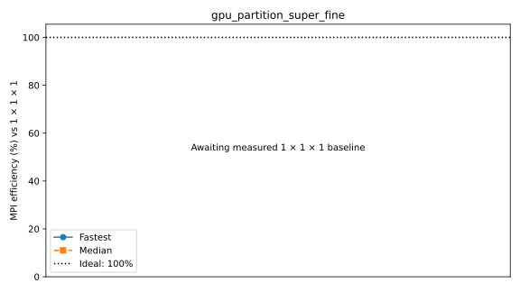

# Full benchmark suite

NonhydrostaticModel; rigid lid; LatitudeLongitudeGrid without bathymetry; Float64, WENO7 momentum/tracers, ScalarDiffusivity (ν=1e-3, κ=1e-5 m²/s), T/S, RungeKutta3. Pressure: ConjugateGradientPoissonSolver; traditional spherical Coriolis and TEOS10 buoyancy.
Δt=60 s on the standard grids; larger horizontal grids reduce Δt in proportion to grid spacing (see each configuration).
No free-surface substeps or extended free-surface halos; two untimed steps and five ten-step windows.
One MPI rank per CPU core or GPU, one Julia computation thread per rank. Hydrostatic geometry bounds are retained to match partitions between models.
Window boundaries synchronize MPI ranks and GPUs. Fastest/median statistics use the maximum across ranks.
Strong efficiency = baseline time × baseline ranks / (time × ranks); weak efficiency = baseline time / time.
Standard baselines use one rank; the larger GPU grids use 4 and 16 ranks. Missing baselines have no efficiency estimate.
Reference lines show ideal inverse-rank strong timing, constant weak timing, and 100% efficiency.
Resolution plots show previous-grid / next-grid time; doubling each grid dimension ideally gives 1/8.
Profiled timings are separate; Nsight captures CUDA/NVTX/MPI after warmup. Kernel shares sum durations across ranks, not elapsed wall time.

## cpu_mpi_scaling_super_fine

Highest completed count: **0 ranks**.

| Case | Ranks | Partition | Global resolution | Grid type | State | Fastest s/step | Median s/step | Efficiency fastest / median | Details |
|---|---:|---|---|---|---|---:|---:|---|---|
| 1_ranks | 1 | 1x1x1 | 1440x720x200 | LatitudeLongitudeGrid | RUNNING | — | — | — | Exit 0:0; None |
| 3_ranks | 3 | 3x1x1 | 1440x720x200 | LatitudeLongitudeGrid | RUNNING | — | — | — | Exit 0:0; None |
| 6_ranks | 6 | 3x2x1 | 1440x720x200 | LatitudeLongitudeGrid | RUNNING | — | — | — | Exit 0:0; None |
| 12_ranks | 12 | 4x3x1 | 1440x720x200 | LatitudeLongitudeGrid | RUNNING | — | — | — | Exit 0:0; None |
| 24_ranks | 24 | 6x4x1 | 1440x720x200 | LatitudeLongitudeGrid | RUNNING | — | — | — | Exit 0:0; None |
| 48_ranks | 48 | 8x6x1 | 1440x720x200 | LatitudeLongitudeGrid | RUNNING | — | — | — | Exit 0:0; None |
| 96_ranks | 96 | 12x8x1 | 1440x720x200 | LatitudeLongitudeGrid | RUNNING | — | — | — | Exit 0:0; None |
| 192_ranks | 192 | 16x12x1 | 1440x720x200 | LatitudeLongitudeGrid | TIMEOUT | — | — | — | Exit 0:0; None |
| 384_ranks | 384 | 24x16x1 | 1440x720x200 | LatitudeLongitudeGrid | TIMEOUT | — | — | — | Exit 0:0; None |
| 768_ranks | 768 | 32x24x1 | 1440x720x200 | LatitudeLongitudeGrid | TIMEOUT | — | — | — | Exit 0:0; None |
| 1536_ranks | 1536 | 32x48x1 | 1440x720x200 | LatitudeLongitudeGrid | TIMEOUT | — | — | — | Exit 0:0; None |
| 3072_ranks | 3072 | 64x48x1 | 1440x720x200 | LatitudeLongitudeGrid | PENDING | — | — | — | (Priority); estimated start 2026-10-13T05:30:18 (scheduler timezone) |
| 6144_ranks | 6144 | 96x64x1 | 1440x720x200 | LatitudeLongitudeGrid | RUNNING | — | — | — | Exit 0:0; None |
| 12288_ranks | 12288 | 128x96x1 | 1440x720x200 | LatitudeLongitudeGrid | RUNNING | — | — | — | Exit 0:0; None |
| 24576_ranks | 24576 |  | 1440x720x200 | LatitudeLongitudeGrid | GEOMETRY_LIMIT | — | — | — | 24576 ranks have no horizontal partition with at least 7 local cells per direction |
## gpu_scaling_super_fine

Highest completed count: **0 ranks**.

| Case | Ranks | Partition | Global resolution | Grid type | State | Fastest s/step | Median s/step | Efficiency fastest / median | Details |
|---|---:|---|---|---|---|---:|---:|---|---|
| 1_ranks | 1 | 1x1x1 | 1440x720x200 | LatitudeLongitudeGrid | PENDING | — | — | — | (Dependency); estimated start N/A (scheduler timezone) |
| 2_ranks | 2 | 2x1x1 | 1440x720x200 | LatitudeLongitudeGrid | PENDING | — | — | — | (Dependency); estimated start N/A (scheduler timezone) |
| 4_ranks | 4 | 2x2x1 | 1440x720x200 | LatitudeLongitudeGrid | PENDING | — | — | — | (Dependency); estimated start N/A (scheduler timezone) |
| 8_ranks | 8 | 4x2x1 | 1440x720x200 | LatitudeLongitudeGrid | PENDING | — | — | — | (Dependency); estimated start N/A (scheduler timezone) |
| 16_ranks | 16 | 4x4x1 | 1440x720x200 | LatitudeLongitudeGrid | PENDING | — | — | — | (Dependency); estimated start N/A (scheduler timezone) |
| 32_ranks | 32 | 8x4x1 | 1440x720x200 | LatitudeLongitudeGrid | PENDING | — | — | — | (Dependency); estimated start N/A (scheduler timezone) |
| 64_ranks | 64 | 8x8x1 | 1440x720x200 | LatitudeLongitudeGrid | PENDING | — | — | — | (Dependency); estimated start N/A (scheduler timezone) |
| 128_ranks | 128 | 16x8x1 | 1440x720x200 | LatitudeLongitudeGrid | PENDING | — | — | — | (Dependency); estimated start N/A (scheduler timezone) |
| 256_ranks | 256 | 16x16x1 | 1440x720x200 | LatitudeLongitudeGrid | PENDING | — | — | — | (Dependency); estimated start N/A (scheduler timezone) |
| 512_ranks | 512 | 32x16x1 | 1440x720x200 | LatitudeLongitudeGrid | RESOURCE_LIMIT | — | — | — | Requires 512; configured capacity is 264 |
## cpu_resolution

Highest completed count: **0 ranks**.

| Case | Ranks | Partition | Global resolution | Grid type | State | Fastest s/step | Median s/step | Efficiency fastest / median | Details |
|---|---:|---|---|---|---|---:|---:|---|---|
| default | 1 | 1x1x1 | 360x180x50 | LatitudeLongitudeGrid | RUNNING | — | — | — | Exit 0:0; None |
| fine | 1 | 1x1x1 | 720x360x100 | LatitudeLongitudeGrid | RUNNING | — | — | — | Exit 0:0; None |
| super_fine | 1 | 1x1x1 | 1440x720x200 | LatitudeLongitudeGrid | PENDING | — | — | — | (Priority); estimated start 2026-10-13T05:41:18 (scheduler timezone) |
## gpu_resolution

Highest completed count: **0 ranks**.

| Case | Ranks | Partition | Global resolution | Grid type | State | Fastest s/step | Median s/step | Efficiency fastest / median | Details |
|---|---:|---|---|---|---|---:|---:|---|---|
| default | 1 | 1x1x1 | 360x180x50 | LatitudeLongitudeGrid | PENDING | — | — | — | (Dependency); estimated start N/A (scheduler timezone) |
| fine | 1 | 1x1x1 | 720x360x100 | LatitudeLongitudeGrid | PENDING | — | — | — | (Dependency); estimated start N/A (scheduler timezone) |
| super_fine | 1 | 1x1x1 | 1440x720x200 | LatitudeLongitudeGrid | PENDING | — | — | — | (Dependency); estimated start N/A (scheduler timezone) |
## cpu_partition_cores_super_fine

Highest completed count: **0 ranks**.

| Case | Ranks | Partition | Global resolution | Grid type | State | Fastest s/step | Median s/step | Efficiency fastest / median | Details |
|---|---:|---|---|---|---|---:|---:|---|---|
| 192x1x1 | 192 | 192x1x1 | 1440x720x200 | LatitudeLongitudeGrid | TIMEOUT | — | — | — | Exit 0:0; None |
| 96x2x1 | 192 | 96x2x1 | 1440x720x200 | LatitudeLongitudeGrid | TIMEOUT | — | — | — | Exit 0:0; None |
| 64x3x1 | 192 | 64x3x1 | 1440x720x200 | LatitudeLongitudeGrid | TIMEOUT | — | — | — | Exit 0:0; None |
| 48x4x1 | 192 | 48x4x1 | 1440x720x200 | LatitudeLongitudeGrid | TIMEOUT | — | — | — | Exit 0:0; None |
| 32x6x1 | 192 | 32x6x1 | 1440x720x200 | LatitudeLongitudeGrid | TIMEOUT | — | — | — | Exit 0:0; None |
| 24x8x1 | 192 | 24x8x1 | 1440x720x200 | LatitudeLongitudeGrid | TIMEOUT | — | — | — | Exit 0:0; None |
| 16x12x1 | 192 | 16x12x1 | 1440x720x200 | LatitudeLongitudeGrid | TIMEOUT | — | — | — | Exit 0:0; None |
| 12x16x1 | 192 | 12x16x1 | 1440x720x200 | LatitudeLongitudeGrid | TIMEOUT | — | — | — | Exit 0:0; None |
| 8x24x1 | 192 | 8x24x1 | 1440x720x200 | LatitudeLongitudeGrid | TIMEOUT | — | — | — | Exit 0:0; None |
| 6x32x1 | 192 | 6x32x1 | 1440x720x200 | LatitudeLongitudeGrid | TIMEOUT | — | — | — | Exit 0:0; None |
| 4x48x1 | 192 | 4x48x1 | 1440x720x200 | LatitudeLongitudeGrid | TIMEOUT | — | — | — | Exit 0:0; None |
| 3x64x1 | 192 | 3x64x1 | 1440x720x200 | LatitudeLongitudeGrid | TIMEOUT | — | — | — | Exit 0:0; None |
| 2x96x1 | 192 | 2x96x1 | 1440x720x200 | LatitudeLongitudeGrid | TIMEOUT | — | — | — | Exit 0:0; None |
| 1x192x1 | 192 | 1x192x1 | 1440x720x200 | LatitudeLongitudeGrid | GEOMETRY_LIMIT | — | — | — | Partition [1, 192, 1] has fewer than 7 local cells per horizontal direction |
## gpu_nsight_scaling_super_fine

Highest completed count: **0 ranks**.

| Case | Ranks | Partition | Global resolution | Grid type | State | Fastest s/step | Median s/step | Efficiency fastest / median | Details |
|---|---:|---|---|---|---|---:|---:|---|---|
| 1_ranks | 1 | 1x1x1 | 1440x720x200 | LatitudeLongitudeGrid | PENDING | — | — | — | (Dependency); estimated start N/A (scheduler timezone) |
| 2_ranks | 2 | 2x1x1 | 1440x720x200 | LatitudeLongitudeGrid | PENDING | — | — | — | (Dependency); estimated start N/A (scheduler timezone) |
| 4_ranks | 4 | 2x2x1 | 1440x720x200 | LatitudeLongitudeGrid | PENDING | — | — | — | (Dependency); estimated start N/A (scheduler timezone) |
| 8_ranks | 8 | 4x2x1 | 1440x720x200 | LatitudeLongitudeGrid | PENDING | — | — | — | (Dependency); estimated start N/A (scheduler timezone) |
| 16_ranks | 16 | 4x4x1 | 1440x720x200 | LatitudeLongitudeGrid | PENDING | — | — | — | (Dependency); estimated start N/A (scheduler timezone) |
| 32_ranks | 32 | 8x4x1 | 1440x720x200 | LatitudeLongitudeGrid | PENDING | — | — | — | (Dependency); estimated start N/A (scheduler timezone) |
| 64_ranks | 64 | 8x8x1 | 1440x720x200 | LatitudeLongitudeGrid | PENDING | — | — | — | (Dependency); estimated start N/A (scheduler timezone) |
| 128_ranks | 128 | 16x8x1 | 1440x720x200 | LatitudeLongitudeGrid | PENDING | — | — | — | (Dependency); estimated start N/A (scheduler timezone) |
| 256_ranks | 256 | 16x16x1 | 1440x720x200 | LatitudeLongitudeGrid | PENDING | — | — | — | (Dependency); estimated start N/A (scheduler timezone) |
| 512_ranks | 512 | 32x16x1 | 1440x720x200 | LatitudeLongitudeGrid | RESOURCE_LIMIT | — | — | — | Requires 512; configured capacity is 264 |
## gpu_partition_super_fine

Highest completed count: **0 ranks**.

MPI efficiency awaits the measured 1 × 1 × 1 baseline.

| Case | Ranks | Partition | Global resolution | Grid type | State | Fastest s/step | Median s/step | Efficiency fastest / median | Details |
|---|---:|---|---|---|---|---:|---:|---|---|
| 1x1x1 | 1 | 1x1x1 | 1440x720x200 | LatitudeLongitudeGrid | PENDING | — | — | — | (Dependency); estimated start N/A (scheduler timezone) |
| 2x1x1 | 2 | 2x1x1 | 1440x720x200 | LatitudeLongitudeGrid | PENDING | — | — | — | (Dependency); estimated start N/A (scheduler timezone) |
| 1x2x1 | 2 | 1x2x1 | 1440x720x200 | LatitudeLongitudeGrid | PENDING | — | — | — | (Dependency); estimated start N/A (scheduler timezone) |
| 4x1x1 | 4 | 4x1x1 | 1440x720x200 | LatitudeLongitudeGrid | PENDING | — | — | — | (Dependency); estimated start N/A (scheduler timezone) |
| 2x2x1 | 4 | 2x2x1 | 1440x720x200 | LatitudeLongitudeGrid | PENDING | — | — | — | (Dependency); estimated start N/A (scheduler timezone) |
| 1x4x1 | 4 | 1x4x1 | 1440x720x200 | LatitudeLongitudeGrid | PENDING | — | — | — | (Dependency); estimated start N/A (scheduler timezone) |
| 8x1x1 | 8 | 8x1x1 | 1440x720x200 | LatitudeLongitudeGrid | PENDING | — | — | — | (Dependency); estimated start N/A (scheduler timezone) |
| 4x2x1 | 8 | 4x2x1 | 1440x720x200 | LatitudeLongitudeGrid | PENDING | — | — | — | (Dependency); estimated start N/A (scheduler timezone) |
| 2x4x1 | 8 | 2x4x1 | 1440x720x200 | LatitudeLongitudeGrid | PENDING | — | — | — | (Dependency); estimated start N/A (scheduler timezone) |
| 1x8x1 | 8 | 1x8x1 | 1440x720x200 | LatitudeLongitudeGrid | PENDING | — | — | — | (Dependency); estimated start N/A (scheduler timezone) |
| 16x1x1 | 16 | 16x1x1 | 1440x720x200 | LatitudeLongitudeGrid | PENDING | — | — | — | (Dependency); estimated start N/A (scheduler timezone) |
| 8x2x1 | 16 | 8x2x1 | 1440x720x200 | LatitudeLongitudeGrid | PENDING | — | — | — | (Dependency); estimated start N/A (scheduler timezone) |
| 4x4x1 | 16 | 4x4x1 | 1440x720x200 | LatitudeLongitudeGrid | PENDING | — | — | — | (Dependency); estimated start N/A (scheduler timezone) |
| 2x8x1 | 16 | 2x8x1 | 1440x720x200 | LatitudeLongitudeGrid | PENDING | — | — | — | (Dependency); estimated start N/A (scheduler timezone) |
| 1x16x1 | 16 | 1x16x1 | 1440x720x200 | LatitudeLongitudeGrid | PENDING | — | — | — | (Dependency); estimated start N/A (scheduler timezone) |
| 32x1x1 | 32 | 32x1x1 | 1440x720x200 | LatitudeLongitudeGrid | PENDING | — | — | — | (Dependency); estimated start N/A (scheduler timezone) |
| 16x2x1 | 32 | 16x2x1 | 1440x720x200 | LatitudeLongitudeGrid | PENDING | — | — | — | (Dependency); estimated start N/A (scheduler timezone) |
| 8x4x1 | 32 | 8x4x1 | 1440x720x200 | LatitudeLongitudeGrid | PENDING | — | — | — | (Dependency); estimated start N/A (scheduler timezone) |
| 4x8x1 | 32 | 4x8x1 | 1440x720x200 | LatitudeLongitudeGrid | PENDING | — | — | — | (Dependency); estimated start N/A (scheduler timezone) |
| 2x16x1 | 32 | 2x16x1 | 1440x720x200 | LatitudeLongitudeGrid | PENDING | — | — | — | (Dependency); estimated start N/A (scheduler timezone) |
| 1x32x1 | 32 | 1x32x1 | 1440x720x200 | LatitudeLongitudeGrid | GEOMETRY_LIMIT | — | — | — | Partition [1, 32, 1] has fewer than 23 local cells per horizontal direction |
| 64x1x1 | 64 | 64x1x1 | 1440x720x200 | LatitudeLongitudeGrid | GEOMETRY_LIMIT | — | — | — | Partition [64, 1, 1] has fewer than 23 local cells per horizontal direction |
| 32x2x1 | 64 | 32x2x1 | 1440x720x200 | LatitudeLongitudeGrid | PENDING | — | — | — | (Dependency); estimated start N/A (scheduler timezone) |
| 16x4x1 | 64 | 16x4x1 | 1440x720x200 | LatitudeLongitudeGrid | PENDING | — | — | — | (Dependency); estimated start N/A (scheduler timezone) |
| 8x8x1 | 64 | 8x8x1 | 1440x720x200 | LatitudeLongitudeGrid | PENDING | — | — | — | (Dependency); estimated start N/A (scheduler timezone) |
| 4x16x1 | 64 | 4x16x1 | 1440x720x200 | LatitudeLongitudeGrid | PENDING | — | — | — | (Dependency); estimated start N/A (scheduler timezone) |
| 2x32x1 | 64 | 2x32x1 | 1440x720x200 | LatitudeLongitudeGrid | GEOMETRY_LIMIT | — | — | — | Partition [2, 32, 1] has fewer than 23 local cells per horizontal direction |
| 1x64x1 | 64 | 1x64x1 | 1440x720x200 | LatitudeLongitudeGrid | GEOMETRY_LIMIT | — | — | — | Partition [1, 64, 1] has fewer than 23 local cells per horizontal direction |
## gpu_scaling_super_super_fine

Highest completed count: **0 ranks**.

| Case | Ranks | Partition | Global resolution | Grid type | State | Fastest s/step | Median s/step | Efficiency fastest / median | Details |
|---|---:|---|---|---|---|---:|---:|---|---|
| 4_ranks | 4 | 2x2x1 | 2880x1440x200 | LatitudeLongitudeGrid | PENDING | — | — | — | (Dependency); estimated start N/A (scheduler timezone) |
| 8_ranks | 8 | 4x2x1 | 2880x1440x200 | LatitudeLongitudeGrid | PENDING | — | — | — | (Dependency); estimated start N/A (scheduler timezone) |
| 16_ranks | 16 | 4x4x1 | 2880x1440x200 | LatitudeLongitudeGrid | PENDING | — | — | — | (Dependency); estimated start N/A (scheduler timezone) |
| 32_ranks | 32 | 8x4x1 | 2880x1440x200 | LatitudeLongitudeGrid | PENDING | — | — | — | (Dependency); estimated start N/A (scheduler timezone) |
| 64_ranks | 64 | 8x8x1 | 2880x1440x200 | LatitudeLongitudeGrid | PENDING | — | — | — | (Dependency); estimated start N/A (scheduler timezone) |
| 128_ranks | 128 | 16x8x1 | 2880x1440x200 | LatitudeLongitudeGrid | PENDING | — | — | — | (Dependency); estimated start N/A (scheduler timezone) |
| 256_ranks | 256 | 16x16x1 | 2880x1440x200 | LatitudeLongitudeGrid | PENDING | — | — | — | (Dependency); estimated start N/A (scheduler timezone) |
| 512_ranks | 512 | 32x16x1 | 2880x1440x200 | LatitudeLongitudeGrid | RESOURCE_LIMIT | — | — | — | Requires 512; configured capacity is 264 |
## gpu_scaling_super_super_super_fine

Highest completed count: **0 ranks**.

| Case | Ranks | Partition | Global resolution | Grid type | State | Fastest s/step | Median s/step | Efficiency fastest / median | Details |
|---|---:|---|---|---|---|---:|---:|---|---|
| 16_ranks | 16 | 4x4x1 | 5760x2880x200 | LatitudeLongitudeGrid | PENDING | — | — | — | (Dependency); estimated start N/A (scheduler timezone) |
| 32_ranks | 32 | 8x4x1 | 5760x2880x200 | LatitudeLongitudeGrid | PENDING | — | — | — | (Dependency); estimated start N/A (scheduler timezone) |
| 64_ranks | 64 | 8x8x1 | 5760x2880x200 | LatitudeLongitudeGrid | PENDING | — | — | — | (Dependency); estimated start N/A (scheduler timezone) |
| 128_ranks | 128 | 16x8x1 | 5760x2880x200 | LatitudeLongitudeGrid | PENDING | — | — | — | (Dependency); estimated start N/A (scheduler timezone) |
| 256_ranks | 256 | 16x16x1 | 5760x2880x200 | LatitudeLongitudeGrid | PENDING | — | — | — | (Dependency); estimated start N/A (scheduler timezone) |
| 512_ranks | 512 | 32x16x1 | 5760x2880x200 | LatitudeLongitudeGrid | RESOURCE_LIMIT | — | — | — | Requires 512; configured capacity is 264 |
## gpu_weak_scaling_super_fine

Highest completed count: **0 ranks**.

| Case | Ranks | Partition | Global resolution | Grid type | State | Fastest s/step | Median s/step | Efficiency fastest / median | Details |
|---|---:|---|---|---|---|---:|---:|---|---|
| 1_ranks | 1 | 1x1x1 | 1440x720x200 | LatitudeLongitudeGrid | PENDING | — | — | — | (Dependency); estimated start N/A (scheduler timezone) |
| 4_ranks | 4 | 2x2x1 | 2880x1440x200 | LatitudeLongitudeGrid | PENDING | — | — | — | (Dependency); estimated start N/A (scheduler timezone) |
| 16_ranks | 16 | 4x4x1 | 5760x2880x200 | LatitudeLongitudeGrid | PENDING | — | — | — | (Dependency); estimated start N/A (scheduler timezone) |
| 64_ranks | 64 | 8x8x1 | 11520x5760x200 | LatitudeLongitudeGrid | PENDING | — | — | — | (Dependency); estimated start N/A (scheduler timezone) |
| 256_ranks | 256 | 16x16x1 | 23040x11520x200 | LatitudeLongitudeGrid | PENDING | — | — | — | (Dependency); estimated start N/A (scheduler timezone) |
| 1024_ranks | 1024 | 32x32x1 | 46080x23040x200 | LatitudeLongitudeGrid | RESOURCE_LIMIT | — | — | — | Requires 1024; configured capacity is 264 |

## GPU scaling comparison (DRAC table format)

Reference: Oceananigans-DRAC/docs/drac.md, section 8. These are Rorqual measurements, not the reference’s Nibi timings.
This suite uses five ten-step windows; the reference uses five 100-step windows. Tables use median seconds per step.
LatitudeLongitudeGrid; partitions are Px × Py × Pz. Nodes are measured from rank placement.
Throughput = global interior cells / median step time. Memory is maximum device-used GiB across ranks after timing, including CUDA context and buffers; it is not peak memory.
Missing memory measurements and unfinished timings are shown as —.

### Strong scaling

Strong efficiency = baseline time × baseline GPUs / (measured time × GPUs); ideal = 100%. Baselines: super_fine 1 GPU, super_super_fine 4 GPUs, super_super_super_fine 16 GPUs.

| Grid | Global resolution (cells) | GPUs | Nodes | Partition | Δt (s) | Median s/step | Efficiency | Throughput (cells/s) | Memory/GPU (GiB) | State |
|---|---|---:|---:|---|---:|---:|---:|---:|---:|---|
| super_fine | 1440 × 720 × 200 (207,360,000) | 1 | — | 1 × 1 × 1 | 60 | — | — | — | — | PENDING |
| super_fine | 1440 × 720 × 200 (207,360,000) | 2 | — | 2 × 1 × 1 | 60 | — | — | — | — | PENDING |
| super_fine | 1440 × 720 × 200 (207,360,000) | 4 | — | 2 × 2 × 1 | 60 | — | — | — | — | PENDING |
| super_fine | 1440 × 720 × 200 (207,360,000) | 8 | — | 4 × 2 × 1 | 60 | — | — | — | — | PENDING |
| super_fine | 1440 × 720 × 200 (207,360,000) | 16 | — | 4 × 4 × 1 | 60 | — | — | — | — | PENDING |
| super_fine | 1440 × 720 × 200 (207,360,000) | 32 | — | 8 × 4 × 1 | 60 | — | — | — | — | PENDING |
| super_fine | 1440 × 720 × 200 (207,360,000) | 64 | — | 8 × 8 × 1 | 60 | — | — | — | — | PENDING |
| super_fine | 1440 × 720 × 200 (207,360,000) | 128 | — | 16 × 8 × 1 | 60 | — | — | — | — | PENDING |
| super_fine | 1440 × 720 × 200 (207,360,000) | 256 | — | 16 × 16 × 1 | 60 | — | — | — | — | PENDING |
| super_super_fine | 2880 × 1440 × 200 (829,440,000) | 4 | — | 2 × 2 × 1 | 30 | — | — | — | — | PENDING |
| super_super_fine | 2880 × 1440 × 200 (829,440,000) | 8 | — | 4 × 2 × 1 | 30 | — | — | — | — | PENDING |
| super_super_fine | 2880 × 1440 × 200 (829,440,000) | 16 | — | 4 × 4 × 1 | 30 | — | — | — | — | PENDING |
| super_super_fine | 2880 × 1440 × 200 (829,440,000) | 32 | — | 8 × 4 × 1 | 30 | — | — | — | — | PENDING |
| super_super_fine | 2880 × 1440 × 200 (829,440,000) | 64 | — | 8 × 8 × 1 | 30 | — | — | — | — | PENDING |
| super_super_fine | 2880 × 1440 × 200 (829,440,000) | 128 | — | 16 × 8 × 1 | 30 | — | — | — | — | PENDING |
| super_super_fine | 2880 × 1440 × 200 (829,440,000) | 256 | — | 16 × 16 × 1 | 30 | — | — | — | — | PENDING |
| super_super_super_fine | 5760 × 2880 × 200 (3,317,760,000) | 16 | — | 4 × 4 × 1 | 15 | — | — | — | — | PENDING |
| super_super_super_fine | 5760 × 2880 × 200 (3,317,760,000) | 32 | — | 8 × 4 × 1 | 15 | — | — | — | — | PENDING |
| super_super_super_fine | 5760 × 2880 × 200 (3,317,760,000) | 64 | — | 8 × 8 × 1 | 15 | — | — | — | — | PENDING |
| super_super_super_fine | 5760 × 2880 × 200 (3,317,760,000) | 128 | — | 16 × 8 × 1 | 15 | — | — | — | — | PENDING |
| super_super_super_fine | 5760 × 2880 × 200 (3,317,760,000) | 256 | — | 16 × 16 × 1 | 15 | — | — | — | — | PENDING |

### Weak scaling

Weak efficiency = one-GPU baseline time / measured time; ideal = 100%. Interior cells/GPU = 207,360,000.

| Grid | Global resolution (cells) | GPUs | Nodes | Partition | Δt (s) | Median s/step | Efficiency | Throughput (cells/s) | Memory/GPU (GiB) | State |
|---|---|---:|---:|---|---:|---:|---:|---:|---:|---|
| super_fine | 1440 × 720 × 200 (207,360,000) | 1 | — | 1 × 1 × 1 | 60 | — | — | — | — | PENDING |
| weak_4_ranks | 2880 × 1440 × 200 (829,440,000) | 4 | — | 2 × 2 × 1 | 30 | — | — | — | — | PENDING |
| weak_16_ranks | 5760 × 2880 × 200 (3,317,760,000) | 16 | — | 4 × 4 × 1 | 15 | — | — | — | — | PENDING |
| weak_64_ranks | 11520 × 5760 × 200 (13,271,040,000) | 64 | — | 8 × 8 × 1 | 7.5 | — | — | — | — | PENDING |
| weak_256_ranks | 23040 × 11520 × 200 (53,084,160,000) | 256 | — | 16 × 16 × 1 | 3.75 | — | — | — | — | PENDING |

