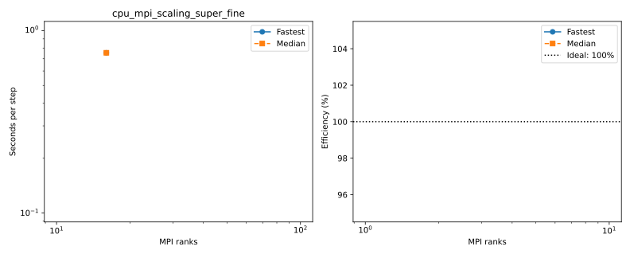

# Benchmark suite

NonhydrostaticModel; rigid lid; LatitudeLongitudeGrid without bathymetry; Float64, WENO7 momentum/tracers, ScalarDiffusivity (ν=1e-3, κ=1e-5 m²/s), T/S, RungeKutta3. Pressure: ConjugateGradientPoissonSolver; traditional spherical Coriolis and TEOS10 buoyancy.
Δt=60 s on the standard grids; larger horizontal grids reduce Δt in proportion to grid spacing (see each configuration).
No free-surface substeps or extended free-surface halos.
Actual timing protocols: 2 untimed steps, 1 windows of 1 steps.
One MPI rank per CPU core or GPU, one Julia computation thread per rank. Hydrostatic geometry bounds are retained to match partitions between models.
Window boundaries synchronize MPI ranks and GPUs. Fastest/median statistics use the maximum across ranks.
Strong efficiency = baseline time × baseline ranks / (time × ranks); weak efficiency = baseline time / time.
Standard baselines use one rank; the larger GPU grids use 4 and 16 ranks. Missing baselines have no efficiency estimate.
Reference lines show ideal inverse-rank strong timing, constant weak timing, and 100% efficiency.
Resolution plots show previous-grid / next-grid time; doubling each grid dimension ideally gives 1/8.
Profiled timings are separate; Nsight captures CUDA/NVTX/MPI after warmup. Kernel shares sum durations across ranks, not elapsed wall time.

## cpu_mpi_scaling_super_fine

Highest completed count: **16 ranks**.

| Case | Ranks | Partition | Global resolution | Grid type | State | Fastest s/step | Median s/step | Efficiency fastest / median | Details |
|---|---:|---|---|---|---|---:|---:|---|---|
| smoke_16_diagonal | 16 | 4x4x1 | 72x36x200 | LatitudeLongitudeGrid | FAILED | — | — | — | Execution/export exit 1; see job.out and rank logs |
| smoke_16_columnwise | 16 | 4x4x1 | 72x36x200 | LatitudeLongitudeGrid | COMPLETED | 0.754874 | 0.754874 | — | Rank results, finite fields and resource placement verified |
| super_fine_192_diagonal | 192 | 16x12x1 | 1440x720x200 | LatitudeLongitudeGrid | FAILED | — | — | — | Execution/export exit 1; see job.out and rank logs |
| super_fine_192_columnwise | 192 | 16x12x1 | 1440x720x200 | LatitudeLongitudeGrid | FAILED | — | — | — | Execution/export exit 1; see job.out and rank logs |

[smoke_16_columnwise configuration](cpu_mpi_scaling_super_fine/smoke_16_columnwise/configuration.md): local resolution **18–18 × 9–9 × 200**, rigid lid; free-surface substeps not applicable.

## Pressure convergence checks

Validation pilots are separate from production comparisons. Each new accepted result checks every pressure stage and the independently recomputed final residual.

| Case | Preconditioner | Recorded solves | Maximum iterations | Last residual / tolerance | Recomputed final residual | Outcome |
|---|---|---:|---:|---|---|---|
| cpu_mpi_scaling_super_fine/smoke_16_diagonal | DiagonallyDominantPreconditioner | 1 | 5000 | 3.388e-02 / 1.490e-08 | — | FAILED |
| cpu_mpi_scaling_super_fine/smoke_16_columnwise | ColumnwiseTridiagonalPreconditioner | 10 | 4606 | 1.138e-08 / 1.490e-08 | — | COMPLETED |
| cpu_mpi_scaling_super_fine/super_fine_192_diagonal | DiagonallyDominantPreconditioner | 1 | 5000 | 3.605e-02 / 1.490e-08 | — | FAILED |
| cpu_mpi_scaling_super_fine/super_fine_192_columnwise | ColumnwiseTridiagonalPreconditioner | 1 | 5000 | 2.862e-02 / 1.490e-08 | — | FAILED |
