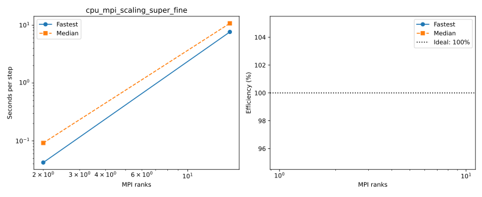

# Full benchmark suite

NonhydrostaticModel; rigid lid; LatitudeLongitudeGrid without bathymetry; Float64, WENO7 momentum/tracers, ScalarDiffusivity (ν=1e-3, κ=1e-5 m²/s), T/S, RungeKutta3. Pressure: ConjugateGradientPoissonSolver; traditional spherical Coriolis and TEOS10 buoyancy.
Δt=60 s on the standard grids; larger horizontal grids reduce Δt in proportion to grid spacing (see each configuration).
No free-surface substeps or extended free-surface halos; two untimed steps and five ten-step windows.
One MPI rank per CPU core or GPU, one Julia computation thread per rank. Hydrostatic geometry bounds are retained to match partitions between models.
Window boundaries synchronize MPI ranks and GPUs. Fastest/median statistics use the maximum across ranks.
Strong efficiency = baseline time × baseline ranks / (time × ranks); weak efficiency = baseline time / time.
Standard baselines use one rank; the larger GPU grids use 4 and 16 ranks. Missing baselines have no efficiency estimate.
Reference lines show ideal inverse-rank strong timing, constant weak timing, and 100% efficiency.
Resolution plots show previous-grid / next-grid time; doubling each grid dimension ideally gives 1/8.
Profiled timings are separate; Nsight captures CUDA/NVTX/MPI after warmup. Kernel shares sum durations across ranks, not elapsed wall time.

## cpu_mpi_scaling_super_fine

Highest completed count: **16 ranks**.

| Case | Ranks | Partition | Global resolution | Grid type | State | Fastest s/step | Median s/step | Efficiency fastest / median | Details |
|---|---:|---|---|---|---|---:|---:|---|---|
| 2_ranks | 2 | 2x1x1 | 72x36x8 | LatitudeLongitudeGrid | COMPLETED | 0.042401 | 0.092381 | — | Rank results, finite fields and resource placement verified |
| 16_ranks_200_levels | 16 | 4x4x1 | 72x36x200 | LatitudeLongitudeGrid | COMPLETED | 7.633759 | 10.754958 | — | Rank results, finite fields and resource placement verified |

[2_ranks configuration](cpu_mpi_scaling_super_fine/2_ranks/configuration.md): local resolution **36–36 × 36–36 × 8**, rigid lid; free-surface substeps not applicable.

[16_ranks_200_levels configuration](cpu_mpi_scaling_super_fine/16_ranks_200_levels/configuration.md): local resolution **18–18 × 9–9 × 200**, rigid lid; free-surface substeps not applicable.
## gpu_scaling_super_fine

Highest completed count: **0 ranks**.

| Case | Ranks | Partition | Global resolution | Grid type | State | Fastest s/step | Median s/step | Efficiency fastest / median | Details |
|---|---:|---|---|---|---|---:|---:|---|---|
| 2_ranks | 2 | 2x1x1 | 72x36x200 | LatitudeLongitudeGrid | CANCELLED | — | — | — | Replaced before execution by shorter functional validation in 2026-10-13_cpu_gpu_validation; original submission preserved |

## GPU scaling comparison (DRAC table format)

Reference: Oceananigans-DRAC/docs/drac.md, section 8. These are Rorqual measurements, not the reference’s Nibi timings.
This suite uses five ten-step windows; the reference uses five 100-step windows. Tables use median seconds per step.
LatitudeLongitudeGrid; partitions are Px × Py × Pz. Nodes are measured from rank placement.
Throughput = global interior cells / median step time. Memory is maximum device-used GiB across ranks after timing, including CUDA context and buffers; it is not peak memory.
Missing memory measurements and unfinished timings are shown as —.

### Strong scaling

Strong efficiency = baseline time × baseline GPUs / (measured time × GPUs); ideal = 100%. Baselines: super_fine 1 GPU, super_super_fine 4 GPUs, super_super_super_fine 16 GPUs.

| Grid | Global resolution (cells) | GPUs | Nodes | Partition | Δt (s) | Median s/step | Efficiency | Throughput (cells/s) | Memory/GPU (GiB) | State |
|---|---|---:|---:|---|---:|---:|---:|---:|---:|---|
| smoke | 72 × 36 × 200 (518,400) | 2 | — | 2 × 1 × 1 | 60 | — | — | — | — | CANCELLED |

