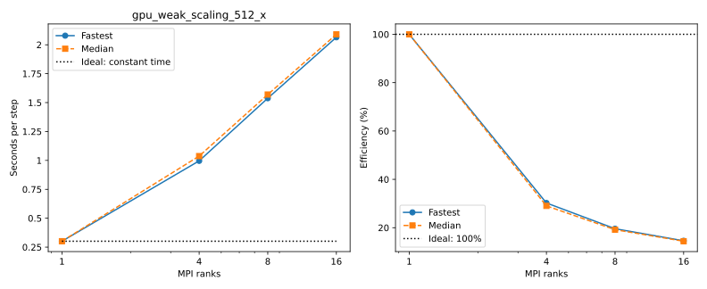

# baseline: gpu_weak_scaling_512_x

Latest accepted measurement for each case. Configuration links record the actual grid, partition, numerical methods, timing protocol and validation limits.

| Case | MPI ranks | Fastest s/step | Median s/step | Validation |
|---|---:|---:|---:|---|
| [1_ranks](1_ranks/configuration.md) | 1 | 0.301069 | 0.301131 | Current suite checks |
| [4_ranks](4_ranks/configuration.md) | 4 | 0.996129 | 1.037267 | Current suite checks |
| [8_ranks](8_ranks/configuration.md) | 8 | 1.537642 | 1.569627 | Current suite checks |
| [16_ranks](16_ranks/configuration.md) | 16 | 2.064788 | 2.090320 | Current suite checks |
| [2_ranks](2_ranks/configuration.md) | 2 | 0.751773 | 0.751905 | Current suite checks |
