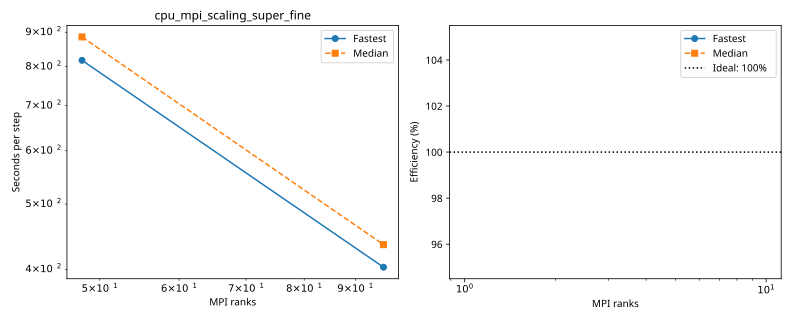

# dagger: cpu_mpi_scaling_super_fine

Latest accepted measurement for each case. Configuration links record the actual grid, partition, numerical methods, timing protocol and validation limits.

| Case | MPI ranks | Fastest s/step | Median s/step | Validation |
|---|---:|---:|---:|---|
| [96_ranks](96_ranks/configuration.md) | 96 | 402.884187 | 435.238376 | Current suite checks |
| [48_ranks](48_ranks/configuration.md) | 48 | 817.456004 | 885.570929 | Current suite checks |
