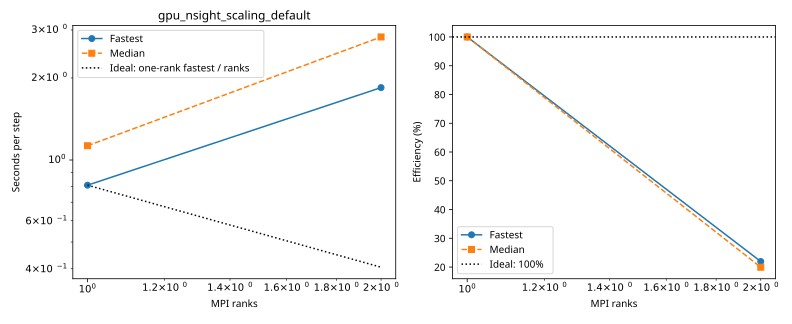
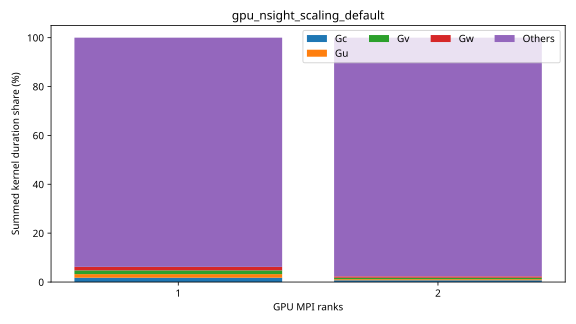

# baseline: gpu_nsight_scaling_default

Latest accepted measurement for each case. Configuration links record the actual grid, partition, numerical methods, timing protocol and validation limits.

| Case | MPI ranks | Fastest s/step | Median s/step | Validation |
|---|---:|---:|---:|---|
| [1_ranks](1_ranks/configuration.md) | 1 | 0.808531 | 1.127963 | Current suite checks |
| [2_ranks](2_ranks/configuration.md) | 2 | 1.843828 | 2.828368 | Current suite checks |
| [4_ranks](4_ranks/configuration.md) | 4 | 1.883249 | 2.861755 | Current suite checks |
