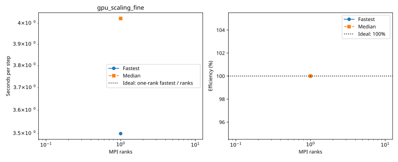

# baseline: gpu_scaling_fine

Latest accepted measurement for each case. Configuration links record the actual grid, partition, numerical methods, timing protocol and validation limits.

| Case | MPI ranks | Fastest s/step | Median s/step | Validation |
|---|---:|---:|---:|---|
| [1_ranks](1_ranks/configuration.md) | 1 | 3.499310 | 4.023600 | Current suite checks |
| [2_ranks](2_ranks/configuration.md) | 2 | 7.418771 | 8.388280 | Current suite checks |
| [4_ranks](4_ranks/configuration.md) | 4 | 4.423683 | 4.997257 | Current suite checks |
