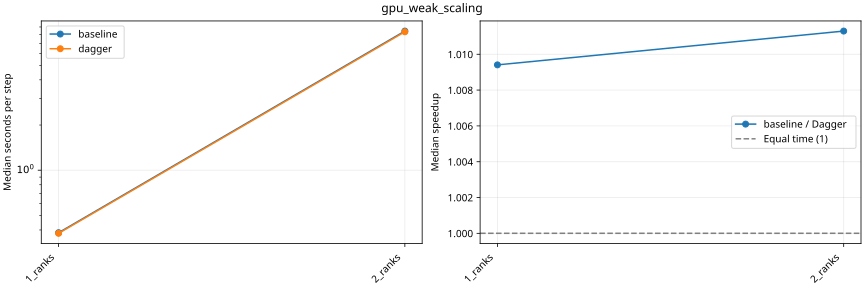
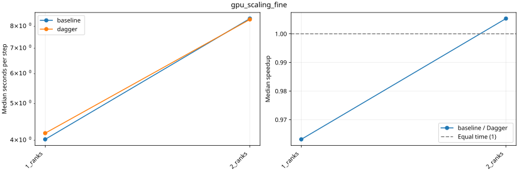
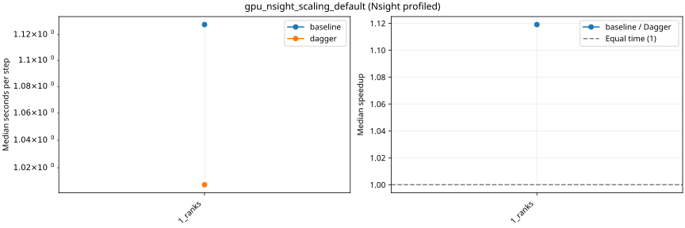
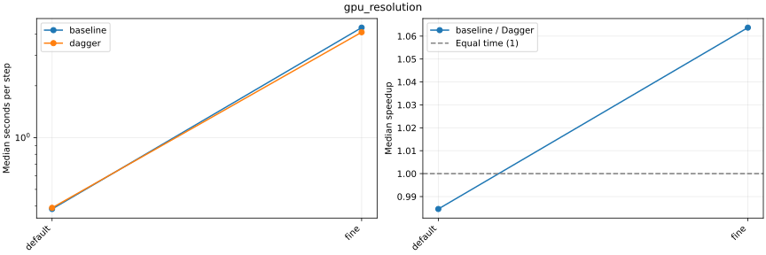

# Rondeau: nonhydrostatic baseline versus Dagger

For MPI series, Dagger submits one task per timing window, restricted to the current MPI process and its sole Julia computation thread. Oceananigans retains its existing MPI domain decomposition. Both paths synchronize CUDA before completing a window.

In gpu_ensemble, four independent single-GPU simulations run concurrently. Dagger schedules four complete simulations; the baseline uses four concurrent Distributed calls. Ensemble speedups compare total timed makespan and dispatch-to-completion time.

Speedup = baseline seconds per step / Dagger seconds per step. Above 1 favors Dagger; the equal-time reference is 1. Fastest and median timings are the maximum rank statistic. Only completed, validated pairs with matching configurations have ratios.

Nsight timings are compared only against the matching profiled variant. Shared-machine activity can affect timings; these are paired runs, not exclusive-node measurements.

Raw study and execution logs: `/local_scratch/ajtse/benchmark_studies/non_hydrostatic_models/2026-10-23-rondeau-small/rondeau`.

[Baseline records](baseline/plot.md) · [Dagger records](dagger/plot.md) · [All outcomes as CSV](comparison.csv)

Requested GPU weak-scaling sequence: 360 × 180 × 50 on 1 GPU, 720 × 360 × 100 on 2 GPUs, and 1440 × 720 × 200 on 4 GPUs. Cells/GPU are 3,240,000, 12,960,000 and 51,840,000: this increases work per GPU. Efficiency uses a linear cell-count reference, not constant-work weak efficiency.

## gpu_weak_scaling

| Case | Resolution / partition | Baseline outcome | Dagger outcome | Median s/step baseline / Dagger | Speedup |
|---|---|---|---|---:|---:|
| 1_ranks | 360x180x50 / 1x1x1 | COMPLETED | COMPLETED | 0.383486 / 0.379911 | 1.0094 |
| 2_ranks | 720x360x100 / 2x1x1 | COMPLETED | COMPLETED | 8.45362 / 8.35918 | 1.0113 |
| 4_ranks | 1440x720x200 / 2x2x1 | FAILED | FAILED | — | — |

4_ranks: baseline: Execution failed; ERROR: ERROR: ERROR: LoadError: LoadError: LoadError: ERROR: LoadError: Recomputed pressure residual exceeds toleranceRecomputed pressure residual exceeds tolerance; dagger: Execution failed; ERROR: LoadError: ERROR: ERROR: ERROR: LoadError: LoadError: LoadError: Recomputed pressure residual exceeds toleranceRecomputed pressure residual exceeds tolerance

## gpu_scaling_fine

| Case | Resolution / partition | Baseline outcome | Dagger outcome | Median s/step baseline / Dagger | Speedup |
|---|---|---|---|---:|---:|
| 1_ranks | 720x360x100 / 1x1x1 | COMPLETED | COMPLETED | 4.0236 / 4.1777 | 0.9631 |
| 2_ranks | 720x360x100 / 2x1x1 | COMPLETED | COMPLETED | 8.38828 / 8.34384 | 1.0053 |
| 4_ranks | 720x360x100 / 2x2x1 | COMPLETED | COMPLETED | 4.99726 / 5.06977 | 0.9857 |

## gpu_nsight_scaling_default

| Case | Resolution / partition | Baseline outcome | Dagger outcome | Median s/step baseline / Dagger | Speedup |
|---|---|---|---|---:|---:|
| 1_ranks | 360x180x50 / 1x1x1 | COMPLETED | COMPLETED | 1.12796 / 1.008 | 1.1190 |
| 2_ranks | 360x180x50 / 2x1x1 | COMPLETED | COMPLETED | 2.82837 / 2.54077 | 1.1132 |
| 4_ranks | 360x180x50 / 2x2x1 | COMPLETED | COMPLETED | 2.86175 / 2.78155 | 1.0288 |

## gpu_resolution

| Case | Resolution / partition | Baseline outcome | Dagger outcome | Median s/step baseline / Dagger | Speedup |
|---|---|---|---|---:|---:|
| default | 360x180x50 / 1x1x1 | COMPLETED | COMPLETED | 0.384814 / 0.390843 | 0.9846 |
| fine | 720x360x100 / 1x1x1 | COMPLETED | COMPLETED | 4.35142 / 4.09083 | 1.0637 |
| super_fine | 1440x720x200 / 1x1x1 | OUT_OF_MEMORY | OUT_OF_MEMORY | — | — |

super_fine: baseline: Execution failed; ERROR: LoadError: Out of GPU memory trying to allocate 1.702 GiB; dagger: Execution failed; ERROR: LoadError: Out of GPU memory trying to allocate 1.702 GiB

## gpu_ensemble

Four independent models run concurrently on four GPUs. Each resolution is per model, with partition 1 × 1 × 1 and one MPI rank per model. Timed makespan covers all four 50-step timing blocks after a common post-warmup start gate. Dispatch time also includes construction, compilation, warmup and validation. Speedup = baseline / Dagger; equal time = 1. One ensemble batch is measured per variant and resolution.

| Resolution per simulation | GPUs | Baseline / Dagger outcome | Timed makespan (s), baseline / Dagger | Timed speedup | Dispatch time (s), baseline / Dagger | Dispatch speedup |
|---|---:|---|---:|---:|---:|---:|
| 360 × 180 × 50 | 4 | PLANNED / PLANNED | — | — | — | — |

baseline: ; dagger:
| 720 × 360 × 100 | 4 | PLANNED / PLANNED | — | — | — | — |

baseline: ; dagger:

