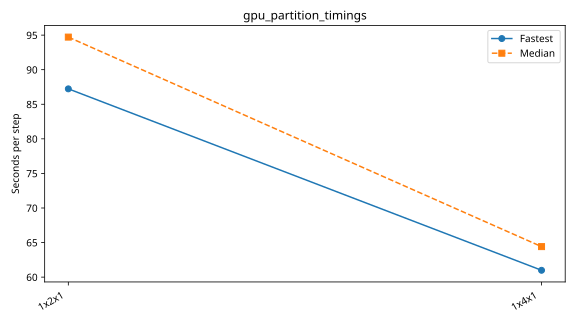

# dagger benchmarks

Each series folder contains its configurations, measurements and provenance. Only completed measurements appear in timing tables and plots.

| Series | Completed cases | Report |
|---|---:|---|
| `gpu_partition_super_fine` | 3 | [Details](gpu_partition_super_fine/plot.md) |
| `gpu_resolution` | 2 | [Details](gpu_resolution/plot.md) |

## gpu_partition_super_fine

| Case | Ranks | Global resolution | Partition | Fastest / median s per step | Median MPI efficiency | Validation |
|---|---:|---|---|---:|---:|---|
| [1x2x1](gpu_partition_super_fine/1x2x1/configuration.md) | 2 | 1440 × 720 × 200 | 1 × 2 × 1 | 87.229127 / 94.713975 | — | Current suite checks |
| [1x4x1](gpu_partition_super_fine/1x4x1/configuration.md) | 4 | 1440 × 720 × 200 | 1 × 4 × 1 | 60.987246 / 64.411970 | — | Current suite checks |
| [4x1x1](gpu_partition_super_fine/4x1x1/configuration.md) | 4 | 1440 × 720 × 200 | 4 × 1 × 1 | 149.820548 / 151.927963 | — | Current suite checks |

## gpu_resolution

| Case | Ranks | Global resolution | Partition | Fastest / median s per step | Median MPI efficiency | Validation |
|---|---:|---|---|---:|---:|---|
| [default](gpu_resolution/default/configuration.md) | 1 | 360 × 180 × 50 | 1 × 1 × 1 | 1.301655 / 1.571387 | — | Current suite checks |
| [fine](gpu_resolution/fine/configuration.md) | 1 | 720 × 360 × 100 | 1 × 1 × 1 | 9.851031 / 11.325562 | — | Current suite checks |
