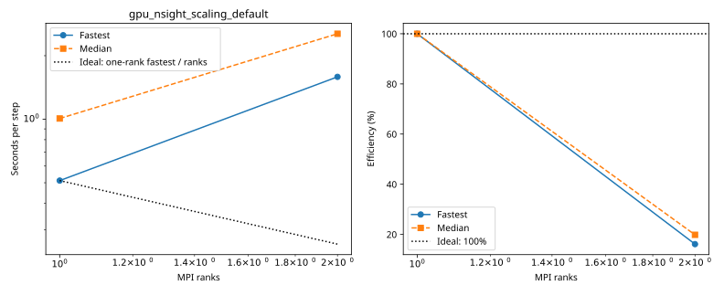
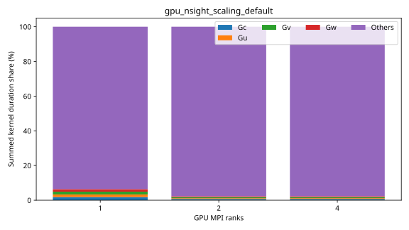

# dagger benchmarks

Each series folder contains its configurations, measurements and provenance. Only completed measurements appear in timing tables and plots.

| Series | Completed cases | Report |
|---|---:|---|
| `gpu_nsight_scaling_default` | 3 | [Details](gpu_nsight_scaling_default/plot.md) |
| `gpu_resolution` | 1 | [Details](gpu_resolution/plot.md) |
| `gpu_scaling_fine` | 3 | [Details](gpu_scaling_fine/plot.md) |
| `gpu_weak_scaling` | 2 | [Details](gpu_weak_scaling/plot.md) |

## gpu_nsight_scaling_default

| Case | Ranks | Global resolution | Partition | Fastest / median s per step | Median MPI efficiency | Validation |
|---|---:|---|---|---:|---:|---|
| [1_ranks](gpu_nsight_scaling_default/1_ranks/configuration.md) | 1 | 360 × 180 × 50 | 1 × 1 × 1 | 0.511977 / 1.008002 | 100.0% | Current suite checks |
| [2_ranks](gpu_nsight_scaling_default/2_ranks/configuration.md) | 2 | 360 × 180 × 50 | 2 × 1 × 1 | 1.587921 / 2.540774 | 19.8% | Current suite checks |
| [4_ranks](gpu_nsight_scaling_default/4_ranks/configuration.md) | 4 | 360 × 180 × 50 | 2 × 2 × 1 | 1.684666 / 2.781554 | 9.1% | Current suite checks |

## gpu_resolution

| Case | Ranks | Global resolution | Partition | Fastest / median s per step | Median MPI efficiency | Validation |
|---|---:|---|---|---:|---:|---|
| [default](gpu_resolution/default/configuration.md) | 1 | 360 × 180 × 50 | 1 × 1 × 1 | 0.372778 / 0.390843 | — | Current suite checks |

## gpu_scaling_fine

| Case | Ranks | Global resolution | Partition | Fastest / median s per step | Median MPI efficiency | Validation |
|---|---:|---|---|---:|---:|---|
| [1_ranks](gpu_scaling_fine/1_ranks/configuration.md) | 1 | 720 × 360 × 100 | 1 × 1 × 1 | 3.618161 / 4.177695 | 100.0% | Current suite checks |
| [2_ranks](gpu_scaling_fine/2_ranks/configuration.md) | 2 | 720 × 360 × 100 | 2 × 1 × 1 | 7.743739 / 8.343843 | 25.0% | Current suite checks |
| [4_ranks](gpu_scaling_fine/4_ranks/configuration.md) | 4 | 720 × 360 × 100 | 2 × 2 × 1 | 4.395863 / 5.069772 | 20.6% | Current suite checks |

## gpu_weak_scaling

| Case | Ranks | Global resolution | Partition | Fastest / median s per step | Median MPI efficiency | Validation |
|---|---:|---|---|---:|---:|---|
| [1_ranks](gpu_weak_scaling/1_ranks/configuration.md) | 1 | 360 × 180 × 50 | 1 × 1 × 1 | 0.341672 / 0.379911 | 100.0% | Current suite checks |
| [2_ranks](gpu_weak_scaling/2_ranks/configuration.md) | 2 | 720 × 360 × 100 | 2 × 1 × 1 | 7.510817 / 8.359179 | 18.2% | Current suite checks |
