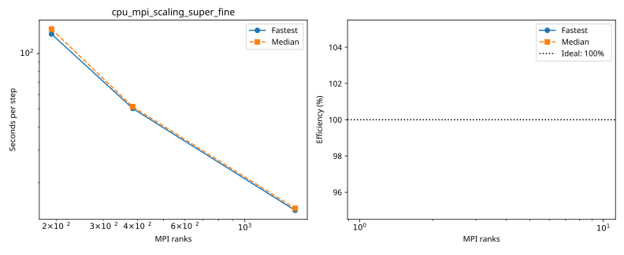

# rorqual: cpu_mpi_scaling_super_fine

Latest accepted measurement for each case. Configuration links record the actual grid, partition, numerical methods, timing protocol and validation limits.

| Case | MPI ranks | Fastest s/step | Median s/step | Validation |
|---|---:|---:|---:|---|
| [1536_ranks](1536_ranks/configuration.md) | 1536 | 14.147107 | 14.490786 | Current suite: rank completeness, finite fields, placement and timings checked |
| [192_ranks](192_ranks/configuration.md) | 192 | 127.564623 | 135.670963 | Current suite: rank completeness, finite fields, placement and timings checked |
| [384_ranks](384_ranks/configuration.md) | 384 | 50.417595 | 51.516729 | Current suite: rank completeness, finite fields, placement and timings checked |
