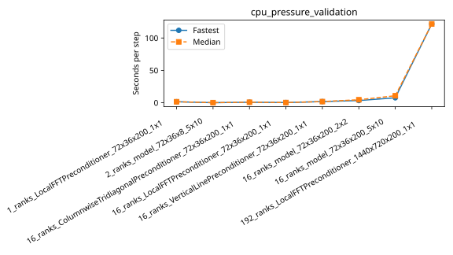

# rorqual: cpu_pressure_validation

Latest accepted measurement for each case. Configuration links record the actual grid, partition, numerical methods, timing protocol and validation limits.

| Case | MPI ranks | Fastest s/step | Median s/step | Validation |
|---|---:|---:|---:|---|
| [16_ranks_ColumnwiseTridiagonalPreconditioner_72x36x200_1x1](16_ranks_ColumnwiseTridiagonalPreconditioner_72x36x200_1x1/configuration.md) | 16 | 0.754874 | 0.754874 | Current suite: rank completeness, finite fields, placement and timings checked |
| [16_ranks_LocalFFTPreconditioner_72x36x200_1x1](16_ranks_LocalFFTPreconditioner_72x36x200_1x1/configuration.md) | 16 | 0.250728 | 0.250728 | Current suite: rank completeness, finite fields, placement and timings checked |
| [16_ranks_VerticalLinePreconditioner_72x36x200_1x1](16_ranks_VerticalLinePreconditioner_72x36x200_1x1/configuration.md) | 16 | 1.749642 | 1.749642 | Current suite: rank completeness, finite fields, placement and timings checked |
| [16_ranks_model_72x36x200_2x2](16_ranks_model_72x36x200_2x2/configuration.md) | 16 | 3.354035 | 4.578106 | Current suite: rank completeness, finite fields, placement and timings checked |
| [16_ranks_model_72x36x200_5x10](16_ranks_model_72x36x200_5x10/configuration.md) | 16 | 7.633759 | 10.754958 | Current suite: rank completeness, finite fields, placement and timings checked |
| [192_ranks_LocalFFTPreconditioner_1440x720x200_1x1](192_ranks_LocalFFTPreconditioner_1440x720x200_1x1/configuration.md) | 192 | 121.662908 | 121.662908 | Current suite: rank completeness, finite fields, placement and timings checked |
| [1_ranks_LocalFFTPreconditioner_72x36x200_1x1](1_ranks_LocalFFTPreconditioner_72x36x200_1x1/configuration.md) | 1 | 1.500630 | 1.500630 | Current suite: rank completeness, finite fields, placement and timings checked |
| [2_ranks_model_72x36x8_5x10](2_ranks_model_72x36x8_5x10/configuration.md) | 2 | 0.042401 | 0.092381 | Current suite: rank completeness, finite fields, placement and timings checked |
