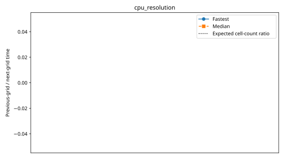

# rorqual: cpu_resolution

Latest accepted measurement for each case. Configuration links record the actual grid, partition, numerical methods, timing protocol and validation limits.

| Case | MPI ranks | Fastest s/step | Median s/step | Validation |
|---|---:|---:|---:|---|
| [default](default/configuration.md) | 1 | 225.153769 | 276.558927 | Current suite: rank completeness, finite fields, placement and timings checked |
