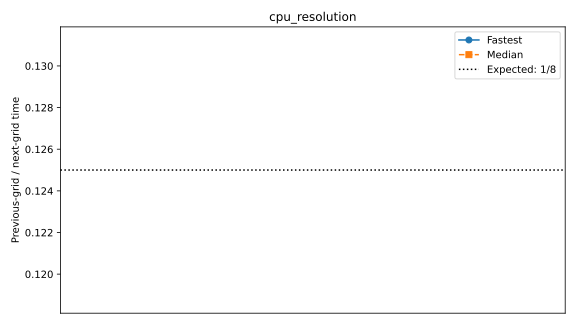

# Full benchmark suite

LatitudeLongitudeGrid without bathymetry; Float64, WENOVectorInvariantDefault, WENO7, CATKE, T/S, SplitRungeKutta3.
Δt=60 s; 30 requested free-surface substeps; two untimed steps and five ten-step windows.
One MPI rank per CPU core or GPU, one Julia computation thread per rank. CPU extended halos=false; GPU=true.
Window boundaries synchronize MPI ranks and GPUs. Fastest/median statistics use the maximum across ranks.
Efficiency uses the measured one-rank baseline for each scaling series. Missing baselines have no efficiency estimate.
Dashed reference lines show ideal inverse-rank timing and 100% MPI efficiency.
Resolution plots show previous-grid / next-grid time; doubling each grid dimension ideally gives 1/8.
Profiled timings are separate; Nsight captures CUDA/NVTX/MPI after warmup. Kernel shares sum durations across ranks, not elapsed wall time.

## cpu_mpi_scaling_super_fine

Highest completed count: **3072 ranks**.

| Case | Ranks | Partition | Global resolution | Grid type | State | Fastest s/step | Median s/step | Efficiency fastest / median | Details |
|---|---:|---|---|---|---|---:|---:|---|---|
| 1_ranks | 1 | 1x1x1 | 1440x720x200 | LatitudeLongitudeGrid | RUNNING | — | — | — | Exit 0:0; None |
| 3_ranks | 3 | 3x1x1 | 1440x720x200 | LatitudeLongitudeGrid | RUNNING | — | — | — | Exit 0:0; None |
| 6_ranks | 6 | 3x2x1 | 1440x720x200 | LatitudeLongitudeGrid | COMPLETED | 103.102502 | 103.291139 | — | Rank results, finite fields and resource placement verified |
| 12_ranks | 12 | 4x3x1 | 1440x720x200 | LatitudeLongitudeGrid | COMPLETED | 53.475571 | 53.536204 | — | Rank results, finite fields and resource placement verified |
| 24_ranks | 24 | 6x4x1 | 1440x720x200 | LatitudeLongitudeGrid | COMPLETED | 30.866122 | 33.370943 | — | Rank results, finite fields and resource placement verified |
| 48_ranks | 48 | 8x6x1 | 1440x720x200 | LatitudeLongitudeGrid | COMPLETED | 14.954807 | 15.022399 | — | Rank results, finite fields and resource placement verified |
| 96_ranks | 96 | 12x8x1 | 1440x720x200 | LatitudeLongitudeGrid | COMPLETED | 8.611579 | 8.640376 | — | Rank results, finite fields and resource placement verified |
| 192_ranks | 192 | 16x12x1 | 1440x720x200 | LatitudeLongitudeGrid | COMPLETED | 4.684070 | 4.746761 | — | Rank results, finite fields and resource placement verified |
| 384_ranks | 384 | 24x16x1 | 1440x720x200 | LatitudeLongitudeGrid | COMPLETED | 2.929167 | 3.067832 | — | Rank results, finite fields and resource placement verified |
| 768_ranks | 768 | 32x24x1 | 1440x720x200 | LatitudeLongitudeGrid | COMPLETED | 1.940831 | 2.146462 | — | Rank results, finite fields and resource placement verified |
| 1536_ranks | 1536 | 32x48x1 | 1440x720x200 | LatitudeLongitudeGrid | COMPLETED | 1.389463 | 1.621086 | — | Rank results, finite fields and resource placement verified |
| 3072_ranks | 3072 | 64x48x1 | 1440x720x200 | LatitudeLongitudeGrid | COMPLETED | 1.015510 | 1.330853 | — | Rank results, finite fields and resource placement verified |
| 6144_ranks | 6144 | 96x64x1 | 1440x720x200 | LatitudeLongitudeGrid | PENDING | — | — | — | (Nodes required for job are DOWN, DRAINED or reserved for jobs in higher priority partitions); estimated start 2026-10-08T12:29:19 (scheduler timezone) |
| 12288_ranks | 12288 | 128x96x1 | 1440x720x200 | LatitudeLongitudeGrid | RUNNING | — | — | — | Exit 0:0; None |
| 24576_ranks | 24576 |  | 1440x720x200 | LatitudeLongitudeGrid | GEOMETRY_LIMIT | — | — | — | 24576 ranks have no horizontal partition with at least 7 local cells per direction |

[6_ranks configuration](cpu_mpi_scaling_super_fine/6_ranks/configuration.md): local resolution **480–480 × 360–360 × 200**, retained free-surface substeps [21].

[12_ranks configuration](cpu_mpi_scaling_super_fine/12_ranks/configuration.md): local resolution **360–360 × 240–240 × 200**, retained free-surface substeps [21].

[24_ranks configuration](cpu_mpi_scaling_super_fine/24_ranks/configuration.md): local resolution **240–240 × 180–180 × 200**, retained free-surface substeps [21].

[48_ranks configuration](cpu_mpi_scaling_super_fine/48_ranks/configuration.md): local resolution **180–180 × 120–120 × 200**, retained free-surface substeps [21].

[96_ranks configuration](cpu_mpi_scaling_super_fine/96_ranks/configuration.md): local resolution **120–120 × 90–90 × 200**, retained free-surface substeps [21].

[192_ranks configuration](cpu_mpi_scaling_super_fine/192_ranks/configuration.md): local resolution **90–90 × 60–60 × 200**, retained free-surface substeps [21].

[384_ranks configuration](cpu_mpi_scaling_super_fine/384_ranks/configuration.md): local resolution **60–60 × 45–45 × 200**, retained free-surface substeps [21].

[768_ranks configuration](cpu_mpi_scaling_super_fine/768_ranks/configuration.md): local resolution **45–45 × 30–30 × 200**, retained free-surface substeps [21].

[1536_ranks configuration](cpu_mpi_scaling_super_fine/1536_ranks/configuration.md): local resolution **45–45 × 15–15 × 200**, retained free-surface substeps [21].

[3072_ranks configuration](cpu_mpi_scaling_super_fine/3072_ranks/configuration.md): local resolution **22–23 × 15–15 × 200**, retained free-surface substeps [21].
## cpu_resolution

Highest completed count: **1 ranks**.

| Case | Ranks | Partition | Global resolution | Grid type | State | Fastest s/step | Median s/step | Efficiency fastest / median | Details |
|---|---:|---|---|---|---|---:|---:|---|---|
| default | 1 | 1x1x1 | 360x180x50 | LatitudeLongitudeGrid | COMPLETED | 9.133294 | 9.150603 | — | Rank results, finite fields and resource placement verified |
| fine | 1 | 1x1x1 | 720x360x100 | LatitudeLongitudeGrid | COMPLETED | 71.099241 | 71.252001 | — | Rank results, finite fields and resource placement verified |
| super_fine | 1 | 1x1x1 | 1440x720x200 | LatitudeLongitudeGrid | RUNNING | — | — | — | Exit 0:0; None |

[default configuration](cpu_resolution/default/configuration.md): local resolution **360–360 × 180–180 × 50**, retained free-surface substeps [21].

[fine configuration](cpu_resolution/fine/configuration.md): local resolution **720–720 × 360–360 × 100**, retained free-surface substeps [21].
## cpu_partition_cores_super_fine

Highest completed count: **192 ranks**.

| Case | Ranks | Partition | Global resolution | Grid type | State | Fastest s/step | Median s/step | Efficiency fastest / median | Details |
|---|---:|---|---|---|---|---:|---:|---|---|
| 192x1x1 | 192 | 192x1x1 | 1440x720x200 | LatitudeLongitudeGrid | COMPLETED | 9.971960 | 10.203584 | — | Rank results, finite fields and resource placement verified |
| 96x2x1 | 192 | 96x2x1 | 1440x720x200 | LatitudeLongitudeGrid | COMPLETED | 6.686653 | 7.216247 | — | Rank results, finite fields and resource placement verified |
| 64x3x1 | 192 | 64x3x1 | 1440x720x200 | LatitudeLongitudeGrid | COMPLETED | 6.277318 | 6.426454 | — | Rank results, finite fields and resource placement verified |
| 48x4x1 | 192 | 48x4x1 | 1440x720x200 | LatitudeLongitudeGrid | COMPLETED | 5.778717 | 5.900243 | — | Rank results, finite fields and resource placement verified |
| 32x6x1 | 192 | 32x6x1 | 1440x720x200 | LatitudeLongitudeGrid | COMPLETED | 5.155393 | 5.173560 | — | Rank results, finite fields and resource placement verified |
| 24x8x1 | 192 | 24x8x1 | 1440x720x200 | LatitudeLongitudeGrid | COMPLETED | 4.948551 | 5.311602 | — | Rank results, finite fields and resource placement verified |
| 16x12x1 | 192 | 16x12x1 | 1440x720x200 | LatitudeLongitudeGrid | COMPLETED | 4.668087 | 4.710430 | — | Rank results, finite fields and resource placement verified |
| 12x16x1 | 192 | 12x16x1 | 1440x720x200 | LatitudeLongitudeGrid | COMPLETED | 4.628829 | 4.815523 | — | Rank results, finite fields and resource placement verified |
| 8x24x1 | 192 | 8x24x1 | 1440x720x200 | LatitudeLongitudeGrid | COMPLETED | 4.659652 | 4.667875 | — | Rank results, finite fields and resource placement verified |
| 6x32x1 | 192 | 6x32x1 | 1440x720x200 | LatitudeLongitudeGrid | COMPLETED | 4.765949 | 4.794643 | — | Rank results, finite fields and resource placement verified |
| 4x48x1 | 192 | 4x48x1 | 1440x720x200 | LatitudeLongitudeGrid | COMPLETED | 5.055624 | 5.140717 | — | Rank results, finite fields and resource placement verified |
| 3x64x1 | 192 | 3x64x1 | 1440x720x200 | LatitudeLongitudeGrid | COMPLETED | 5.415662 | 5.537940 | — | Rank results, finite fields and resource placement verified |
| 2x96x1 | 192 | 2x96x1 | 1440x720x200 | LatitudeLongitudeGrid | RUNNING | — | — | — | Exit 0:0; None |
| 1x192x1 | 192 | 1x192x1 | 1440x720x200 | LatitudeLongitudeGrid | GEOMETRY_LIMIT | — | — | — | Partition [1, 192, 1] has fewer than 7 local cells per horizontal direction |

[192x1x1 configuration](cpu_partition_cores_super_fine/192x1x1/configuration.md): local resolution **7–8 × 720–720 × 200**, retained free-surface substeps [21].

[96x2x1 configuration](cpu_partition_cores_super_fine/96x2x1/configuration.md): local resolution **15–15 × 360–360 × 200**, retained free-surface substeps [21].

[64x3x1 configuration](cpu_partition_cores_super_fine/64x3x1/configuration.md): local resolution **22–23 × 240–240 × 200**, retained free-surface substeps [21].

[48x4x1 configuration](cpu_partition_cores_super_fine/48x4x1/configuration.md): local resolution **30–30 × 180–180 × 200**, retained free-surface substeps [21].

[32x6x1 configuration](cpu_partition_cores_super_fine/32x6x1/configuration.md): local resolution **45–45 × 120–120 × 200**, retained free-surface substeps [21].

[24x8x1 configuration](cpu_partition_cores_super_fine/24x8x1/configuration.md): local resolution **60–60 × 90–90 × 200**, retained free-surface substeps [21].

[16x12x1 configuration](cpu_partition_cores_super_fine/16x12x1/configuration.md): local resolution **90–90 × 60–60 × 200**, retained free-surface substeps [21].

[12x16x1 configuration](cpu_partition_cores_super_fine/12x16x1/configuration.md): local resolution **120–120 × 45–45 × 200**, retained free-surface substeps [21].

[8x24x1 configuration](cpu_partition_cores_super_fine/8x24x1/configuration.md): local resolution **180–180 × 30–30 × 200**, retained free-surface substeps [21].

[6x32x1 configuration](cpu_partition_cores_super_fine/6x32x1/configuration.md): local resolution **240–240 × 22–23 × 200**, retained free-surface substeps [21].

[4x48x1 configuration](cpu_partition_cores_super_fine/4x48x1/configuration.md): local resolution **360–360 × 15–15 × 200**, retained free-surface substeps [21].

[3x64x1 configuration](cpu_partition_cores_super_fine/3x64x1/configuration.md): local resolution **480–480 × 11–12 × 200**, retained free-surface substeps [21].
